# Colour Theory

*Português: [README.pt.md](README.pt.md)*

A colour theory guide, a ten-page vector poster and two build-your-own colour wheels,
all generated with Python. The wheels can be printed and cut out, or turned on screen
(desktop app or web page). Every text is available in English, Portuguese and Spanish.

**Try the wheels online: https://mcampilho.github.io/color-theory/web/**

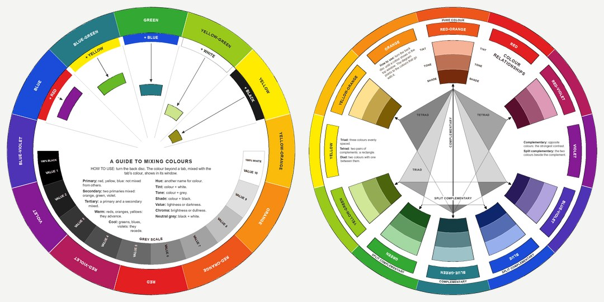

## Poster

`color_theory_document.py` draws a ten-page, landscape US Letter poster with ReportLab.
Every colour is computed: the RYB cube, HSB, the RGB cube, a simple CMY ink model, the
values of the CSS colour keywords, the CIE 1931 colour-matching functions and CIELAB. No image
is copied. Ready-made PDFs: [English](colour_theory_en.pdf), [Português](colour_theory_pt.pdf),
[Español](colour_theory_es.pdf).

| Page | Content |
|------|---------|
| 1 | RYB colour wheel, primary/secondary/tertiary colours, tint/tone/shade, colour meanings, colour schemes |
| 2 | Colour models (CMYK, RGB, HSB, grayscale), hue/saturation disc, colour properties and harmonies |
| 3 | Hue & lightness: a cross of hue × tint/shade swatches, tint, tone and shade wheels, and the RGB cube seen from its white corner (hexagon of hexagons) |
| 4 | Colour mixing & codes: RYB, RGB and CMYK side by side, a CMYK hexagram with ink percentages, and the 216-colour web-safe palette |
| 5 | Named colours: an overlapping-circles RYB wheel with colour names, and a wheel of CSS named colours with hex codes |
| 6 | Colour & emotion: Plutchik's wheel of emotions, a spiral rosette of tints and shades, and translucent petals |
| 7 | "The Color Wheel": six RYB circles through the centre with named overlaps and a named outer ring, and a spiral sphere on black |
| 8 | The space of visible colours: the CIE 1931 chromaticity diagram (spectral and Planckian loci, sRGB triangle), the visible spectrum and the colour-matching functions |
| 9 | Tints and shades: ten base colours in the middle of a scale from 90 % white (left) to 90 % black (right) |
| 10 | Hue circles: Munsell's 20-hue circle (most saturated sRGB colour of each hue, via CIELAB), and RYB and RGB twelve-colour stars |

| | |
|---|---|
| 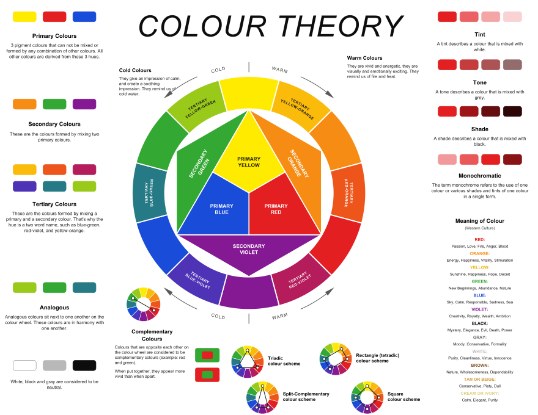 | 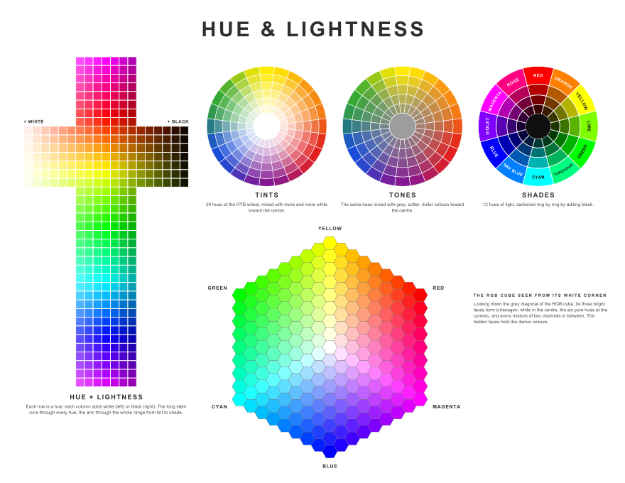 |
| 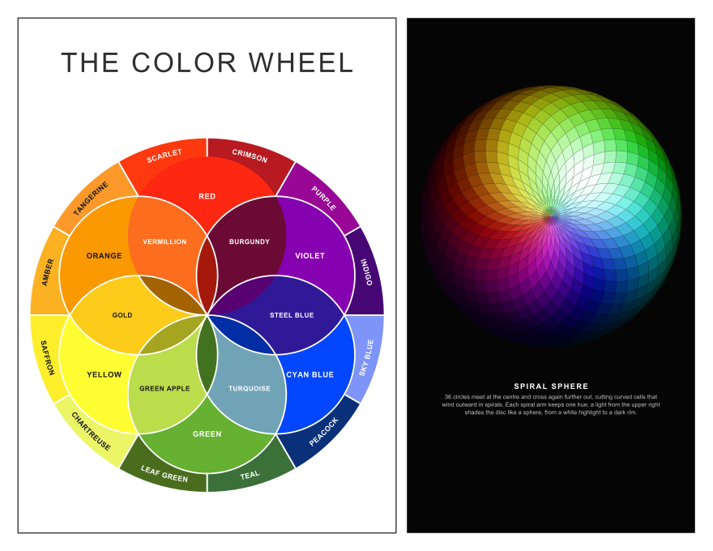 | 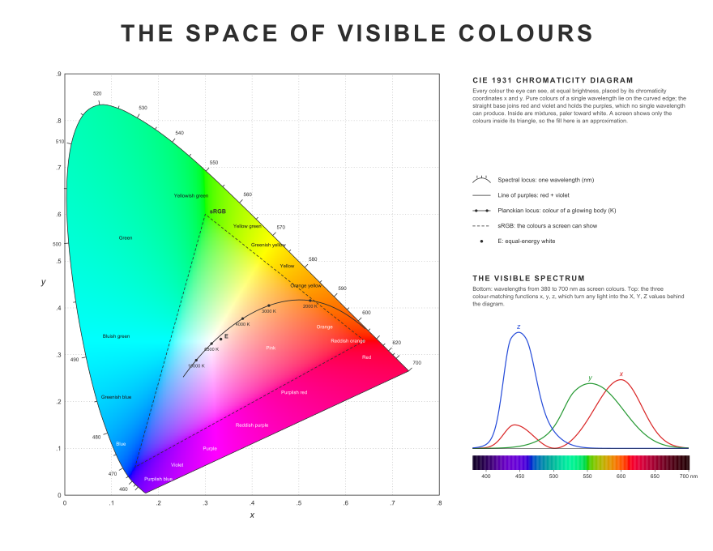 |
| 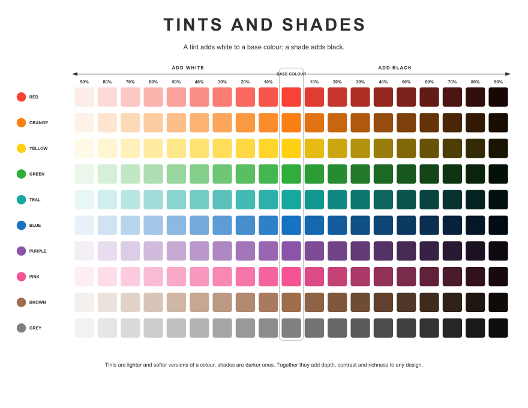 | 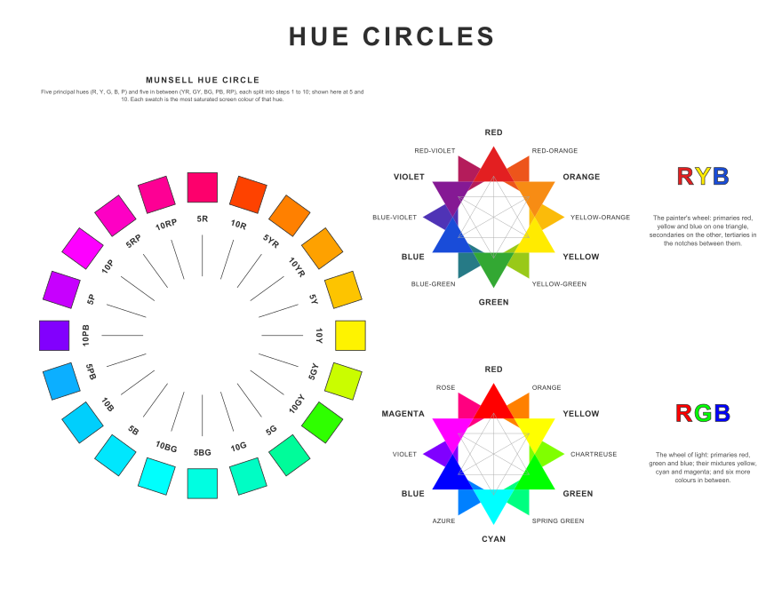 |

All text is in the `STRINGS` table.

```bash
pip install reportlab pillow
python3 color_theory_document.py                 # all pages -> colour_theory_en.pdf
python3 color_theory_document.py --lang pt       # Portuguese -> colour_theory_pt.pdf
python3 color_theory_document.py --lang es -o es.pdf
python3 color_theory_document.py --pages 3 4     # only some pages
```

Options:

- `--lang {en,pt,es}`: text language (default `en`).
- `-o, --out PATH`: output PDF (default `colour_theory_<lang>.pdf`).
- `--pages N [N ...]`: pages to render (default: all ten).

To add a language, copy the `en` block of `STRINGS`, translate the values and register
it under a new key.

## Build-your-own colour wheels

`color_wheel.py` makes a printable A4 PDF (six pages) with two paper colour wheels to cut
out and assemble at home. Each wheel has a back disc that turns and a front disc with
windows, joined at the centre by a split pin. Ready-made PDFs:
[English](colour_wheels_en.pdf), [Português](colour_wheels_pt.pdf),
[Español](colour_wheels_es.pdf).

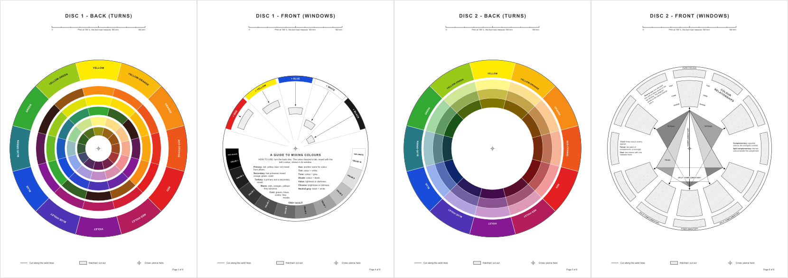

| Page | Content |
|------|---------|
| 1 | What you need, printing, cutting and assembly (with an exploded view) |
| 2 | How to use both wheels, and a glossary of colour words |
| 3 | Disc 1, back: the 12 RYB hues and five rings of mixtures (+ red, + yellow, + blue, + white, + black) |
| 4 | Disc 1, front: five coloured tabs with their windows, a grey scale (value 1 to 10) and colour definitions |
| 5 | Disc 2, back: the 12 hues with their names, and tint, tone and shade of each |
| 6 | Disc 2, front: 12 name windows, 8 large windows and the harmony diagram (complementary, split complementary, triad, tetrads) |

On disc 1 each window sits at a different distance from the centre, so the mixture of a
hue with what a tab adds can be printed at that hue's angle on the back disc: it shows in
the window when the hue stands just beyond the tab.

```bash
python3 color_wheel.py                 # -> colour_wheels_en.pdf
python3 color_wheel.py --lang pt       # Portuguese
python3 color_wheel.py --lang es -o es.pdf
```

Print pages 3 to 6 at actual size (100 %); each page has a 100 mm bar to check the scale.
The script imports its colours and some drawing helpers from `color_theory_document.py`,
so keep both files in the same folder.

### On screen

The same two wheels can be turned on a computer, with every part (back and front of
each disc) movable:

- drag a disc with the mouse (a back disc by its coloured rim or through a window);
- the mouse wheel turns the disc under the pointer one colour at a time;
- ← and → turn the selected disc one colour, ↑ and ↓ (or Tab) select another disc.

Every on-screen version has a **dark mode**. It follows the operating system at first,
and a button next to the language box switches between light and dark (the web page
remembers the choice). The printed PDFs are always light.

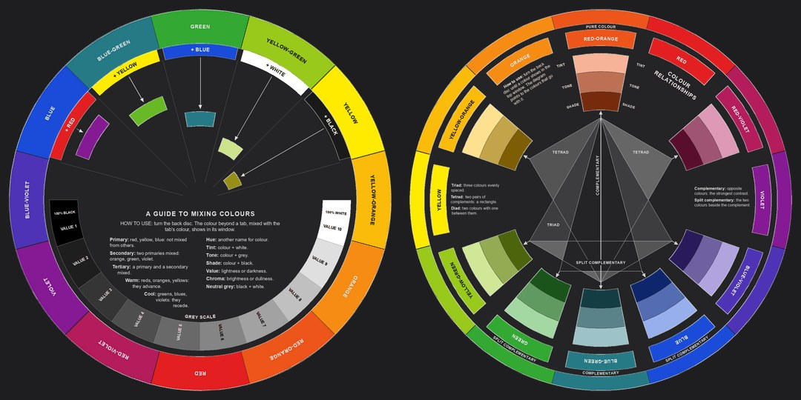

**Desktop** (Tkinter and Pillow, nothing else to install):

```bash
python3 color_wheel.py --app            # English
python3 color_wheel.py --app --lang pt  # starts in Portuguese; the language can be changed in the window
python3 color_wheel.py --app --theme dark   # --theme auto (default), light or dark
```

**Web**: open `web/index.html` in a browser. The language box at the top switches between
English, Portuguese and Spanish. The page loads the discs from `web/discs/` (SVG) and the
texts and disc geometry from `web/discs/data.js`, both written by (each disc in a light
and a dark version; `?theme=dark` or `?lang=pt` in the address also work):

```bash
python3 color_wheel.py --web            # -> web/discs/  (or: --web OTHER_FOLDER)
```

Run it again after changing the discs or the texts. The page itself (`index.html`,
`style.css`, `app.js`) is plain HTML, CSS and JavaScript, with no build step.

**Web page in a window of its own** (pywebview): the same page as above, in a desktop
window without a browser. It writes `web/discs/` first if it is missing.

```bash
pip install pywebview
python3 color_wheel.py --webview            # English
python3 color_wheel.py --webview --lang pt  # starts in Portuguese
python3 color_wheel.py --webview --theme light
```

On Windows it uses the Edge WebView2 runtime, which comes with Windows 10 and 11.

## Tilings and mosaics

`tilings.py` draws the tilings of the Wikipedia articles listed in `tiles.md`, each with
several colourings and with colours from the colour schemes above. Ready-made catalogues
(A4, 22 pages): [English](tilings_en.pdf), [Português](tilings_pt.pdf), [Español](tilings_es.pdf).

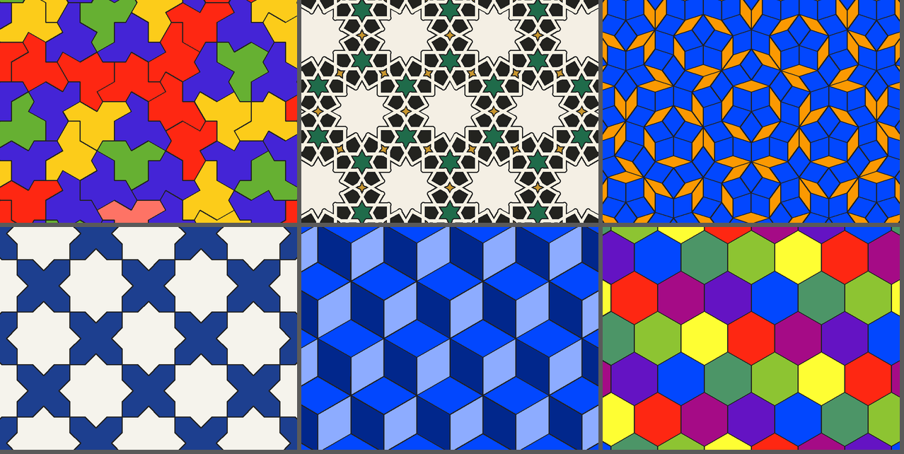

- **Regular and uniform**: triangular, square and hexagonal tilings, and the eight
  semiregular ones (3.6.3.6, 3.12.12, 4.8.8, 4.6.12, 3.4.6.4, 3.3.3.3.6, 3.3.3.4.4, 3.3.4.3.4).
- **Duals and variations**: rhombille, tetrakis, kisrhombille, kisdeltile, Cairo,
  prismatic and floret pentagonal; triangles of two sizes or turned (stars), alternating
  squares, chamfered square tiling, 2-uniform hexagon dissections.
- **Bricks and squares**: Pythagorean tiling, herringbone (any ratio, turned or slanted), basket weave.
- **Pentagons**: type 1 (halved hexagons), Cairo, prismatic, floret.
- **Aperiodic**: Penrose P3 (rhombs) and P2 (kites and darts), the "hat" monotile,
  Robinson's tiles, and the 11 Wang tiles of Jeandel and Rao.
- **Islamic art**: girih tiles and lines, zellij stars and crosses, and star patterns
  made from any of the tilings with Hankin's polygons-in-contact method.

Colourings: each tiling's own (the uniform colourings 121212, 111222 … of the triangular
tiling, 2/3/4/7 colours of the hexagonal one), and colourings that work on any tiling:
`single`, `kind`, `shape`, `chirality` (mirror images), `orientation`, `proper`
(neighbours differ), `random` and `rings`. Schemes: `mono`, `analogous`, `complementary`,
`split`, `triad`, `tetrad`, `square`, `rainbow` from any base hue of the RYB wheel, or the
palettes `zellij`, `azulejo`, `girih`, `earth`, `grey`, or your own colours.

```bash
python3 tilings.py                       # catalogue -> tilings_en.pdf  (--lang pt, --lang es)
python3 tilings.py --list                # tilings, their colourings and parameters
python3 tilings.py hexagonal -c 7 --scheme rainbow -o hex.svg
python3 tilings.py penrose_p2 -c orientation --scheme analogous --hue blue -o p2.png
python3 tilings.py herringbone -p ratio=3 -p angle=45 --colours "#b5532f,#e2b77a" -o floor.pdf
python3 tilings.py hankin -p base=truncated_trihexagonal -p theta=60 --scheme zellij -o stars.png
python3 tilings.py trihexagonal --overlay dual     # also: circles, incircles, edges
python3 tilings.py girih --girih 54                # girih lines over the tiles
```

The output format follows the file name (`.png`, `.svg` or `.pdf`); `--size` sets how
many tile edges fit across the picture (a bigger number shows a bigger block of the
tiling), `--aspect` its proportions and `--width` the pixels.

**Preview window.** `--show` opens a window (Tkinter, nothing to install) with boxes for
the tiling, colouring, scheme, base hue, width and parameters; every change redraws at
once, and *Save…* writes PNG, SVG or PDF. With `-o` the file is written as well.

```bash
python3 tilings.py --show                          # starts with the hexagonal tiling
python3 tilings.py cairo -c orientation --scheme triad --show --lang pt
```

**Sheets of several tilings.** Give several tilings, each followed by its own options
(`:name=value`; colours separated by `/`, overlays by `+`; any other name is a tiling
parameter), or let `--vary` make the variations of one tiling. `--cols` sets the columns,
`--no-labels` drops the captions; `--show` shows the sheet in the window.

```bash
python3 tilings.py cairo --vary scheme --cols 4 -o cairo_schemes.png    # every scheme
python3 tilings.py penrose_p3 --vary hue -o penrose_hues.png            # every base hue
python3 tilings.py hexagonal --vary colouring                           # every colouring
python3 tilings.py "hexagonal:c=7:scheme=rainbow" "penrose_p2:c=orientation:hue=blue" \
    "herringbone:ratio=3:angle=45:colours=#b5532f/#e2b77a" "hankin:base=hexagonal:theta=60:scheme=azulejo" \
    --cols 2 --aspect 0.6 --width 2400 -o sheet.pdf
```

Options given before the tilings (`--scheme`, `--hue`, `-c` …) apply to every panel
unless a panel sets its own. Everything is computed: periodic tilings are a motif of polygons on a lattice,
gaps between placed polygons are found as faces of the planar graph of their edges, the
duals join the centres of the tiles around each vertex, Penrose tilings come from
deflating golden triangles and the hat from the metatile substitution of Smith, Myers,
Kaplan and Goodman-Strauss.

## Decorated mosaics

`patterns.py` makes mosaics whose basic shape is more elaborate, on the engine of
`tilings.py` (same palettes, colourings, outputs, sheets, `--vary` and `--show`).
Ready-made catalogues: [English](patterns_en.pdf), [Português](patterns_pt.pdf),
[Español](patterns_es.pdf).

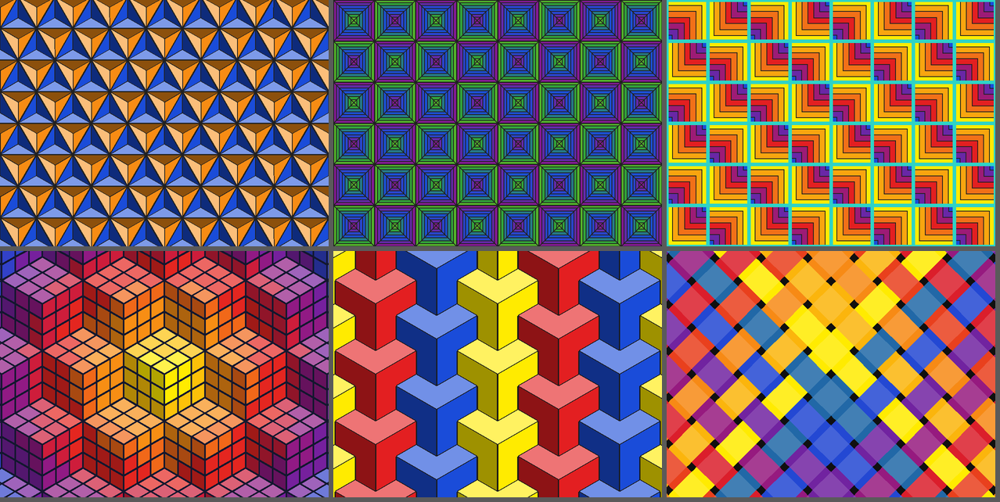

| Pattern | What it does | Main parameters |
|---------|--------------|-----------------|
| `facets` | cuts every tile of any tiling into triangles from its centre and lights them from one side: pyramids, 3D stars, hourglass blocks | `base`, `light`, `sun` |
| `bands` | concentric bands towards the centre (courthouse steps) or a corner (log cabin) of every tile | `base`, `bands`, `anchor`, `facets`, `gap`, `gap_colour`, `turn` |
| `cubes`, `rubik` | isometric cubes in three shades; Rubik cubes cut into stickers | `grid`, `gap`, `top`, `side` |
| `tripods` | interlocking Y tripods (corners of cube frames) | `arm` (1 or 2) |
| `framework` | isometric framework of bars | `spacing`, `depth` |
| `quilt` | half-square triangles: pinwheel, diamonds, chevron, streak, broken_dishes, zigzag, pinwheel_big, storm; or hourglass blocks | `layout`, `groups`, `hourglass` |
| `jigsaw` | jigsaw puzzle with random tabs | `seed` |
| `weave` | plain weave or twill, strips darken where they go under | `width`, `turn`, `twill` |
| `beadwork` | kaleidoscopic pixel patterns with the symmetry of the square | `n`, `seed`, `colours_used` |

Two schemes were added for bands and gradients (also in `tilings.py`): `ramp` (one hue
from dark to light) and `sweep` (half the wheel from the base hue), and the colouring
`gradient` (bands of colour across the picture).

```bash
python3 patterns.py                      # catalogue -> patterns_en.pdf  (--lang pt, --lang es)
python3 patterns.py --list               # patterns, colourings, parameters, quilt layouts
python3 patterns.py --show               # preview window
python3 patterns.py facets -p base=triangular -c tile --scheme complementary --hue blue -o stars.png
python3 patterns.py bands -p bands=7 -p anchor=alternate -p gap=2.5 -p gap_colour=2ED3C6 --scheme rainbow -o cabin.png
python3 patterns.py bands -p base=hexagonal -p bands=5 --scheme ramp --hue blue -o rings.svg
python3 patterns.py rubik -c rings --scheme rainbow --size 7 -o rubik.pdf
python3 patterns.py tripods --vary scheme --cols 4 -o tripods.png
python3 patterns.py quilt -p layout=storm --scheme triad --hue blue-violet -o storm.png
```

## Other files

- `Claude - The Complete Guide to Color Theory.md`: the full reference guide, from the physics
  of light to colour spaces (also as `.docx` and `.pdf`).
- `color_theory_poster.py`: the earlier single-page poster, English only.
- `images/`: the pictures in this README.

## Licence

[MIT](LICENSE)
