# Teoria da Cor

*English: [README.md](README.md)*

Um guia de teoria da cor, um póster vetorial de dez páginas e duas rodas de cores para
construir em casa, tudo gerado em Python. As rodas podem ser impressas e recortadas, ou
rodadas no ecrã (aplicação de computador ou página web). Todos os textos existem em inglês,
português e espanhol.

**Experimente as rodas online: https://mcampilho.github.io/color-theory/web/?lang=pt**

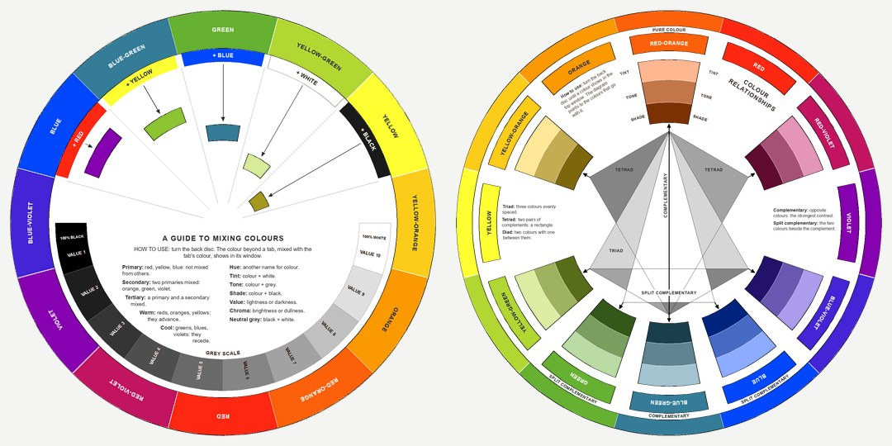

## Póster

O `color_theory_document.py` desenha com o ReportLab um póster de dez páginas em formato
carta, na horizontal. Todas as cores são calculadas: o cubo RYB, o HSB, o cubo RGB, um
modelo simples de tintas CMY, os valores das palavras-chave de cor do CSS, as funções de
correspondência de cor CIE 1931 e o CIELAB. Nenhuma imagem é copiada. PDFs prontos:
[English](colour_theory_en.pdf), [Português](colour_theory_pt.pdf),
[Español](colour_theory_es.pdf).

As 12 cores da roda RYB são as usadas pela
[w3schools](https://www.w3schools.com/colors/colors_wheels.asp) e pelo
[Canva](https://www.canva.com/colors/color-wheel/): vermelho `#FE2712`, vermelho-alaranjado
`#FC600A`, laranja `#FB9902`, amarelo-alaranjado `#FCCC1A`, amarelo `#FEFE33`,
amarelo-esverdeado `#B2D732`, verde `#66B032`, azul-esverdeado `#347C98`, azul `#0247FE`,
azul-arroxeado `#4424D6`, violeta `#8601AF`, vermelho-arroxeado `#C21460`. Ficam nos
vértices e arestas do cubo RYB, que as mistura como tintas (amarelo com azul dá verde) e não
como luz.

| Página | Conteúdo |
|--------|----------|
| 1 | Roda RYB, cores primárias, secundárias e terciárias, tinta/tom/sombra, significados das cores, esquemas de cores |
| 2 | Modelos de cor (CMYK, RGB, HSB, escala de cinzentos), disco de matiz/saturação, propriedades e harmonias |
| 3 | Matiz e luminosidade: cruz de amostras matiz × tinta/sombra, rodas de tintas, tons e sombras, e o cubo RGB visto do vértice branco (hexágono de hexágonos) |
| 4 | Mistura e códigos: RYB, RGB e CMYK lado a lado, um hexagrama CMYK com percentagens de tinta e a paleta web-safe de 216 cores |
| 5 | Nomes das cores: roda RYB de círculos sobrepostos com nomes, e roda das cores com nome do CSS com os códigos hex |
| 6 | Cor e emoção: roda das emoções de Plutchik, rosácea em espiral de tintas e sombras, e pétalas translúcidas |
| 7 | "The Color Wheel": seis círculos RYB que passam pelo centro, com nomes nas sobreposições e no anel exterior, e uma esfera em espiral em fundo negro |
| 8 | O espaço das cores visíveis: diagrama de cromaticidade CIE 1931 (lugar espectral, lugar de Planck, triângulo sRGB), o espetro visível e as funções de correspondência de cor |
| 9 | Tintas e sombras: dez cores de base no meio de uma escala de 90 % branco (esquerda) a 90 % preto (direita) |
| 10 | Círculos de matiz: o círculo de 20 matizes de Munsell (a cor sRGB mais saturada de cada matiz, via CIELAB) e estrelas de doze cores RYB e RGB |

| | |
|---|---|
| 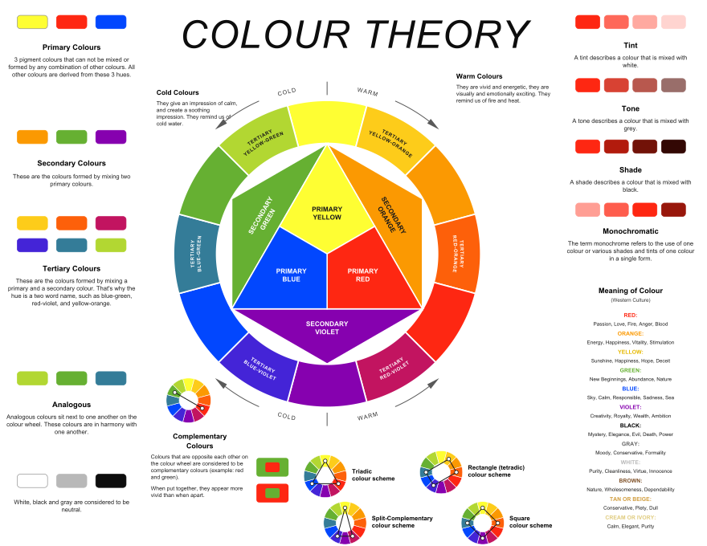 | 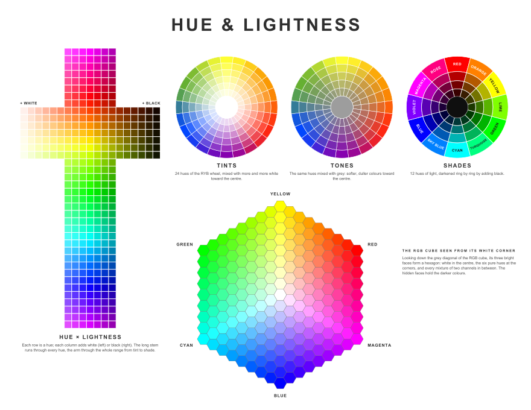 |
| 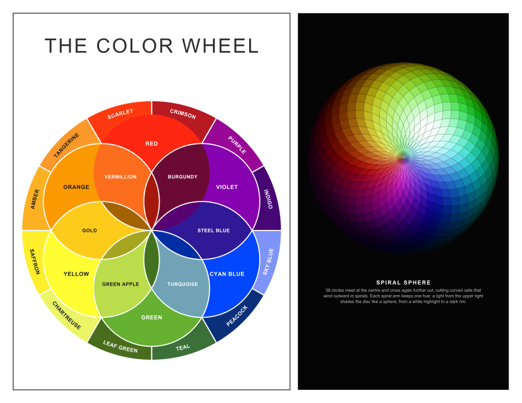 | 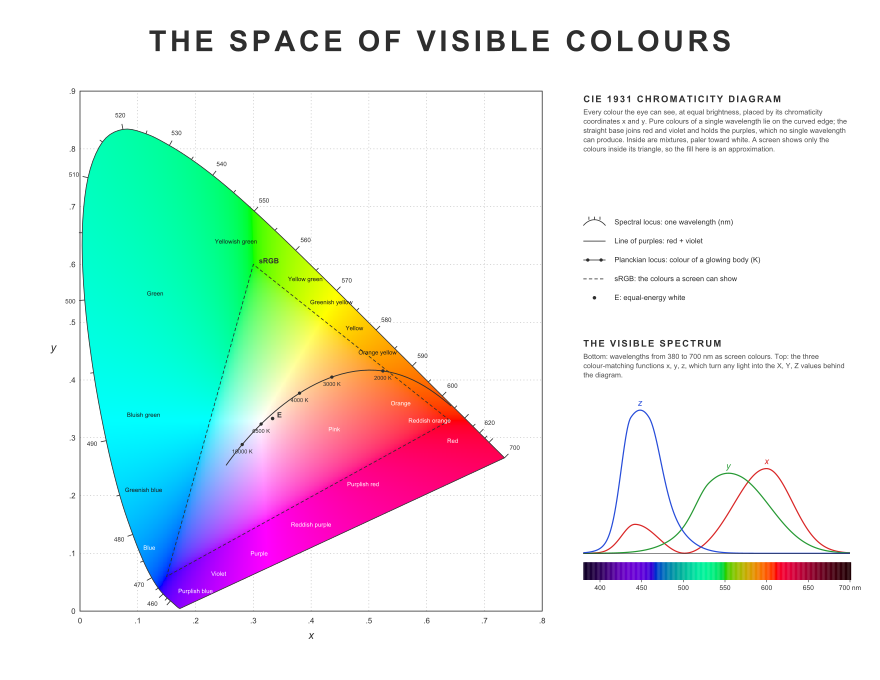 |
| 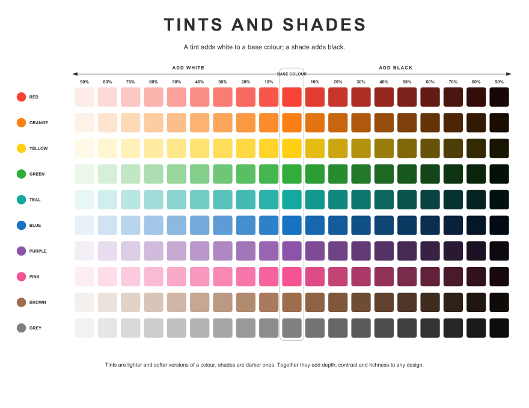 | 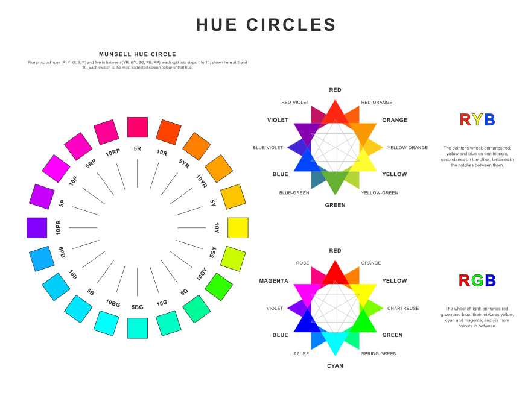 |

Todo o texto está na tabela `STRINGS`.

```bash
pip install reportlab pillow
python3 color_theory_document.py                 # todas as páginas -> colour_theory_en.pdf
python3 color_theory_document.py --lang pt       # português -> colour_theory_pt.pdf
python3 color_theory_document.py --lang es -o es.pdf
python3 color_theory_document.py --pages 3 4     # só algumas páginas
```

Opções:

- `--lang {en,pt,es}`: idioma do texto (por omissão `en`).
- `-o, --out CAMINHO`: PDF de saída (por omissão `colour_theory_<lang>.pdf`).
- `--pages N [N ...]`: páginas a desenhar (por omissão, as dez).

Para acrescentar um idioma, copia-se o bloco `en` da tabela `STRINGS`, traduzem-se os
valores e regista-se com uma chave nova.

## Rodas de cores para construir em casa

O `color_wheel.py` cria um PDF A4 de seis páginas, pronto a imprimir, com duas rodas de
cores em papel para recortar e montar em casa. Cada roda tem um disco de trás, que roda, e
um disco da frente com janelas, unidos no centro por um atache. PDFs prontos:
[English](colour_wheels_en.pdf), [Português](colour_wheels_pt.pdf),
[Español](colour_wheels_es.pdf).

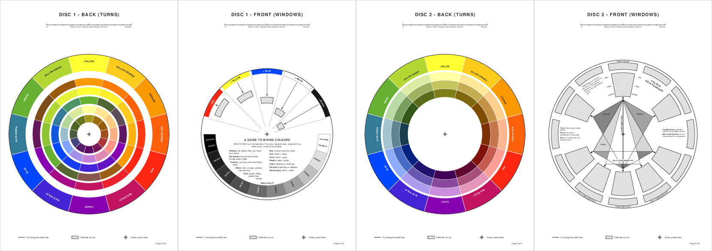

| Página | Conteúdo |
|--------|----------|
| 1 | Material necessário, impressão, recorte e montagem (com uma vista explodida) |
| 2 | Como usar as duas rodas e um glossário das palavras da cor |
| 3 | Disco 1, trás: as 12 cores RYB e cinco anéis de misturas (+ vermelho, + amarelo, + azul, + branco, + preto) |
| 4 | Disco 1, frente: cinco patilhas coloridas com as suas janelas, uma escala de cinzentos (valor 1 a 10) e definições das cores |
| 5 | Disco 2, trás: as 12 cores com os nomes, e a tinta, o tom e a sombra de cada uma |
| 6 | Disco 2, frente: 12 janelas para os nomes, 8 janelas grandes e o diagrama das harmonias (complementar, complementares divididas, tríade, tétrades) |

No disco 1, cada janela fica a uma distância diferente do centro. Por isso, a mistura de
uma cor com o que a patilha acrescenta pode ser impressa no ângulo dessa cor no disco de
trás: aparece na janela quando a cor está mesmo junto à patilha.

```bash
python3 color_wheel.py                 # -> colour_wheels_en.pdf
python3 color_wheel.py --lang pt       # português
python3 color_wheel.py --lang es -o es.pdf
```

As páginas 3 a 6 devem ser impressas em tamanho real (100 %); cada página tem uma barra de
100 mm para confirmar a escala. O programa vai buscar as cores e algumas funções de desenho
ao `color_theory_document.py`, por isso os dois ficheiros têm de estar na mesma pasta.

### No ecrã

As mesmas duas rodas podem ser rodadas no computador, com todas as partes (trás e frente
de cada disco) móveis:

- arrasta-se um disco com o rato (um disco de trás pela borda colorida ou através de uma janela);
- a roda do rato roda o disco debaixo do ponteiro, uma cor de cada vez;
- ← e → rodam o disco selecionado uma cor; ↑ e ↓ (ou Tab) escolhem outro disco.

Todas as versões no ecrã têm **modo escuro**. Ao abrir, seguem o tema do sistema
operativo, e um botão ao lado da caixa de idioma alterna entre claro e escuro (a página
web lembra-se da escolha). Os PDFs para imprimir são sempre claros.

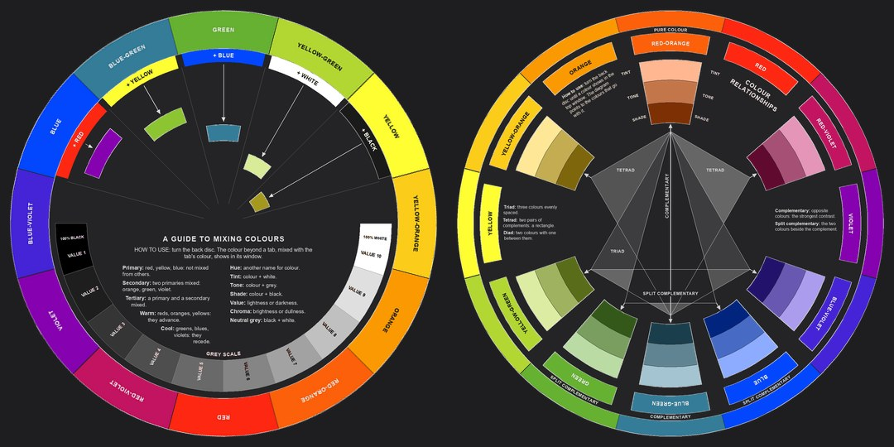

**Computador** (Tkinter e Pillow, nada mais para instalar):

```bash
python3 color_wheel.py --app            # inglês
python3 color_wheel.py --app --lang pt  # começa em português; o idioma pode ser mudado na janela
python3 color_wheel.py --app --theme dark   # --theme auto (por omissão), light ou dark
```

**Web**: abre-se o `web/index.html` num browser. A caixa de idioma no topo alterna entre
inglês, português e espanhol. A página carrega os discos de `web/discs/` (SVG) e os textos e
a geometria dos discos de `web/discs/data.js`, ambos escritos por (cada disco numa versão
clara e numa escura; `?theme=dark` ou `?lang=pt` no endereço também funcionam):

```bash
python3 color_wheel.py --web            # -> web/discs/  (ou: --web OUTRA_PASTA)
```

É preciso voltar a executá-lo depois de mudar os discos ou os textos. A página em si
(`index.html`, `style.css`, `app.js`) é HTML, CSS e JavaScript simples, sem passo de build.

**A página web numa janela própria** (pywebview): a mesma página, numa janela do
computador sem browser. Se a pasta `web/discs/` faltar, é escrita primeiro.

```bash
pip install pywebview
python3 color_wheel.py --webview            # inglês
python3 color_wheel.py --webview --lang pt  # começa em português
python3 color_wheel.py --webview --theme light
```

No Windows usa o Edge WebView2, que já vem com o Windows 10 e 11.

## Pavimentações e mosaicos

O `tilings.py` desenha as pavimentações dos artigos da Wikipedia listados no `tiles.md`,
cada uma com várias colorações e com as cores dos esquemas de cores acima. Catálogos
prontos (A4, 22 páginas): [English](tilings_en.pdf), [Português](tilings_pt.pdf),
[Español](tilings_es.pdf).

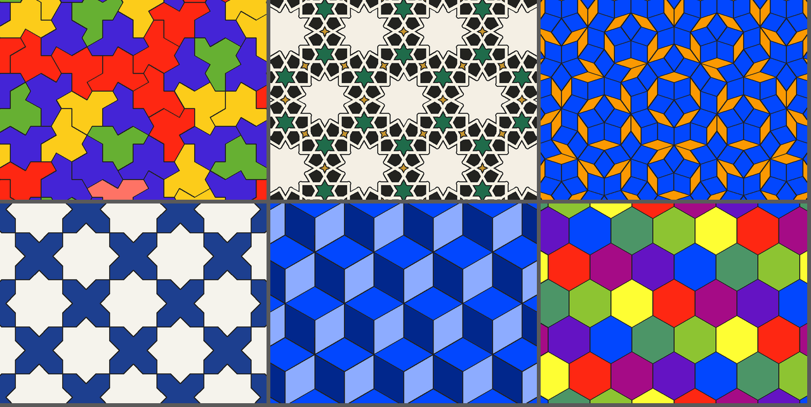

- **Regulares e uniformes**: as pavimentações triangular, quadrada e hexagonal, e as oito
  semirregulares (3.6.3.6, 3.12.12, 4.8.8, 4.6.12, 3.4.6.4, 3.3.3.3.6, 3.3.3.4.4, 3.3.4.3.4).
- **Duais e variações**: losangos (rhombille), tetrakis, kisrhombille, kisdeltile, Cairo,
  pentagonal prismática e em flor; triângulos de dois tamanhos ou rodados (estrelas),
  quadrados alternados, pavimentação chanfrada, hexágonos cortados (2-uniformes).
- **Tijolos e quadrados**: pavimentação pitagórica, espinha de peixe (qualquer proporção,
  rodada ou inclinada) e cestaria.
- **Pentágonos**: tipo 1 (hexágonos cortados ao meio), Cairo, prismática, em flor.
- **Aperiódicas**: Penrose P3 (losangos) e P2 (papagaios e dardos), o "chapéu" (uma só
  peça), as peças de Robinson e as 11 peças de Wang de Jeandel e Rao.
- **Arte islâmica**: peças e linhas girih, estrelas e cruzes do zellij, e padrões de
  estrelas feitos a partir de qualquer pavimentação com o método de Hankin dos polígonos em contacto.

Colorações: as próprias de cada pavimentação (as colorações uniformes 121212, 111222 … da
triangular, 2/3/4/7 cores da hexagonal) e colorações que servem para qualquer uma:
`single`, `kind` (tipo de peça), `shape` (forma), `chirality` (imagem ao espelho),
`orientation`, `proper` (vizinhas diferentes), `random` e `rings` (anéis). Esquemas:
`mono`, `analogous`, `complementary`, `split`, `triad`, `tetrad`, `square` e `rainbow`, a
partir de qualquer matiz da roda RYB; as paletas `zellij`, `azulejo`, `girih`, `earth` e
`grey`; ou cores à escolha.

```bash
python3 tilings.py                       # catálogo -> tilings_en.pdf  (--lang pt, --lang es)
python3 tilings.py --list                # pavimentações, colorações e parâmetros
python3 tilings.py hexagonal -c 7 --scheme rainbow -o hex.svg
python3 tilings.py penrose_p2 -c orientation --scheme analogous --hue blue -o p2.png
python3 tilings.py herringbone -p ratio=3 -p angle=45 --colours "#b5532f,#e2b77a" -o chao.pdf
python3 tilings.py hankin -p base=truncated_trihexagonal -p theta=60 --scheme zellij -o estrelas.png
python3 tilings.py trihexagonal --overlay dual     # também: circles, incircles, edges
python3 tilings.py girih --girih 54                # linhas girih sobre as peças
```

O formato de saída segue a extensão do ficheiro (`.png`, `.svg` ou `.pdf`). O `--size`
diz quantas arestas cabem na largura da imagem (um número maior mostra um bloco maior do
mosaico), o `--aspect` dá as proporções e o `--width` os píxeis.

**Janela de pré-visualização.** O `--show` abre uma janela (Tkinter, nada para instalar)
com caixas para a pavimentação, a coloração, o esquema, o matiz de base, a largura e os
parâmetros. Cada mudança redesenha logo, e o botão *Guardar…* escreve PNG, SVG ou PDF.
Com `-o` o ficheiro também é escrito.

```bash
python3 tilings.py --show                          # começa pela pavimentação hexagonal
python3 tilings.py cairo -c orientation --scheme triad --show --lang pt
```

**Folhas com vários mosaicos.** Indicam-se várias pavimentações, cada uma seguida das suas
opções (`:nome=valor`; cores separadas por `/`, sobreposições por `+`; qualquer outro nome
é um parâmetro da pavimentação), ou deixa-se o `--vary` fazer as variações de uma só.
O `--cols` dá o número de colunas e o `--no-labels` tira as legendas; com `--show` a folha
aparece na janela.

```bash
python3 tilings.py cairo --vary scheme --cols 4 -o cairo_esquemas.png   # todos os esquemas
python3 tilings.py penrose_p3 --vary hue -o penrose_matizes.png         # todos os matizes
python3 tilings.py hexagonal --vary colouring                           # todas as colorações
python3 tilings.py "hexagonal:c=7:scheme=rainbow" "penrose_p2:c=orientation:hue=blue" \
    "herringbone:ratio=3:angle=45:colours=#b5532f/#e2b77a" "hankin:base=hexagonal:theta=60:scheme=azulejo" \
    --cols 2 --aspect 0.6 --width 2400 -o folha.pdf
```

As opções dadas antes das pavimentações (`--scheme`, `--hue`, `-c` …) valem para todos os
painéis, exceto quando um painel tem as suas. Tudo é calculado:

- as pavimentações periódicas são um motivo de polígonos repetido numa rede;
- os buracos entre polígonos colocados são as faces do grafo plano das suas arestas;
- as duais ligam os centros das peças à volta de cada vértice;
- as de Penrose vêm da deflação de triângulos de ouro;
- o chapéu vem da substituição de metapeças de Smith, Myers, Kaplan e Goodman-Strauss.

## Mosaicos decorados

O `patterns.py` faz mosaicos cuja forma de base é mais elaborada, sobre o motor do
`tilings.py`: as mesmas paletas, colorações, saídas, folhas, `--vary` e `--show`. Catálogos
prontos: [English](patterns_en.pdf), [Português](patterns_pt.pdf), [Español](patterns_es.pdf).

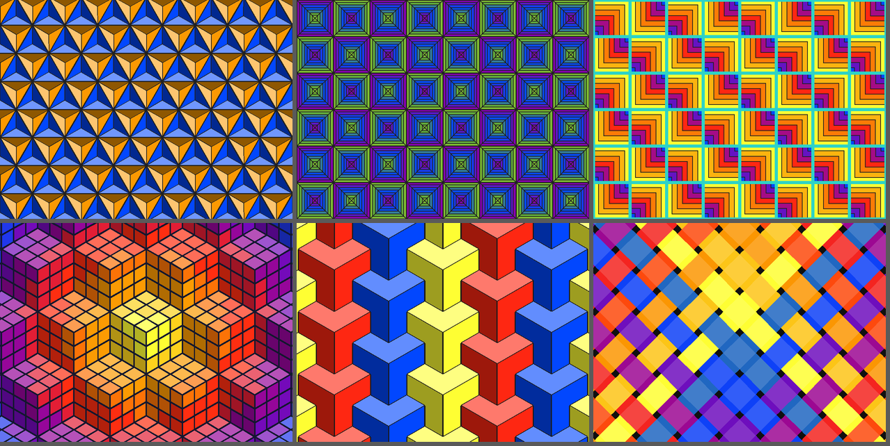

| Padrão | O que faz | Parâmetros principais |
|--------|-----------|-----------------------|
| `facets` | corta cada peça de qualquer pavimentação em triângulos a partir do centro e ilumina-os de um lado: pirâmides, estrelas em relevo, blocos em ampulheta | `base`, `light`, `sun` |
| `bands` | faixas concêntricas em cada peça, para o centro (degraus do tribunal) ou para um canto (cabana de troncos) | `base`, `bands`, `anchor`, `facets`, `gap`, `gap_colour`, `turn` |
| `cubes`, `rubik` | cubos isométricos em três tons; cubos de Rubik cortados em quadradinhos | `grid`, `gap`, `top`, `side` |
| `tripods` | tripés em Y encaixados (cantos de estruturas de cubos) | `arm` (1 ou 2) |
| `framework` | estrutura isométrica de barras | `spacing`, `depth` |
| `quilt` | triângulos de meio quadrado (pinwheel, diamonds, chevron, streak, broken_dishes, zigzag, pinwheel_big, storm) ou blocos em ampulheta | `layout`, `groups`, `hourglass` |
| `jigsaw` | puzzle com encaixes ao acaso | `seed` |
| `weave` | tafetá ou sarja; as tiras escurecem onde passam por baixo | `width`, `turn`, `twill` |
| `beadwork` | padrões de píxeis com a simetria do quadrado, como missangas | `n`, `seed`, `colours_used` |
| `maze` | labirinto perfeito ao acaso num toro (repete-se sem costuras), com paredes isométricas ou plano; colorações `walls`, `path` (caminho mais longo), `flow` (degradê ao longo dos corredores), `face` | `n`, `seed`, `loops`, `flat`, `wide`, `height`, `steps` |
| `spiral` | espirais quadradas de parede; `link=1` liga-as numa grega, `pinwheel=1` roda quatro à volta de um canto | `n`, `link`, `pinwheel`, `flat`, `wide`, `height` |
| `whirl` | polígonos em remoinho sobre qualquer pavimentação: os cantos deslizam pelas arestas passo a passo e os triângulos cortados formam braços de espiral | `base`, `steps`, `t`, `mirror` |

Para as faixas e os degradês juntaram-se dois esquemas, também disponíveis no `tilings.py`:
`ramp` (um matiz do escuro ao claro) e `sweep` (meia roda a partir do matiz de base). Há
também a coloração `gradient` (faixas de cor na diagonal da imagem).

```bash
python3 patterns.py                      # catálogo -> patterns_en.pdf  (--lang pt, --lang es)
python3 patterns.py --list               # padrões, colorações, parâmetros e layouts de patchwork
python3 patterns.py --show               # janela de pré-visualização
python3 patterns.py facets -p base=triangular -c tile --scheme complementary --hue blue -o estrelas.png
python3 patterns.py bands -p bands=7 -p anchor=alternate -p gap=2.5 -p gap_colour=2ED3C6 --scheme rainbow -o cabana.png
python3 patterns.py bands -p base=hexagonal -p bands=5 --scheme ramp --hue blue -o aneis.svg
python3 patterns.py rubik -c rings --scheme rainbow --size 7 -o rubik.pdf
python3 patterns.py tripods --vary scheme --cols 4 -o tripes.png
python3 patterns.py quilt -p layout=storm --scheme triad --hue blue-violet -o tempestade.png
python3 patterns.py maze -p seed=7 -c flow --scheme rainbow -o labirinto.png
python3 patterns.py maze -p flat=1 -p wide=1 -p n=12 -c path --scheme complementary -o labirinto_plano.svg
python3 patterns.py spiral -p link=1 -p flat=1 -p wide=1 -c walls --size 20 --scheme mono --hue blue -o grega.png
python3 patterns.py whirl -p base=hexagonal -p mirror=0 -c twist --scheme rainbow -o remoinho.pdf
```

## Wallpapers abstratos

O `wallpapers.py` pinta wallpapers abstratos para computador (horizontal) e para telemóvel
ou tablet (vertical), nos tamanhos de ecrã mais comuns, com os mesmos esquemas de cor RYB.
Cada imagem nasce de uma semente, por isso as mesmas opções dão sempre a mesma imagem.

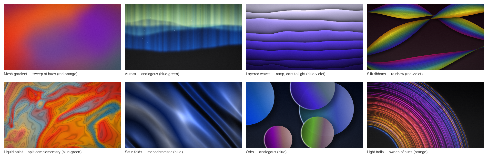

| Estilo | O que pinta | Parâmetros principais |
|--------|-------------|-----------------------|
| `mesh` | manchas suaves de cor que se fundem umas nas outras | `blobs`, `warp`, `spread` |
| `aurora` | cortinas de luz sobre um céu escuro | `bands`, `rays`, `stars` |
| `waves` | camadas de ondas recortadas em papel, cada uma com a sua sombra | `layers`, `height`, `shadow` |
| `ribbons` | fitas torcidas feitas de fios de cor finos | `ribbons`, `threads`, `width`, `twist`, `texture` |
| `fluid` | tinta líquida dobrada por deformação do domínio, brilhante e com estrias | `scale`, `warp`, `lines`, `bands`, `gloss` |
| `silk` | pregas de cetim com reflexos suaves | `folds`, `depth`, `softness`, `sheen` |
| `orbs` | esferas sobrepostas com degradês e um contorno de luz | `orbs`, `size`, `opacity`, `rings` |
| `trails` | arcos de luz em longa exposição | `lines`, `sweep`, `spiral` |

Tamanhos: `hd`, `hd+`, `fhd` (por omissão), `wuxga`, `qhd`, `wqxga`, `4k`, `5k`, `ultrawide`,
`uwqhd`, `macbook-air`, `macbook-pro`, `imac`; telemóveis `phone-hd`, `phone-fhd`, `android`,
`android-qhd`, `iphone-se`, `iphone-13`, `iphone`, `iphone-pro-max`; tablets `ipad`,
`ipad-pro`, `tablet`; ou qualquer `LxA` (por exemplo `2560x1080`). O `--orientation` roda o
tamanho quando é preciso.

```bash
pip install numpy scipy pillow
python3 wallpapers.py --show --lang pt                # janela: muda-se lá e depois guarda-se
python3 wallpapers.py --list --lang pt                # estilos, parâmetros e tamanhos
python3 wallpapers.py ribbons                         # -> wallpaper_ribbons_fhd_1.png
python3 wallpapers.py fluid --size 4k --scheme triad --hue blue -o tinta.png
python3 wallpapers.py waves --size iphone --seed 7 -o ondas.jpg
python3 wallpapers.py silk --scheme mono --hue red -p folds=4 -o cetim.webp
python3 wallpapers.py orbs --size ultrawide --colours "#ff6b6b,#4ecdc4,#ffe66d"
python3 wallpapers.py mesh --count 5                  # sementes 1 .. 5
python3 wallpapers.py --gallery --size iphone --cols 8    # todos os estilos lado a lado
```

Outras opções: `--background dark|black|light|white|<hex>`, `--grain` (grão de filme),
`--vignette` (cantos mais escuros) e `--lang pt|es` para a janela e as legendas.

### Mudar a tonalidade e o tamanho de uma imagem

Com `--input`, o programa recebe uma imagem sua (PNG, JPG, WebP, AVIF ...) e muda-lhe a
tonalidade e/ou as dimensões:

- `--hue`: o novo matiz. Sem `--hue`, as cores ficam como estão e só muda o tamanho.
- `--mode shift` (por omissão) roda todos os matizes de modo a que o matiz principal da imagem
  passe a ser o `--hue`, e assim a variedade de cores mantém-se; `--mode tint` põe tudo no mesmo
  matiz, mantendo saturação e luminosidade; `--mode map` passa a luminosidade pelas cores de
  um esquema (`--scheme`, de preferência `ramp` ou `mono`).
- `--size`: o novo tamanho (por omissão o da imagem original). `--fit cover` (por omissão)
  enche o ecrã e corta o que sobra, `--fit contain` mostra a imagem inteira sobre uma cópia
  desfocada dela própria, `--fit stretch` estica.
- `-p saturation=1.2 -p brightness=0.9` ajustam a saturação e o brilho.

```bash
python3 wallpapers.py --input onda_azul.avif --hue orange --size 1980x1080 -o onda_laranja.png
python3 wallpapers.py --input onda_azul.avif --hue orange --mode tint --size fhd
python3 wallpapers.py --input onda_azul.avif --mode map --scheme ramp --hue blue-green
python3 wallpapers.py --input onda_azul.avif --hue green --size iphone --fit contain
python3 wallpapers.py --input onda_azul.avif --show --lang pt      # experimentar na janela
```

Na janela, o botão "Abrir imagem..." escolhe a imagem, e o matiz "(manter)" deixa as cores
originais. Com `--show` nada é gravado sem o botão "Guardar em tamanho real...": o `-o`
dá apenas o nome e a pasta propostos nesse diálogo. Os ficheiros sem caminho completo ficam
na pasta onde o comando foi executado, e o programa escreve sempre o caminho completo do que
gravou. Sem `-o`, o nome do ficheiro diz o matiz e o tamanho, por exemplo
`onda_azul_orange_1980x1080.png`.

## Outros ficheiros

- `Claude - The Complete Guide to Color Theory.md`: o guia de referência completo, da física
  da luz aos espaços de cor, em inglês (também em `.docx` e `.pdf`).
- `color_theory_poster.py`: o póster anterior, de uma página, só em inglês.
- `images/`: as imagens deste README.

## Licença

[MIT](LICENSE)
