# Teoria da Cor

*English: [README.md](README.md)*

Um guia de teoria da cor, um póster vetorial de dez páginas e duas rodas de cores para
construir em casa, tudo gerado em Python. As rodas podem ser impressas e recortadas, ou
rodadas no ecrã (aplicação de computador ou página web). Todos os programas falam 15 línguas:
inglês, português (de Portugal e do Brasil), espanhol, francês, italiano, alemão, neerlandês,
polaco, turco, russo, árabe, chinês, japonês e coreano (ver [Línguas](#línguas)).

**Experimente as rodas online: https://mcampilho.github.io/color-theory/web/?lang=pt**

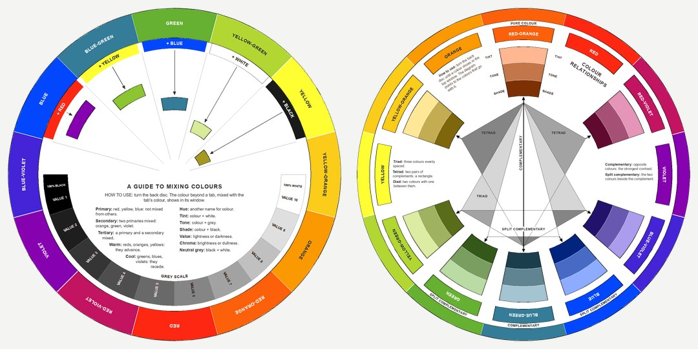

## Póster

O `document.py` desenha com o ReportLab um póster de dez páginas em formato
carta, na horizontal. Todas as cores são calculadas: o cubo RYB, o HSB, o cubo RGB, um
modelo simples de tintas CMY, os valores das palavras-chave de cor do CSS, as funções de
correspondência de cor CIE 1931 e o CIELAB. Nenhuma imagem é copiada. PDFs prontos:
[English](output/colour_theory_en.pdf), [Português (Portugal)](output/colour_theory_pt.pdf),
[Português (Brasil)](output/colour_theory_pt-BR.pdf), [Español](output/colour_theory_es.pdf),
[Français](output/colour_theory_fr.pdf), [Italiano](output/colour_theory_it.pdf), [Deutsch](output/colour_theory_de.pdf),
[Nederlands](output/colour_theory_nl.pdf), [Polski](output/colour_theory_pl.pdf), [Türkçe](output/colour_theory_tr.pdf),
[Русский](output/colour_theory_ru.pdf), [العربية](output/colour_theory_ar.pdf), [简体中文](output/colour_theory_zh.pdf), [日本語](output/colour_theory_ja.pdf),
[한국어](output/colour_theory_ko.pdf).

As 12 cores da roda RYB são as usadas pela
[w3schools](https://www.w3schools.com/colors/colors_wheels.asp) e pelo
[Canva](https://www.canva.com/colors/color-wheel/): vermelho `#FE2712`, vermelho-alaranjado
`#FC600A`, laranja `#FB9902`, amarelo-alaranjado `#FCCC1A`, amarelo `#FEFE33`,
amarelo-esverdeado `#B2D732`, verde `#66B032`, azul-esverdeado `#347C98`, azul `#0247FE`,
azul-arroxeado `#4424D6`, violeta `#8601AF`, vermelho-arroxeado `#C21460`. Ficam nos
vértices e arestas do cubo RYB, que as mistura como tintas (amarelo com azul dá verde) e não
como luz.

| Página | Conteúdo |
|--------|----------|
| 1 | Roda RYB, cores primárias, secundárias e terciárias, tinta/tom/sombra, significados das cores, esquemas de cores |
| 2 | Modelos de cor (CMYK, RGB, HSB, escala de cinzentos), disco de matiz/saturação, propriedades e harmonias |
| 3 | Matiz e luminosidade: cruz de amostras matiz × tinta/sombra, rodas de tintas, tons e sombras, e o cubo RGB visto do vértice branco (hexágono de hexágonos) |
| 4 | Mistura e códigos: RYB, RGB e CMYK lado a lado, um hexagrama CMYK com percentagens de tinta e a paleta web-safe de 216 cores |
| 5 | Nomes das cores: roda RYB de círculos sobrepostos com nomes, e roda das cores com nome do CSS com os códigos hex |
| 6 | Cor e emoção: roda das emoções de Plutchik, rosácea em espiral de tintas e sombras, e pétalas translúcidas |
| 7 | "The Color Wheel": seis círculos RYB que passam pelo centro, com nomes nas sobreposições e no anel exterior, e uma esfera em espiral em fundo negro |
| 8 | O espaço das cores visíveis: diagrama de cromaticidade CIE 1931 (lugar espectral, lugar de Planck, triângulo sRGB), o espetro visível e as funções de correspondência de cor |
| 9 | Tintas e sombras: dez cores de base no meio de uma escala de 90 % branco (esquerda) a 90 % preto (direita) |
| 10 | Círculos de matiz: o círculo de 20 matizes de Munsell (a cor sRGB mais saturada de cada matiz, via CIELAB) e estrelas de doze cores RYB e RGB |

| | |
|---|---|
| 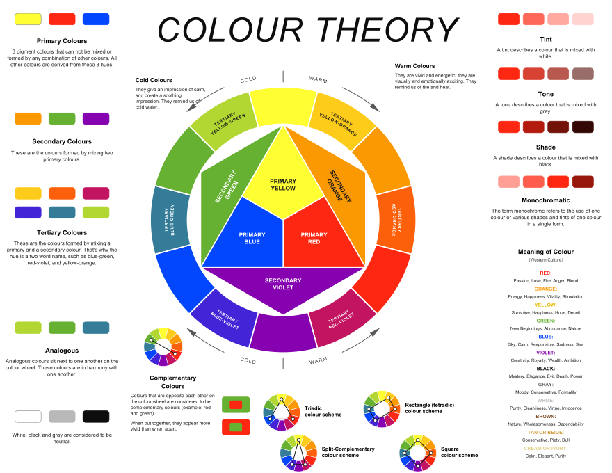 | 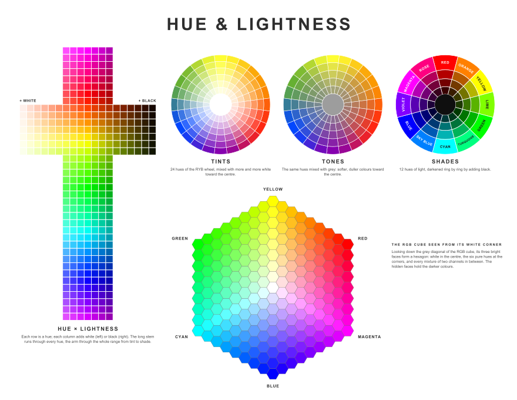 |
| 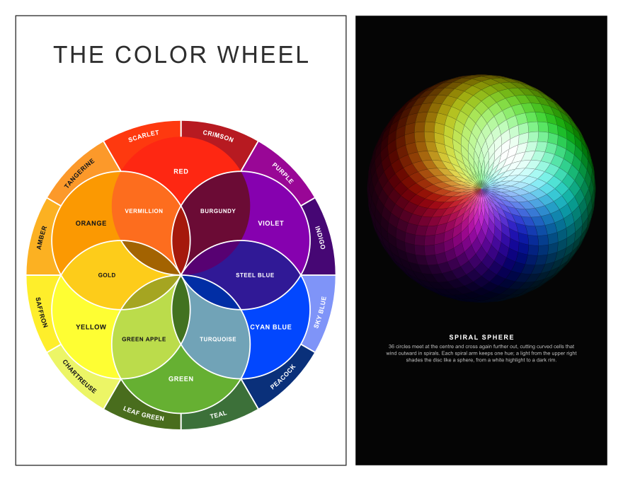 | 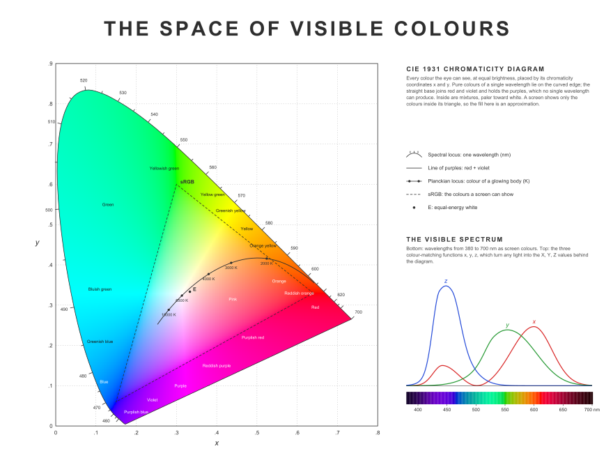 |
| 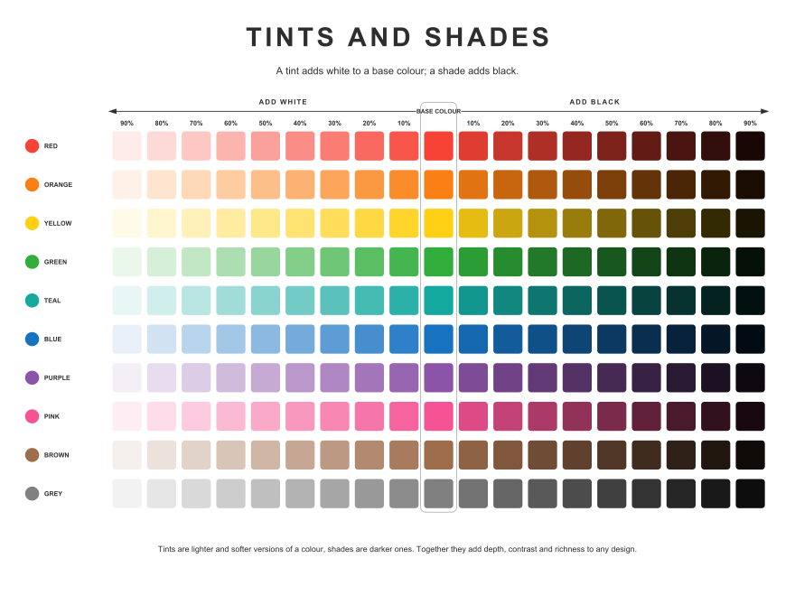 | 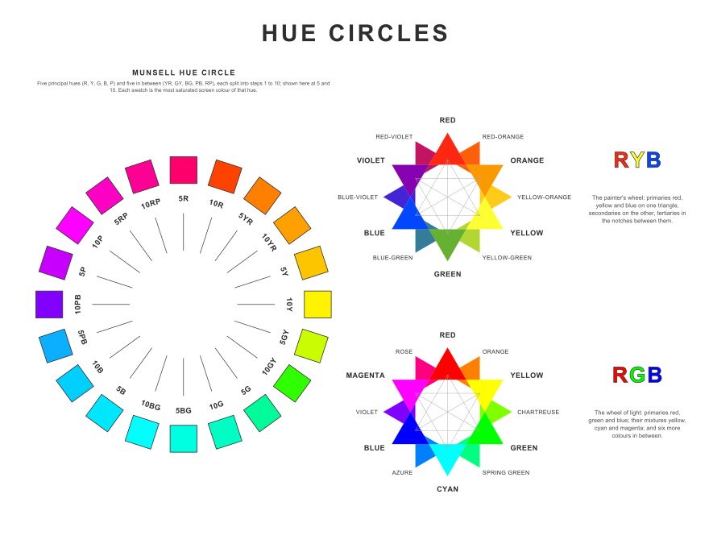 |

Todo o texto está na tabela `STRINGS`.

```bash
pip install .          # a partir desta pasta: o pacote colortheory, o reportlab e o pillow
python3 -m colortheory.document                 # todas as páginas -> colour_theory_en.pdf
python3 -m colortheory.document --lang pt       # português -> colour_theory_pt.pdf
python3 -m colortheory.document --lang es -o es.pdf
python3 -m colortheory.document --pages 3 4     # só algumas páginas
```

Opções:

- `--lang`: idioma do texto (por omissão `en`): en, pt, pt-BR, es, fr, it, de, nl, pl, tr, ru, zh, ja, ko.
- `-o, --out CAMINHO`: PDF de saída (por omissão `colour_theory_<lang>.pdf`).
- `--pages N [N ...]`: páginas a desenhar (por omissão, as dez).

Para acrescentar um idioma, copia-se o bloco `en` da tabela `STRINGS`, traduzem-se os
valores e regista-se com uma chave nova.

## Rodas de cores para construir em casa

O `wheel.py` cria um PDF A4 de seis páginas, pronto a imprimir, com duas rodas de
cores em papel para recortar e montar em casa. Cada roda tem um disco de trás, que roda, e
um disco da frente com janelas, unidos no centro por um atache. PDFs prontos:
[English](output/colour_wheels_en.pdf), [Português (Portugal)](output/colour_wheels_pt.pdf),
[Português (Brasil)](output/colour_wheels_pt-BR.pdf), [Español](output/colour_wheels_es.pdf),
[Français](output/colour_wheels_fr.pdf), [Italiano](output/colour_wheels_it.pdf),
[Deutsch](output/colour_wheels_de.pdf), [Nederlands](output/colour_wheels_nl.pdf),
[Polski](output/colour_wheels_pl.pdf), [Türkçe](output/colour_wheels_tr.pdf), [Русский](output/colour_wheels_ru.pdf), [العربية](output/colour_wheels_ar.pdf),
[简体中文](output/colour_wheels_zh.pdf), [日本語](output/colour_wheels_ja.pdf), [한국어](output/colour_wheels_ko.pdf).

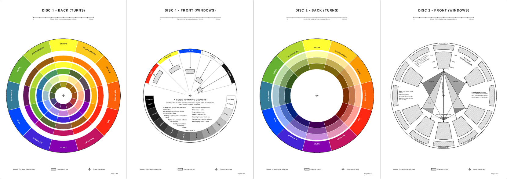

| Página | Conteúdo |
|--------|----------|
| 1 | Material necessário, impressão, recorte e montagem (com uma vista explodida) |
| 2 | Como usar as duas rodas e um glossário das palavras da cor |
| 3 | Disco 1, trás: as 12 cores RYB e cinco anéis de misturas (+ vermelho, + amarelo, + azul, + branco, + preto) |
| 4 | Disco 1, frente: cinco patilhas coloridas com as suas janelas, uma escala de cinzentos (valor 1 a 10) e definições das cores |
| 5 | Disco 2, trás: as 12 cores com os nomes, e a tinta, o tom e a sombra de cada uma |
| 6 | Disco 2, frente: 12 janelas para os nomes, 8 janelas grandes e o diagrama das harmonias (complementar, complementares divididas, tríade, tétrades) |

No disco 1, cada janela fica a uma distância diferente do centro. Por isso, a mistura de
uma cor com o que a patilha acrescenta pode ser impressa no ângulo dessa cor no disco de
trás: aparece na janela quando a cor está mesmo junto à patilha.

```bash
python3 -m colortheory.wheel                 # -> colour_wheels_en.pdf
python3 -m colortheory.wheel --lang pt       # português
python3 -m colortheory.wheel --lang es -o es.pdf
python3 -m colortheory.wheel --lang pt-BR    # também fr, it, de, nl, pl, tr, ru, zh, ja, ko
```

As páginas 3 a 6 devem ser impressas em tamanho real (100 %); cada página tem uma barra de
100 mm para confirmar a escala. O programa vai buscar as cores e algumas funções de desenho
ao `document.py` (ambos no pacote `colortheory`).

### No ecrã

As mesmas duas rodas podem ser rodadas no computador, com todas as partes (trás e frente
de cada disco) móveis:

- arrasta-se um disco com o rato (um disco de trás pela borda colorida ou através de uma janela);
- a roda do rato roda o disco debaixo do ponteiro, uma cor de cada vez;
- ← e → rodam o disco selecionado uma cor; ↑ e ↓ (ou Tab) escolhem outro disco.

Todas as versões no ecrã têm **modo escuro**. Ao abrir, seguem o tema do sistema
operativo, e um botão ao lado da caixa de idioma alterna entre claro e escuro (a página
web lembra-se da escolha). Os PDFs para imprimir são sempre claros.

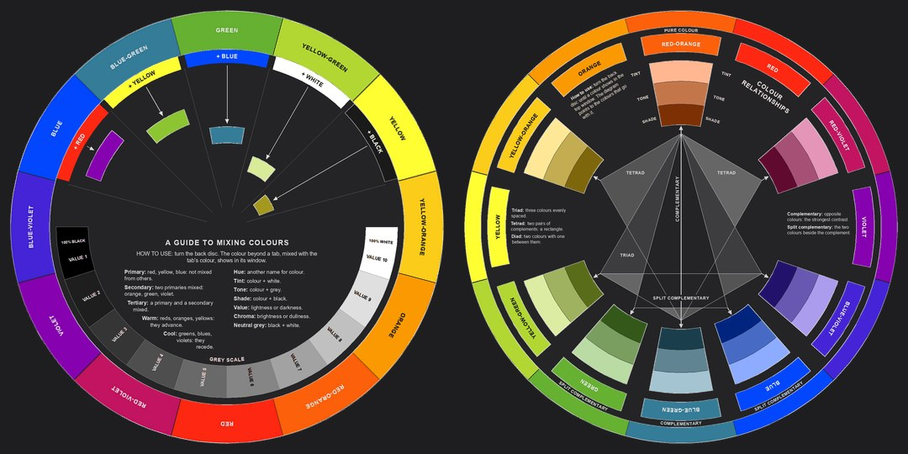

**Computador** (Tkinter e Pillow, nada mais para instalar):

```bash
python3 -m colortheory.wheel --app            # inglês
python3 -m colortheory.wheel --app --lang pt  # começa em português; o idioma pode ser mudado na janela
python3 -m colortheory.wheel --app --theme dark   # --theme auto (por omissão), light ou dark
```

**Web**: abre-se o `web/index.html` num browser. A caixa de idioma no topo alterna entre
as 15 línguas, e a página começa na língua do browser, quando a tem. A página carrega os discos de `web/discs/` (SVG) e os textos e
a geometria dos discos de `web/discs/data.js`, ambos escritos por (cada disco numa versão
clara e numa escura; `?theme=dark` ou `?lang=pt` no endereço também funcionam):

```bash
python3 -m colortheory.wheel --web            # -> web/discs/  (ou: --web OUTRA_PASTA)
```

É preciso voltar a executá-lo depois de mudar os discos ou os textos. A página em si
(`index.html`, `style.css`, `app.js`) é HTML, CSS e JavaScript simples, sem passo de build.

**A página web numa janela própria** (pywebview): a mesma página, numa janela do
computador sem browser. Se a pasta `web/discs/` faltar, é escrita primeiro.

```bash
pip install pywebview
python3 -m colortheory.wheel --webview            # inglês
python3 -m colortheory.wheel --webview --lang pt  # começa em português
python3 -m colortheory.wheel --webview --theme light
```

No Windows usa o Edge WebView2, que já vem com o Windows 10 e 11.

## Pavimentações e mosaicos

O `tilings.py` desenha as pavimentações dos artigos da Wikipedia listados no [`docs/tiles.md`](docs/tiles.md),
cada uma com várias colorações e com as cores dos esquemas de cores acima. Catálogos
prontos (A4, 22 páginas):
[English](output/tilings_en.pdf), [Português (Portugal)](output/tilings_pt.pdf),
[Português (Brasil)](output/tilings_pt-BR.pdf), [Español](output/tilings_es.pdf),
[Français](output/tilings_fr.pdf), [Italiano](output/tilings_it.pdf), [Deutsch](output/tilings_de.pdf),
[Nederlands](output/tilings_nl.pdf), [Polski](output/tilings_pl.pdf), [Türkçe](output/tilings_tr.pdf),
[Русский](output/tilings_ru.pdf), [العربية](output/tilings_ar.pdf), [简体中文](output/tilings_zh.pdf), [日本語](output/tilings_ja.pdf),
[한국어](output/tilings_ko.pdf).

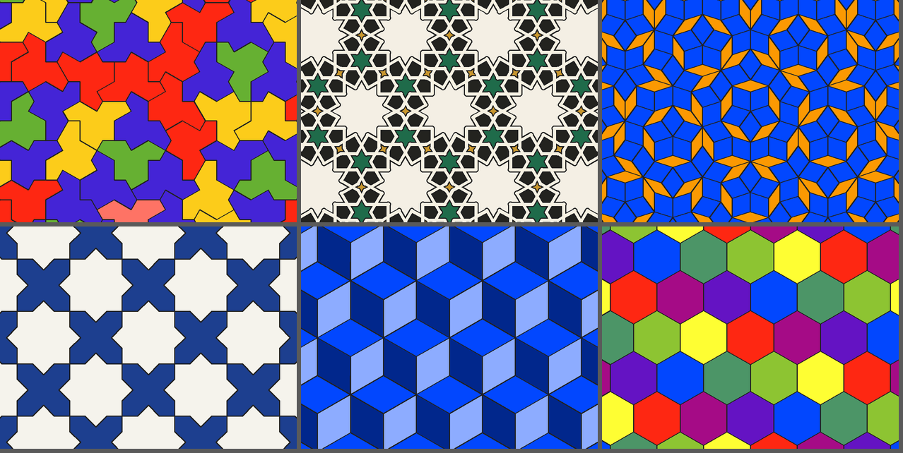

- **Regulares e uniformes**: as pavimentações triangular, quadrada e hexagonal, e as oito
  semirregulares (3.6.3.6, 3.12.12, 4.8.8, 4.6.12, 3.4.6.4, 3.3.3.3.6, 3.3.3.4.4, 3.3.4.3.4).
- **Duais e variações**: losangos (rhombille), tetrakis, kisrhombille, kisdeltile, Cairo,
  pentagonal prismática e em flor; triângulos de dois tamanhos ou rodados (estrelas),
  quadrados alternados, pavimentação chanfrada, hexágonos cortados (2-uniformes).
- **Tijolos e quadrados**: pavimentação pitagórica, espinha de peixe (qualquer proporção,
  rodada ou inclinada) e cestaria.
- **Pentágonos**: tipo 1 (hexágonos cortados ao meio), Cairo, prismática, em flor.
- **Aperiódicas**: Penrose P3 (losangos) e P2 (papagaios e dardos), o "chapéu" (uma só
  peça), as peças de Robinson e as 11 peças de Wang de Jeandel e Rao.
- **Arte islâmica**: peças e linhas girih, estrelas e cruzes do zellij, e padrões de
  estrelas feitos a partir de qualquer pavimentação com o método de Hankin dos polígonos em contacto.

Colorações: as próprias de cada pavimentação (as colorações uniformes 121212, 111222 … da
triangular, 2/3/4/7 cores da hexagonal) e colorações que servem para qualquer uma:
`single`, `kind` (tipo de peça), `shape` (forma), `chirality` (imagem ao espelho),
`orientation`, `proper` (vizinhas diferentes), `random` e `rings` (anéis). Esquemas:
`mono`, `analogous`, `complementary`, `split`, `triad`, `tetrad`, `square` e `rainbow`, a
partir de qualquer matiz da roda RYB; as paletas `zellij`, `azulejo`, `girih`, `earth` e
`grey`; ou cores à escolha.

```bash
python3 -m colortheory.tilings                       # catálogo -> tilings_en.pdf  (--lang pt, fr, de, zh ...)
python3 -m colortheory.tilings --list                # pavimentações, colorações e parâmetros
python3 -m colortheory.tilings hexagonal -c 7 --scheme rainbow -o hex.svg
python3 -m colortheory.tilings penrose_p2 -c orientation --scheme analogous --hue blue -o p2.png
python3 -m colortheory.tilings herringbone -p ratio=3 -p angle=45 --colours "#b5532f,#e2b77a" -o chao.pdf
python3 -m colortheory.tilings hankin -p base=truncated_trihexagonal -p theta=60 --scheme zellij -o estrelas.png
python3 -m colortheory.tilings trihexagonal --overlay dual     # também: circles, incircles, edges
python3 -m colortheory.tilings girih --girih 54                # linhas girih sobre as peças
```

O formato de saída segue a extensão do ficheiro (`.png`, `.svg` ou `.pdf`). O `--size`
diz quantas arestas cabem na largura da imagem (um número maior mostra um bloco maior do
mosaico), o `--aspect` dá as proporções e o `--width` os píxeis.

**Janela de pré-visualização.** O `--show` abre uma janela (Tkinter, nada para instalar)
com caixas para a pavimentação, a coloração, o esquema, o matiz de base, a largura e os
parâmetros. Cada mudança redesenha logo, e o botão *Guardar…* escreve PNG, SVG ou PDF.
Com `-o` o ficheiro também é escrito.

```bash
python3 -m colortheory.tilings --show                          # começa pela pavimentação hexagonal
python3 -m colortheory.tilings cairo -c orientation --scheme triad --show --lang pt
```

**Folhas com vários mosaicos.** Indicam-se várias pavimentações, cada uma seguida das suas
opções (`:nome=valor`; cores separadas por `/`, sobreposições por `+`; qualquer outro nome
é um parâmetro da pavimentação), ou deixa-se o `--vary` fazer as variações de uma só.
O `--cols` dá o número de colunas e o `--no-labels` tira as legendas; com `--show` a folha
aparece na janela.

```bash
python3 -m colortheory.tilings cairo --vary scheme --cols 4 -o cairo_esquemas.png   # todos os esquemas
python3 -m colortheory.tilings penrose_p3 --vary hue -o penrose_matizes.png         # todos os matizes
python3 -m colortheory.tilings hexagonal --vary colouring                           # todas as colorações
python3 -m colortheory.tilings "hexagonal:c=7:scheme=rainbow" "penrose_p2:c=orientation:hue=blue" \
    "herringbone:ratio=3:angle=45:colours=#b5532f/#e2b77a" "hankin:base=hexagonal:theta=60:scheme=azulejo" \
    --cols 2 --aspect 0.6 --width 2400 -o folha.pdf
```

As opções dadas antes das pavimentações (`--scheme`, `--hue`, `-c` …) valem para todos os
painéis, exceto quando um painel tem as suas. Tudo é calculado:

- as pavimentações periódicas são um motivo de polígonos repetido numa rede;
- os buracos entre polígonos colocados são as faces do grafo plano das suas arestas;
- as duais ligam os centros das peças à volta de cada vértice;
- as de Penrose vêm da deflação de triângulos de ouro;
- o chapéu vem da substituição de metapeças de Smith, Myers, Kaplan e Goodman-Strauss.

## Mosaicos decorados

O `patterns.py` faz mosaicos cuja forma de base é mais elaborada, sobre o motor do
`tilings.py`: as mesmas paletas, colorações, saídas, folhas, `--vary` e `--show`. Catálogos
prontos:
[English](output/patterns_en.pdf), [Português (Portugal)](output/patterns_pt.pdf),
[Português (Brasil)](output/patterns_pt-BR.pdf), [Español](output/patterns_es.pdf),
[Français](output/patterns_fr.pdf), [Italiano](output/patterns_it.pdf), [Deutsch](output/patterns_de.pdf),
[Nederlands](output/patterns_nl.pdf), [Polski](output/patterns_pl.pdf), [Türkçe](output/patterns_tr.pdf),
[Русский](output/patterns_ru.pdf), [العربية](output/patterns_ar.pdf), [简体中文](output/patterns_zh.pdf), [日本語](output/patterns_ja.pdf),
[한국어](output/patterns_ko.pdf).

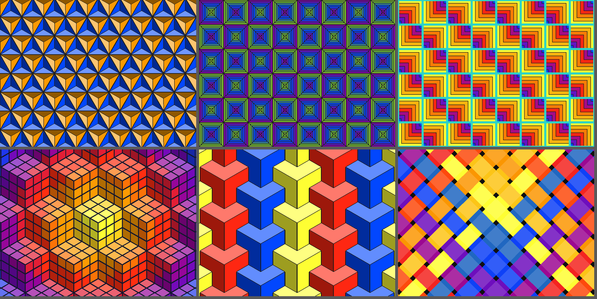

| Padrão | O que faz | Parâmetros principais |
|--------|-----------|-----------------------|
| `facets` | corta cada peça de qualquer pavimentação em triângulos a partir do centro e ilumina-os de um lado: pirâmides, estrelas em relevo, blocos em ampulheta | `base`, `light`, `sun` |
| `bands` | faixas concêntricas em cada peça, para o centro (degraus do tribunal) ou para um canto (cabana de troncos) | `base`, `bands`, `anchor`, `facets`, `gap`, `gap_colour`, `turn` |
| `cubes`, `rubik` | cubos isométricos em três tons; cubos de Rubik cortados em quadradinhos | `grid`, `gap`, `top`, `side` |
| `tripods` | tripés em Y encaixados (cantos de estruturas de cubos) | `arm` (1 ou 2) |
| `framework` | estrutura isométrica de barras | `spacing`, `depth` |
| `quilt` | triângulos de meio quadrado (pinwheel, diamonds, chevron, streak, broken_dishes, zigzag, pinwheel_big, storm) ou blocos em ampulheta | `layout`, `groups`, `hourglass` |
| `jigsaw` | puzzle com encaixes ao acaso | `seed` |
| `weave` | tafetá ou sarja; as tiras escurecem onde passam por baixo | `width`, `turn`, `twill` |
| `beadwork` | padrões de píxeis com a simetria do quadrado, como missangas | `n`, `seed`, `colours_used` |
| `maze` | labirinto perfeito ao acaso num toro (repete-se sem costuras), com paredes isométricas ou plano; colorações `walls`, `path` (caminho mais longo), `flow` (degradê ao longo dos corredores), `face` | `n`, `seed`, `loops`, `flat`, `wide`, `height`, `steps` |
| `spiral` | espirais quadradas de parede; `link=1` liga-as numa grega, `pinwheel=1` roda quatro à volta de um canto | `n`, `link`, `pinwheel`, `flat`, `wide`, `height` |
| `whirl` | polígonos em remoinho sobre qualquer pavimentação: os cantos deslizam pelas arestas passo a passo e os triângulos cortados formam braços de espiral | `base`, `steps`, `t`, `mirror` |

Para as faixas e os degradês juntaram-se dois esquemas, também disponíveis no `tilings.py`:
`ramp` (um matiz do escuro ao claro) e `sweep` (meia roda a partir do matiz de base). Há
também a coloração `gradient` (faixas de cor na diagonal da imagem).

```bash
python3 -m colortheory.patterns                      # catálogo -> patterns_en.pdf  (--lang pt, fr, de, zh ...)
python3 -m colortheory.patterns --list               # padrões, colorações, parâmetros e layouts de patchwork
python3 -m colortheory.patterns --show               # janela de pré-visualização
python3 -m colortheory.patterns facets -p base=triangular -c tile --scheme complementary --hue blue -o estrelas.png
python3 -m colortheory.patterns bands -p bands=7 -p anchor=alternate -p gap=2.5 -p gap_colour=2ED3C6 --scheme rainbow -o cabana.png
python3 -m colortheory.patterns bands -p base=hexagonal -p bands=5 --scheme ramp --hue blue -o aneis.svg
python3 -m colortheory.patterns rubik -c rings --scheme rainbow --size 7 -o rubik.pdf
python3 -m colortheory.patterns tripods --vary scheme --cols 4 -o tripes.png
python3 -m colortheory.patterns quilt -p layout=storm --scheme triad --hue blue-violet -o tempestade.png
python3 -m colortheory.patterns maze -p seed=7 -c flow --scheme rainbow -o labirinto.png
python3 -m colortheory.patterns maze -p flat=1 -p wide=1 -p n=12 -c path --scheme complementary -o labirinto_plano.svg
python3 -m colortheory.patterns spiral -p link=1 -p flat=1 -p wide=1 -c walls --size 20 --scheme mono --hue blue -o grega.png
python3 -m colortheory.patterns whirl -p base=hexagonal -p mirror=0 -c twist --scheme rainbow -o remoinho.pdf
```

## Wallpapers abstratos

O `wallpapers.py` pinta wallpapers abstratos para computador (horizontal) e para telemóvel
ou tablet (vertical), nos tamanhos de ecrã mais comuns, com os mesmos esquemas de cor RYB.
Cada imagem nasce de uma semente, por isso as mesmas opções dão sempre a mesma imagem.

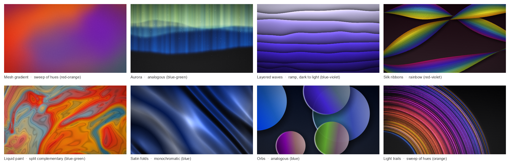

| Estilo | O que pinta | Parâmetros principais |
|--------|-------------|-----------------------|
| `mesh` | manchas suaves de cor que se fundem umas nas outras | `blobs`, `warp`, `spread` |
| `aurora` | cortinas de luz sobre um céu escuro | `bands`, `rays`, `stars` |
| `waves` | camadas de ondas recortadas em papel, cada uma com a sua sombra | `layers`, `height`, `shadow` |
| `ribbons` | fitas torcidas feitas de fios de cor finos | `ribbons`, `threads`, `width`, `twist`, `texture` |
| `fluid` | tinta líquida dobrada por deformação do domínio, brilhante e com estrias | `scale`, `warp`, `lines`, `bands`, `gloss` |
| `silk` | pregas de cetim com reflexos suaves | `folds`, `depth`, `softness`, `sheen` |
| `orbs` | esferas sobrepostas com degradês e um contorno de luz | `orbs`, `size`, `opacity`, `rings` |
| `trails` | arcos de luz em longa exposição | `lines`, `sweep`, `spiral` |

Tamanhos: `hd`, `hd+`, `fhd` (por omissão), `wuxga`, `qhd`, `wqxga`, `4k`, `5k`, `ultrawide`,
`uwqhd`, `macbook-air`, `macbook-pro`, `imac`; telemóveis `phone-hd`, `phone-fhd`, `android`,
`android-qhd`, `iphone-se`, `iphone-13`, `iphone`, `iphone-pro-max`; tablets `ipad`,
`ipad-pro`, `tablet`; ou qualquer `LxA` (por exemplo `2560x1080`). O `--orientation` roda o
tamanho quando é preciso.

```bash
pip install ".[wallpapers]"      # acrescenta o numpy e o scipy
python3 -m colortheory.wallpapers --show --lang pt                # janela: muda-se lá e depois guarda-se
python3 -m colortheory.wallpapers --list --lang pt                # estilos, parâmetros e tamanhos
python3 -m colortheory.wallpapers ribbons                         # -> wallpaper_ribbons_fhd_1.png
python3 -m colortheory.wallpapers fluid --size 4k --scheme triad --hue blue -o tinta.png
python3 -m colortheory.wallpapers waves --size iphone --seed 7 -o ondas.jpg
python3 -m colortheory.wallpapers silk --scheme mono --hue red -p folds=4 -o cetim.webp
python3 -m colortheory.wallpapers orbs --size ultrawide --colours "#ff6b6b,#4ecdc4,#ffe66d"
python3 -m colortheory.wallpapers mesh --count 5                  # sementes 1 .. 5
python3 -m colortheory.wallpapers --gallery --size iphone --cols 8    # todos os estilos lado a lado
```

Outras opções: `--background dark|black|light|white|<hex>`, `--grain` (grão de filme),
`--vignette` (cantos mais escuros) e `--lang` (qualquer das 15 línguas) para a janela e as legendas.

### Mudar a tonalidade e o tamanho de uma imagem

Com `--input`, o programa recebe uma imagem sua (PNG, JPG, WebP, AVIF ...) e muda-lhe a
tonalidade e/ou as dimensões:

- `--hue`: o novo matiz. Sem `--hue`, as cores ficam como estão e só muda o tamanho.
- `--mode shift` (por omissão) roda todos os matizes de modo a que o matiz principal da imagem
  passe a ser o `--hue`, e assim a variedade de cores mantém-se; `--mode tint` põe tudo no mesmo
  matiz, mantendo saturação e luminosidade; `--mode map` passa a luminosidade pelas cores de
  um esquema (`--scheme`, de preferência `ramp` ou `mono`).
- `--size`: o novo tamanho (por omissão o da imagem original). `--fit cover` (por omissão)
  enche o ecrã e corta o que sobra, `--fit contain` mostra a imagem inteira sobre uma cópia
  desfocada dela própria, `--fit stretch` estica.
- `-p saturation=1.2 -p brightness=0.9` ajustam a saturação e o brilho.

```bash
python3 -m colortheory.wallpapers --input onda_azul.avif --hue orange --size 1980x1080 -o onda_laranja.png
python3 -m colortheory.wallpapers --input onda_azul.avif --hue orange --mode tint --size fhd
python3 -m colortheory.wallpapers --input onda_azul.avif --mode map --scheme ramp --hue blue-green
python3 -m colortheory.wallpapers --input onda_azul.avif --hue green --size iphone --fit contain
python3 -m colortheory.wallpapers --input onda_azul.avif --show --lang pt      # experimentar na janela
```

Na janela, o botão "Abrir imagem..." escolhe a imagem, e o matiz "(manter)" deixa as cores
originais. Com `--show` nada é gravado sem o botão "Guardar em tamanho real...": o `-o`
dá apenas o nome e a pasta propostos nesse diálogo. Os ficheiros sem caminho completo ficam
na pasta onde o comando foi executado, e o programa escreve sempre o caminho completo do que
gravou. Sem `-o`, o nome do ficheiro diz o matiz e o tamanho, por exemplo
`onda_azul_orange_1980x1080.png`.

## Ilusões de cor

O `illusions.py` cria um documento ilustrado sobre ilusões de cor e de contraste, em PDF
(A4, 30 páginas) e em Markdown: 28 entradas em seis grupos (cor; luminosidade e contraste;
tamanho e comprimento; linhas curvadas e inclinadas; movimento em imagens paradas; figura,
fundo e objetos impossíveis), cada uma com o que se vê, porque acontece, algo para
experimentar e uma ligação ao artigo da Wikipédia. Todas as figuras são desenhadas de raiz em
vetor; na versão Markdown o perseguidor lilás é animado. Para já existe em inglês, português e
espanhol.

Há também uma **página interativa**, [colour_illusions.html](docs/illusions/colour_illusions.html)
([experimentar online](https://mcampilho.github.io/color-theory/docs/illusions/colour_illusions.html)): uma
ilusão de cada vez, escolhida numa lista, com outros pares de cores (vermelho/verde, azul/laranja,
violeta/amarelo... ou os seus) e um botão de ajuda que retira ou acrescenta linhas para mostrar
o que lá está de facto. É um único ficheiro, que também funciona sem rede.

- English: [PDF](output/colour_illusions_en.pdf) · [Markdown](docs/illusions/colour_illusions_en.md)
- Português: [PDF](output/colour_illusions_pt.pdf) · [Markdown](docs/illusions/colour_illusions_pt.md)
- Español: [PDF](output/colour_illusions_es.pdf) · [Markdown](docs/illusions/colour_illusions_es.md)
- Português (Brasil): [PDF](output/colour_illusions_pt-BR.pdf) · [Markdown](docs/illusions/colour_illusions_pt-BR.md)
- Français: [PDF](output/colour_illusions_fr.pdf) · [Markdown](docs/illusions/colour_illusions_fr.md)
- Italiano: [PDF](output/colour_illusions_it.pdf) · [Markdown](docs/illusions/colour_illusions_it.md)
- Deutsch: [PDF](output/colour_illusions_de.pdf) · [Markdown](docs/illusions/colour_illusions_de.md)
- Nederlands: [PDF](output/colour_illusions_nl.pdf) · [Markdown](docs/illusions/colour_illusions_nl.md)
- Polski: [PDF](output/colour_illusions_pl.pdf) · [Markdown](docs/illusions/colour_illusions_pl.md)
- Türkçe: [PDF](output/colour_illusions_tr.pdf) · [Markdown](docs/illusions/colour_illusions_tr.md)
- Русский: [PDF](output/colour_illusions_ru.pdf) · [Markdown](docs/illusions/colour_illusions_ru.md)
- العربية: [PDF](output/colour_illusions_ar.pdf) · [Markdown](docs/illusions/colour_illusions_ar.md)
- 简体中文: [PDF](output/colour_illusions_zh.pdf) · [Markdown](docs/illusions/colour_illusions_zh.md)
- 日本語: [PDF](output/colour_illusions_ja.pdf) · [Markdown](docs/illusions/colour_illusions_ja.md)
- 한국어: [PDF](output/colour_illusions_ko.pdf) · [Markdown](docs/illusions/colour_illusions_ko.md)

```bash
python3 -m colortheory.illusions              # -> colour_illusions_en.pdf, .md, illusion_images/
python3 -m colortheory.illusions --lang pt
python3 -m colortheory.illusion_page         # -> colour_illusions.html
python3 -m colortheory.illusions -o doc.pdf --md doc.md --images figuras
```

## Línguas

Todos os programas (os PDFs, a aplicação e a página web das rodas, os wallpapers e os
catálogos) estão em 15 línguas: inglês, português (de Portugal e do Brasil), espanhol,
francês, italiano, alemão, neerlandês, polaco, turco, russo, árabe, chinês simplificado,
japonês e coreano.

O `i18n.py` guarda o que todos os programas partilham: a lista de línguas com os seus nomes,
os tipos de letra de cada escrita e a quebra de linha para chinês e japonês (entre caracteres,
nunca antes de pontuação de fecho nem depois de pontuação de abertura). Os PDFs mantêm a
Helvetica nas línguas da Europa ocidental, sem fonte embutida; polaco, turco e russo usam
Arial, chinês Microsoft YaHei, japonês Yu Gothic e coreano Malgun Gothic (ou as alternativas
listadas no `i18n.py`, em Linux e macOS), embutidas só com as letras usadas.
O árabe escreve-se da direita para a esquerda e as letras mudam de forma conforme as
vizinhas, o que um PDF não faz sozinho: o `i18n.visual()` liga as letras (`arabic-reshaper`)
e põe cada linha na ordem de leitura (`python-bidi`), e os parágrafos, as páginas dos
catálogos e a página web ficam espelhados. É preciso `pip install arabic-reshaper python-bidi`. Os textos das
línguas novas estão em `src/colortheory/locales/` (um ficheiro por programa); um texto em falta usa o inglês.
As traduções foram feitas por máquina e convém que sejam revistas por falantes nativos.

## Desenvolvimento

As dependências estão declaradas no `pyproject.toml`: `reportlab` e `pillow` para tudo, mais
os extras `wallpapers` (numpy, scipy), `rtl` (árabe) e `app` (pywebview). O código é o pacote
`colortheory` em `src/`: `i18n` (línguas, fontes, texto da direita para a esquerda), `colour` (matemática das
cores), `document`, `poster`, `wheel`, `tilings`, `patterns` e `wallpapers` (os programas) e `locales/`.
Instalado, o pacote traz um comando por programa (`colortheory-document`, `colortheory-wheel`,
`colortheory-tilings`, `colortheory-patterns`, `colortheory-wallpapers`, `colortheory-poster`), o mesmo que
`python3 -m colortheory.<programa>`; numa cópia do repositório basta `PYTHONPATH=src` para correr este último:

```bash
python3 -m venv .venv
.venv/bin/pip install ".[dev,wallpapers,rtl]"      # Windows: .venv\Scripts\pip
.venv/bin/pytest                                   # traduções, cores, i18n e testes de fumo
ruff check .
.venv/bin/colortheory-tilings hexagonal -o hex.svg   # os comandos instalados
```

Os testes verificam que todas as línguas têm as mesmas chaves, o mesmo número de itens nas
listas e os mesmos marcadores `%` que o inglês, que as cores RYB batem com a roda de 12 cores,
a quebra de linha e a ligação das letras árabes, e que cada programa escreve um ficheiro. Os
casos que precisam de uma fonte CJK ou árabe são saltados onde a fonte não existe. O GitHub
Actions (`.github/workflows/ci.yml`) corre o `ruff` e os testes em Linux e Windows.

## Ligações

A roda de cores RYB (as 12 cores usadas aqui):

- [w3schools: rodas de cores](https://www.w3schools.com/colors/colors_wheels.asp)
- [Canva: roda de cores](https://www.canva.com/colors/color-wheel/)

Misturadores de cores na web, para experimentar outras misturas:

- [colors.tools](https://www.colors.tools/color-mixer/)
- [CalcBE](https://calcbe.com/en/tools/color-mixer/)
- [Trycolors](https://trycolors.com/mixer)
- [Gradients.app](https://gradients.app/en/mix)
- [ColorMagic](https://colormagic.app/color-mixer)
- [Colordesigner.io](https://colordesigner.io/color-mixer)
- [Paleta Color Pro](https://paletacolorpro.com/en/color-mixer)

Alguns fazem a média dos canais RGB, que mistura as cores como luz (amarelo com azul dá um
cinzento); outros simulam tintas, como as rodas de cores daqui (amarelo com azul dá verde),
por isso o mesmo par pode dar resultados bem diferentes.

## Outros ficheiros

- [`docs/reference/The Complete Guide to Color Theory.md`](<docs/reference/The Complete Guide to Color Theory.md>): o guia de referência completo, da física
  da luz aos espaços de cor, em inglês (também em [`.docx`](<docs/reference/The Complete Guide to Color Theory.docx>) e [`.pdf`](<docs/reference/The Complete Guide to Color Theory.pdf>)).
- `poster.py`: o póster anterior, de uma página, só em inglês.
- `docs/images/`: as imagens deste README.

## Licença

[MIT](LICENSE)
