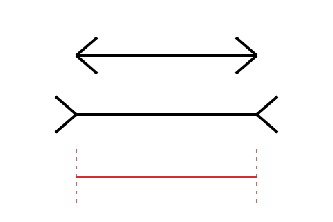
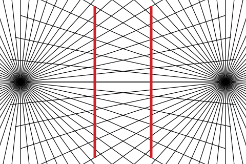

# خدع الألوان

*ما تراه العين ليس ما هو مرسوم على الصفحة*

لا يُقرأ اللون والسطوع والحجم والشكل من الصورة نقطة بنقطة: فالجهاز البصري يقارن كل مساحة بما يحيط بها ويخمّن ما هو موجود. تُظهر هذه الخدع ذلك التخمين وهو يعمل. وليست كلها تتعلق بصبغة اللون، فبعضها لا يحتاج إلا إلى التباين بين الأسود والأبيض.

انظر إلى الأشكال على شاشة أو في طباعة ملونة جيدة، من مسافة مريحة. تختلف قوة كل خدعة من شخص إلى آخر. يستخدم بعضها الحركة أو الوميض: توقف إن أزعجتك.

> رُسمت جميع الأشكال لهذه الوثيقة. والنصوص ملخصات قصيرة مبنية على مقالات ويكيبيديا المرتبطة (المتاحة برخصة CC BY-SA).

## المحتويات

- **اللون**
  - [التباين المتزامن](#contrast)
  - [تأثير بيزولد](#bezold)
  - [ثبات اللون](#constancy)
  - [الصورة التلوية السالبة](#afterimage)
  - [المطارد الأرجواني](#lilac)
  - [تأثير ماكولو](#mccollough)
  - [التجسيم اللوني](#chromostereopsis)
- **السطوع والتباين**
  - [خدعة ظل رقعة الشطرنج](#checker)
  - [خدعتا وايت ومونكر](#white)
  - [أشرطة ماخ](#mach)
  - [خدعة كورنسويت](#cornsweet)
  - [خدع الشبكة: هيرمان والمتلألئة](#grid)
  - [خدعة إيرنشتاين](#ehrenstein)
  - [خدعة التشعع](#irradiation)
- **الحجم والطول**
  - [خدعة إيبنغهاوس (دوائر تيتشنر)](#ebbinghaus)
  - [خدعة مولر-لاير](#muller_lyer)
  - [خدعة بونزو](#ponzo)
- **خطوط منحنية ومائلة**
  - [خدعة جدار المقهى](#cafe)
  - [حلزون فريزر](#fraser)
  - [خدعة هيرينغ](#hering)
  - [خدعة فونت](#wundt)
  - [خدعة أوربيسون](#orbison)
  - [خدعة تسولنر](#zollner)
  - [خدعة بوغندورف](#poggendorff)
  - [خدعة الميل والأثر التالي للميل](#tilt)
- **حركة في صور ساكنة**
  - [الحركة الوهمية](#motion)
  - [خدعة الانجراف المحيطي](#drift)
- **الشكل والخلفية والأجسام المستحيلة**
  - [مزهرية روبن](#rubin)
  - [مثلث بنروز](#penrose)

## اللون

### التباين المتزامن

**ما تراه.** المربعات الصغيرة الأربعة بالرمادي نفسه. يبدو على الأرضية الداكنة أفتح منه على الفاتحة، وعلى الأزرق يميل إلى الأصفر، وعلى الأصفر إلى الأزرق.

**لماذا يحدث.** يُحكم على اللون بالفرق. فالمحيط يدفع المساحة التي بداخله بعيداً عنه، في الإضاءة وفي الصبغة.

**جرّب هذا.** اقطع ثقبين في ورقة بحيث يظهر مربعان صغيران فقط: يختفي الفرق.

[مقالة ويكيبيديا (بالإنجليزية)](https://en.wikipedia.org/wiki/Contrast_effect)

### تأثير بيزولد

**ما تراه.** يبدو الأحمر بين الخطوط السوداء أعمق وأدكن من الأحمر بين الخطوط البيضاء الذي يبدو أبهت وأميل إلى الوردي. وهو أحمر واحد.

**لماذا يحدث.** حين تتناوب مساحات لونية صغيرة تمزجها العين جزئياً (الاستيعاب): فيأخذ الأحمر شيئاً من جاره. لاحظ ذلك فيلهلم فون بيزولد وهو يعيد تصميم السجاد بتغيير لون واحد.

**جرّب هذا.** ابتعد عن الصفحة: كلما ابتعدت ازداد المزج.

[مقالة ويكيبيديا (بالإنجليزية)](https://en.wikipedia.org/wiki/Bezold_effect)

### ثبات اللون

**ما تراه.** نسختان من فسيفساء يضيئهما ضوء دافئ وضوء بارد (القرصان في الأعلى). تبدو البلاطة الثانية من الصف الثاني مزرقّة على اليسار ومصفرّة على اليمين، وهي الرمادي المحايد نفسه.

**لماذا يحدث.** لكي تبقى الأشياء معروفة يقدّر الدماغ لون الضوء ويطرحه. فالرمادي في مشهد برتقالي كله يُقرأ سطحاً مزرقاً.

**جرّب هذا.** غطِّ كل شيء ما عدا البلاطتين الرماديتين.

[مقالة ويكيبيديا](https://ar.wikipedia.org/wiki/%D8%AB%D8%A8%D8%A7%D8%AA_%D9%84%D9%88%D9%86%D9%8A)

### الصورة التلوية السالبة

**ما تراه.** بعد التحديق في النقطة داخل الحلقات الملونة، تبدو النقطة المنفردة على اليمين محاطة بحلقات بألوان أخرى: أحمر وأخضر وأصفر.

**لماذا يحدث.** تتعب الخلايا التي تستجيب للون ما (التكيف). وعلى السطح الأبيض تستجيب الخلايا الأخرى بقوة أكبر فترى اللون المتمم.

**جرّب هذا.** حدّق في النقطة اليسرى 30 ثانية دون تحريك عينيك، ثم انظر إلى اليمنى وارمش.

[مقالة ويكيبيديا](https://ar.wikipedia.org/wiki/%D8%B5%D9%88%D8%B1%D8%A9_%D8%AA%D9%84%D9%88%D9%8A%D8%A9_%28%D8%B7%D8%A8_%D8%A7%D9%84%D8%B9%D9%8A%D9%88%D9%86%29)

### المطارد الأرجواني

**ما تراه.** عند التحديق في الصليب تدور فجوة حول حلقة الأقراص الأرجوانية، ثم تتحول الفجوة إلى قرص أخضر، وبعد حين قد تختفي الأقراص الأرجوانية كلها.

**لماذا يحدث.** الفجوة المتنقلة حركة ظاهرية (ظاهرة فاي). وحيث يختفي قرص تظهر صورة تلوية باللون المقابل، الأخضر. أما الأقراص الضبابية الساكنة في محيط البصر فتغيب عن الوعي (تأثير تروكسلر).

**جرّب هذا.** ثبّت عينيك على الصليب 30 ثانية على الأقل. أنشأ جيريمي هينتون هذه الرسوم المتحركة قبل عام 2005.

[مقالة ويكيبيديا](https://ar.wikipedia.org/wiki/%D8%AE%D8%AF%D8%B9%D8%A9_%D8%A7%D9%84%D9%84%D9%88%D9%84%D8%A8_%D8%A7%D9%84%D8%A3%D8%B1%D8%AC%D9%88%D8%A7%D9%86%D9%8A)

### تأثير ماكولو

**ما تراه.** بعد النظر بالتناوب إلى خطوط أفقية حمراء ورأسية خضراء، تبدو المربعات السوداء والبيضاء في الأسفل ملونة: مخضرّة حيث الخطوط أفقية ووردية حيث هي رأسية.

**لماذا يحدث.** يتكيف الجهاز البصري مع لون مقترن باتجاه. وصفته سيليست ماكولو عام 1965، وقد يدوم ساعات بل أشهراً.

**جرّب هذا.** ناوب بين الشبكتين الملونتين، بضع ثوانٍ لكل منهما، عدة دقائق، ثم انظر إلى المربعات الصغيرة. انتبه: قد يستمر التأثير طويلاً.

[مقالة ويكيبيديا (بالإنجليزية)](https://en.wikipedia.org/wiki/McCollough_effect)

### التجسيم اللوني

**ما تراه.** لا يبدو الأحمر والأزرق على الأسود في مستوى واحد: يراه معظم الناس أحمر طافياً أمام الأزرق، ويراه بعضهم غائراً خلفه.

**لماذا يحدث.** تكسر عدسة العين الموجات القصيرة والطويلة بمقادير مختلفة (الزيغ اللوني)، فيقع اللونان في موضعين مختلفين قليلاً في كل عين، ويقرأ الدماغ هذا الفارق عمقاً.

**جرّب هذا.** شاهده في غرفة خافتة الإضاءة بكلتا العينين، وجرّب بالنظارة ودونها.

[مقالة ويكيبيديا (بالإنجليزية)](https://en.wikipedia.org/wiki/Chromostereopsis)

## السطوع والتباين

### خدعة ظل رقعة الشطرنج

**ما تراه.** يبدو المربع A أدكن كثيراً من المربع B. وهما بالرمادي نفسه تماماً، كما يبيّن الشريط في الشكل الثاني.

**لماذا يحدث.** يقرأ الدماغ أرضية مربعات عليها ظل فيصحح أثر الظل: لا بد أن B مربع فاتح، فيُرى فاتحاً. نشر إدوارد أدلسون الخدعة عام 1995.

**جرّب هذا.** أخفِ بقية الرقعة بورقتين واترك A وB فقط.

[مقالة ويكيبيديا](https://ar.wikipedia.org/wiki/%D8%AE%D8%AF%D8%B9%D8%A9_%D8%B1%D9%82%D8%B9%D8%A9_%D8%A7%D9%84%D8%B4%D8%B7%D8%B1%D9%86%D8%AC)

### خدعتا وايت ومونكر

**ما تراه.** تبدو القضبان الرمادية الموضوعة في الخطوط السوداء أفتح من الموضوعة في البيضاء. وفي النسخة الملونة (مونكر) يبدو الأحمر نفسه برتقالياً في جانب وبنفسجياً في الآخر.

**لماذا يحدث.** على عكس ما يتوقعه التباين البسيط، يبدو أن العين تضم كل قضيب إلى الخط الذي وُضع فيه.

**جرّب هذا.** قارن المجموعتين من خلال ثقب صغير في ورقة.

[مقالة ويكيبيديا (بالإنجليزية)](https://en.wikipedia.org/wiki/White%27s_illusion)

### أشرطة ماخ

**ما تراه.** يبدو كل شريط رمادي منتظم أدكن قرب جاره الأفتح، وأفتح قرب جاره الأدكن، كأن الأشرطة مخددة.

**لماذا يحدث.** تثبّط الخلايا المتجاورة في الشبكية بعضها بعضاً (التثبيط الجانبي) فتبالغ في الحواف. وصف إرنست ماخ التأثير عام 1865.

**جرّب هذا.** غطِّ كل الأشرطة إلا واحداً: إنه منتظم تماماً.

[مقالة ويكيبيديا (بالإنجليزية)](https://en.wikipedia.org/wiki/Mach_bands)

### خدعة كورنسويت

**ما تراه.** يبدو النصف الأيسر أفتح من الأيمن. وبعيداً عن الوسط هما بالرمادي نفسه.

**لماذا يحدث.** الحافة وحدها مختلفة، ترتفع في جانب وتنخفض في الآخر. ويأخذ الجهاز البصري الدرجة عند الحافة على أنها الفرق بين المساحتين كلهما.

**جرّب هذا.** ضع قلماً على خط الوسط وشاهد النصفين يتساويان.

[مقالة ويكيبيديا (بالإنجليزية)](https://en.wikipedia.org/wiki/Cornsweet_illusion)

### خدع الشبكة: هيرمان والمتلألئة

**ما تراه.** في الشبكة البيضاء تظهر بقع رمادية عند التقاطعات إلا حيث تنظر. ومع أقراص على شبكة رمادية تبدو نقاط سوداء تومض.

**لماذا يحدث.** فُسّرت شبكة هيرمان (1870) طويلاً بالتثبيط الجانبي وحده، ثم أظهرت تجارب لاحقة (حني الخطوط يزيلها) أنها تتوقف أيضاً على معالجة القشرة الدماغية للخطوط المستقيمة. وذُكرت النسخة المتلألئة في تسعينيات القرن العشرين.

**جرّب هذا.** دع عينيك تجولان في الشبكة ثم ثبّتهما على تقاطع واحد.

[مقالة ويكيبيديا (بالإنجليزية)](https://en.wikipedia.org/wiki/Grid_illusion)

### خدعة إيرنشتاين

**ما تراه.** حيث تتوقف الخطوط قبل أن تتقاطع تبدو أقراص ساطعة أنصع بياضاً من الورق.

**لماذا يحدث.** توحي نهايات الخطوط بشكل موضوع فوقها يخفي التقاطعات. فيرسم الدماغ محيطه (حافة وهمية) ويملؤه سطوعاً.

**جرّب هذا.** أغلق الفراغات في ذهنك أو بقلم: تختفي الأقراص.

[مقالة ويكيبيديا (بالإنجليزية)](https://en.wikipedia.org/wiki/Ehrenstein_illusion)

### خدعة التشعع

**ما تراه.** يبدو المربع الأبيض على الأسود أكبر من المربع الأسود على الأبيض مع أنهما متساويان.

**لماذا يحدث.** يتشتت الضوء داخل العين فتنتشر المساحة الساطعة على الشبكية. ذكرها غاليليو عام 1632، وأطلق عليها هلمهولتز اسمها.

**جرّب هذا.** قِس المربعين.

[مقالة ويكيبيديا (بالإنجليزية)](https://en.wikipedia.org/wiki/Irradiation_illusion)

## الحجم والطول

### خدعة إيبنغهاوس (دوائر تيتشنر)

**ما تراه.** تبدو الدائرة البرتقالية المحاطة بدوائر كبيرة أصغر من المحاطة بدوائر صغيرة.

**لماذا يحدث.** يُقدَّر الحجم نسبةً إلى السياق، وتؤثر أيضاً مسافة الدوائر المحيطة وتباعدها.

**جرّب هذا.** غطِّ الدوائر الزرقاء بأصابعك.

[مقالة ويكيبيديا](https://ar.wikipedia.org/wiki/%D8%AE%D8%AF%D8%A7%D8%B9_%D8%A5%D9%8A%D8%A8%D9%86%D8%BA%D9%87%D8%A7%D9%88%D8%B3_%D8%A7%D9%84%D8%A8%D8%B5%D8%B1%D9%8A)

### خدعة مولر-لاير

**ما تراه.** يبدو الخط ذو الزعانف المتجهة إلى الخارج أطول من ذي الزعانف المتجهة إلى الداخل. وهما متساويان، كالخط الأحمر في الأسفل.

**لماذا يحدث.** تزيح الزعانف الموضع الذي يبدو فيه طرفا الخط، ويربطها أحد التفسيرات بزوايا الغرف والمباني المرئية في العمق. وصفها فرانتس مولر-لاير عام 1889.

**جرّب هذا.** قارن الخطين بالأدلة المتقطعة.

[مقالة ويكيبيديا](https://ar.wikipedia.org/wiki/%D8%AE%D8%AF%D8%A7%D8%B9_%D9%85%D9%88%D9%84%D8%B1-%D9%84%D8%A7%D9%8A%D8%B1)

### خدعة بونزو

**ما تراه.** يبدو القضيب الأصفر العلوي أطول من السفلي.

**لماذا يحدث.** توحي الخطوط المتقاربة بالبعد كقضبان السكة الحديدية: فقضيب بالحجم نفسه على الصفحة لكنه أبعد لا بد أن يكون أكبر.

**جرّب هذا.** قِس القضيبين أو اقلب الصفحة رأساً على عقب.

[مقالة ويكيبيديا](https://ar.wikipedia.org/wiki/%D8%AE%D8%AF%D8%A7%D8%B9_%D8%A8%D9%88%D9%86%D8%B2%D9%88)

## خطوط منحنية ومائلة

### خدعة جدار المقهى

**ما تراه.** تبدو خطوط الملاط الرمادية مائلة بالتناوب، مع أنها متوازية وأفقية.

**لماذا يحدث.** البلاطات السوداء والبيضاء المزاحة، مع ملاط برمادي متوسط، تصنع عناصر صغيرة مائلة على طول كل خط. سمّاها ريتشارد غريغوري عام 1973 نسبة إلى جدار مقهى في بريستول.

**جرّب هذا.** انظر على امتداد خط ملاط والصفحة تكاد تكون جانبية.

[مقالة ويكيبيديا (بالإنجليزية)](https://en.wikipedia.org/wiki/Caf%C3%A9_wall_illusion)

### حلزون فريزر

**ما تراه.** يبدو حلزون يلتف نحو المركز. لا يوجد حلزون: فالحبال السوداء والبيضاء دوائر متحدة المركز.

**لماذا يحدث.** كل قطعة قصيرة مائلة، والخلفية الملتوية تزيد الميل، فتصلها العين في حلزون. وصفها جيمس فريزر عام 1908.

**جرّب هذا.** ضع إصبعك على حبل وتتبعه: تعود إلى حيث بدأت.

[مقالة ويكيبيديا (بالإنجليزية)](https://en.wikipedia.org/wiki/Fraser_spiral_illusion)

### خدعة هيرينغ

**ما تراه.** يبدو الخطان الأحمران منحنيين إلى الخارج عند الوسط. وهما مستقيمان ومتوازيان.

**لماذا يحدث.** يُبالَغ في تقدير الزوايا مع الخطوط الشعاعية، ويوحي النمط أيضاً بحركة نحو العمق. اكتشفها إيفالد هيرينغ عام 1861.

**جرّب هذا.** ضع مسطرة على خط أحمر.

[مقالة ويكيبيديا](https://ar.wikipedia.org/wiki/%D8%AE%D8%AF%D8%A7%D8%B9_%D9%87%D9%8A%D8%B1%D9%8A%D9%86%D8%BA)

### خدعة فونت

**ما تراه.** يبدو الخطان الأحمران منحنيين إلى الداخل، أحدهما نحو الآخر، عند الوسط. وهما مستقيمان ومتوازيان.

**لماذا يحدث.** هي المقابل لشكل هيرينغ: فالأشعة تنطلق هنا من نقطتين على الجانبين، فتحرف الزوايا الخطين الأحمرين في الاتجاه المعاكس. وصفها فيلهلم فونت عام 1898.

**جرّب هذا.** قارنها بخدعة هيرينغ.

[مقالة ويكيبيديا](https://ar.wikipedia.org/wiki/%D8%AE%D8%AF%D8%A7%D8%B9_%D9%81%D9%88%D9%86%D8%AA)

### خدعة أوربيسون

**ما تراه.** يبدو المربع الأحمر مشوهاً، أضلاعه منحنية وزواياه مشدودة.

**لماذا يحدث.** كما في شكل هيرينغ، تحرف تقاطعات الأضلاع مع حلقات الخلفية الاتجاه المدرك لكل ضلع. وصفها وليام أوربيسون عام 1939.

**جرّب هذا.** تحقق من الأضلاع بمسطرة.

[مقالة ويكيبيديا](https://ar.wikipedia.org/wiki/%D8%AE%D8%AF%D8%A7%D8%B9_%D8%A3%D8%B1%D8%A8%D9%8A%D8%B3%D9%86)

### خدعة تسولنر

**ما تراه.** تبدو الخطوط القطرية الطويلة متقاربة ومتباعدة. وهي متوازية.

**لماذا يحدث.** تقطعها الشرطات القصيرة بزاوية، ويبالغ الجهاز البصري في الزوايا الحادة فيدير كل خط قليلاً. أبلغ عنها يوهان تسولنر عام 1860.

**جرّب هذا.** انظر على امتداد الخطوط الطويلة من ركن الصفحة.

[مقالة ويكيبيديا](https://ar.wikipedia.org/wiki/%D8%AE%D8%AF%D8%A7%D8%B9_%D8%B2%D9%88%D9%84%D9%86%D8%B1)

### خدعة بوغندورف

**ما تراه.** يبدو الخط الأسود الداخل في الكتلة الرمادية من اليسار خارجاً على أنه الخط الأزرق. وهو يخرج على أنه الأسود العلوي، كما يبيّن الشكل الثاني.

**لماذا يحدث.** تُرى الزوايا الحادة بين الخط والكتلة أوسع مما هي، فينزاح المسار الظاهري. لوحظت في رسوم تسولنر نفسه.

**جرّب هذا.** مدّ الخط الأيسر بمسطرة.

[مقالة ويكيبيديا](https://ar.wikipedia.org/wiki/%D8%AE%D8%AF%D8%A7%D8%B9_%D8%A8%D9%88%D8%BA%D9%86%D8%AF%D9%88%D8%B1%D9%81)

### خدعة الميل والأثر التالي للميل

**ما تراه.** الخطوط في القرصين الداخليين رأسية، لكنها تبدو مائلة بعيداً عن الخطوط المحيطة بها.

**لماذا يحدث.** تثبّط الخلايا المضبوطة على اتجاهات متقاربة بعضها بعضاً فتدفع الزاوية المدركة بعيداً. وللنظر الطويل إلى خطوط مائلة أثر مشابه على ما تراه بعده.

**جرّب هذا.** غطِّ الحلقات الخارجية وقارن القرصين الداخليين.

[مقالة ويكيبيديا (بالإنجليزية)](https://en.wikipedia.org/wiki/Visual_tilt_effects)

## حركة في صور ساكنة

### الحركة الوهمية

**ما تراه.** تبدو العجلات تدور ببطء، ولا سيما التي لا تنظر إليها مباشرة.

**لماذا يحدث.** تُعالَج الكتل المختلفة التباين بتأخيرات متفاوتة قليلاً، وكل حركة صغيرة للعين تعيد بدء التسلسل، فتقرؤه كاشفات الحركة حركةً.

**جرّب هذا.** انقل نظرك من عجلة إلى أخرى، أو ارمش.

[مقالة ويكيبيديا (بالإنجليزية)](https://en.wikipedia.org/wiki/Illusory_motion)

### خدعة الانجراف المحيطي

**ما تراه.** تبدو الحلقات المكونة من تدرجات رمادية دائرةً حين تُرى بطرف العين.

**لماذا يحدث.** التدرج المتكرر من الداكن إلى الفاتح (سن المنشار) ينبه كاشفات الحركة في محيط البصر، فتُرى الحركة من الداكن إلى الفاتح.

**جرّب هذا.** انظر إلى جانب الشكل وارمش بسرعة.

[مقالة ويكيبيديا (بالإنجليزية)](https://en.wikipedia.org/wiki/Peripheral_drift_illusion)

## الشكل والخلفية والأجسام المستحيلة

### مزهرية روبن

**ما تراه.** مزهرية فاتحة أو وجهان داكنان متقابلان: إما هذا وإما ذاك، ويكاد يستحيل رؤيتهما معاً.

**لماذا يحدث.** لا يمكن للمحيط المشترك أن ينتمي إلا إلى جانب واحد في كل مرة: فما يُعدّ شكلاً يأخذ الهيئة ويصير الباقي خلفية. درسها إدغار روبن نحو عام 1915.

**جرّب هذا.** حاول التبديل متى شئت، وعدّ المرات التي يتبدل فيها من تلقاء نفسه.

[مقالة ويكيبيديا (بالإنجليزية)](https://en.wikipedia.org/wiki/Rubin_vase)

### مثلث بنروز

**ما تراه.** مثلث مصمت من ثلاث عوارض مربعة المقطع، تتصل كل منها بالتالية بزاوية قائمة.

**لماذا يحدث.** كل ركن متسق وحده، لكن الأركان الثلاثة لا تصح معاً: لا وجود لجسم كهذا. رسمه أوسكار رويترسفارد عام 1934، وأشهره ليونيل وروجر بنروز، وألهم لوحة الشلال لإيشر.

**جرّب هذا.** غطِّ ركناً واحداً في كل مرة: يصير الباقي ممكناً.

[مقالة ويكيبيديا](https://ar.wikipedia.org/wiki/%D9%85%D8%AB%D9%84%D8%AB_%D8%A8%D9%86%D8%B1%D9%88%D8%B2)

