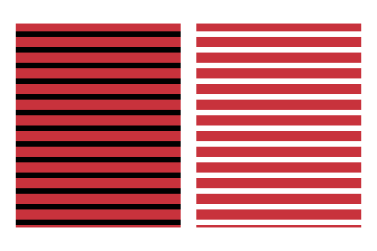
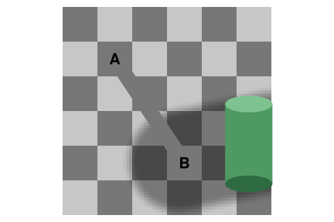
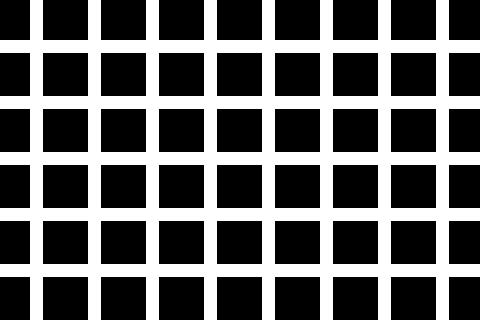
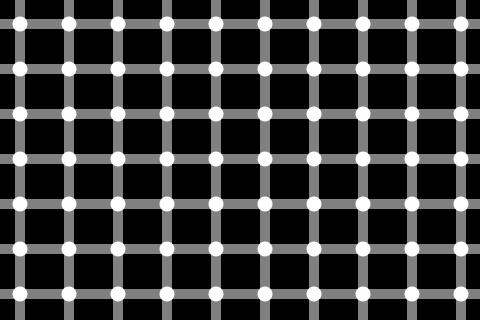
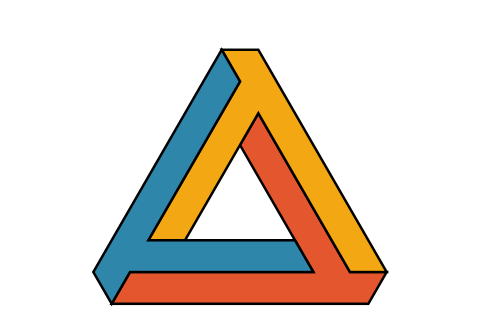

# Farbtäuschungen

*Was das Auge sieht, ist nicht, was auf der Seite steht*

Farbe, Helligkeit, Größe und Form werden nicht Punkt für Punkt vom Bild abgelesen: Das Sehsystem vergleicht jede Fläche mit ihrer Umgebung und schätzt, was dort ist. Diese Täuschungen zeigen das Schätzen bei der Arbeit. Nicht alle betreffen den Farbton; manche brauchen nur den Kontrast zwischen Schwarz und Weiß.

Betrachten Sie die Figuren auf einem Bildschirm oder in einem guten Farbdruck aus bequemer Entfernung. Die Stärke jeder Täuschung ist von Mensch zu Mensch verschieden. Einige arbeiten mit Bewegung oder Flimmern: Hören Sie auf, wenn es unangenehm wird.

> Alle Figuren wurden für dieses Dokument gezeichnet. Die Texte sind kurze Zusammenfassungen nach den verlinkten Wikipedia-Artikeln (verfügbar unter der Lizenz CC BY-SA).

## Inhalt

- **Farbe**
  - [Simultankontrast](#contrast)
  - [Bezold-Effekt](#bezold)
  - [Farbkonstanz](#constancy)
  - [Negatives Nachbild](#afterimage)
  - [Lila Verfolger](#lilac)
  - [McCollough-Effekt](#mccollough)
  - [Chromostereopsis](#chromostereopsis)
- **Helligkeit und Kontrast**
  - [Adelsons Schachbrett-Illusion](#checker)
  - [White- und Munker-Täuschung](#white)
  - [Machsche Streifen](#mach)
  - [Cornsweet-Illusion](#cornsweet)
  - [Gittertäuschungen: Hermann und szintillierend](#grid)
  - [Ehrenstein-Täuschung](#ehrenstein)
  - [Irradiationstäuschung](#irradiation)
- **Größe und Länge**
  - [Ebbinghaus-Täuschung (Titchener-Kreise)](#ebbinghaus)
  - [Müller-Lyer-Illusion](#muller_lyer)
  - [Ponzo-Täuschung](#ponzo)
- **Gebogene und schiefe Linien**
  - [Café-Wall-Illusion](#cafe)
  - [Fraser-Spirale](#fraser)
  - [Hering-Täuschung](#hering)
  - [Wundt-Täuschung](#wundt)
  - [Orbison-Täuschung](#orbison)
  - [Zöllner-Täuschung](#zollner)
  - [Poggendorff-Täuschung](#poggendorff)
  - [Neigungstäuschung und Neigungsnacheffekt](#tilt)
- **Bewegung in stehenden Bildern**
  - [Scheinbewegung](#motion)
  - [Periphere Drift](#drift)
- **Figur, Grund und unmögliche Objekte**
  - [Rubinsche Vase](#rubin)
  - [Penrose-Dreieck](#penrose)

## Farbe

### Simultankontrast

**Was man sieht.** Die vier kleinen Quadrate haben dasselbe Grau. Auf dunklem Grund wirkt es heller als auf hellem; auf Blau neigt es zu Gelb, auf Gelb zu Blau.

**Warum es geschieht.** Farbe wird nach dem Unterschied beurteilt. Das Umfeld drängt die eingeschlossene Fläche in Helligkeit und Farbton von sich weg.

**Zum Ausprobieren.** Schneiden Sie zwei Löcher in ein Blatt, sodass nur zwei der kleinen Quadrate zu sehen sind: Der Unterschied verschwindet.

[Wikipedia-Artikel](https://de.wikipedia.org/wiki/Kontrasteffekt)

### Bezold-Effekt

**Was man sieht.** Das Rot zwischen den schwarzen Streifen wirkt tiefer und dunkler als das Rot zwischen den weißen, das blasser und rosiger wirkt. Es ist ein und dasselbe Rot.

**Warum es geschieht.** Wechseln sich kleine Farbflächen ab, mischt das Auge sie teilweise (Assimilation): Das Rot nimmt etwas vom Nachbarn an. Wilhelm von Bezold bemerkte es, als er Teppiche durch Ändern einer einzigen Farbe umgestaltete.

**Zum Ausprobieren.** Treten Sie von der Seite zurück: Je weiter weg, desto stärker die Mischung.

[Wikipedia-Artikel](https://de.wikipedia.org/wiki/Bezold-Effekt)

### Farbkonstanz

**Was man sieht.** Zwei Kopien eines Mosaiks werden von warmem und von kühlem Licht beleuchtet (die Scheiben oben). Das zweite Feld der zweiten Reihe wirkt links bläulich und rechts gelblich, ist aber dasselbe neutrale Grau.

**Warum es geschieht.** Damit Gegenstände erkennbar bleiben, schätzt das Gehirn die Farbe des Lichts und rechnet sie heraus. Ein Grau in einer ganz orangefarbenen Szene wird als bläuliche Fläche gelesen.

**Zum Ausprobieren.** Decken Sie alles außer den beiden grauen Feldern ab.

[Wikipedia-Artikel](https://de.wikipedia.org/wiki/Farbwahrnehmung%23Farbkonstanz)

### Negatives Nachbild

**Was man sieht.** Nachdem man den Punkt in den bunten Ringen fixiert hat, scheint der einzelne Punkt rechts von Ringen anderer Farben umgeben: Rot, Grün und Gelb.

**Warum es geschieht.** Die Zellen, die auf eine Farbe antworten, ermüden (Adaptation). Auf Weiß antworten die anderen stärker, und man sieht die Komplementärfarbe.

**Zum Ausprobieren.** Fixieren Sie 30 Sekunden lang den linken Punkt, ohne die Augen zu bewegen, schauen Sie dann auf den rechten und blinzeln Sie.

[Wikipedia-Artikel](https://de.wikipedia.org/wiki/Nachbild)

### Lila Verfolger

**Was man sieht.** Fixiert man das Kreuz, läuft eine Lücke durch den Ring der lila Scheiben; dann wird die Lücke zu einer grünen Scheibe, und nach einer Weile können die lila Scheiben ganz verschwinden.

**Warum es geschieht.** Die wandernde Lücke ist Scheinbewegung (Phi-Phänomen). Wo eine Scheibe verschwindet, erscheint ein Nachbild der Gegenfarbe Grün. Die unscharfen, ruhenden Scheiben am Rand verblassen aus dem Bewusstsein (Troxler-Effekt).

**Zum Ausprobieren.** Fixieren Sie das Kreuz mindestens 30 Sekunden. Jeremy Hinton schuf diese Animation vor 2005.

[Wikipedia-Artikel (auf Englisch)](https://en.wikipedia.org/wiki/Lilac_chaser)

### McCollough-Effekt

**Was man sieht.** Nachdem man abwechselnd rote waagrechte und grüne senkrechte Streifen betrachtet hat, wirken die schwarzweißen Felder unten gefärbt: grünlich bei waagrechten und rosa bei senkrechten Streifen.

**Warum es geschieht.** Das Sehsystem passt sich an eine Farbe an, die an eine Orientierung gebunden ist. Celeste McCollough beschrieb den Effekt 1965; er kann Stunden und sogar Monate anhalten.

**Zum Ausprobieren.** Wechseln Sie einige Minuten lang alle paar Sekunden zwischen den beiden farbigen Gittern und schauen Sie dann auf die kleinen Felder. Achtung: Der Effekt kann lange anhalten.

[Wikipedia-Artikel (auf Englisch)](https://en.wikipedia.org/wiki/McCollough_effect)

### Chromostereopsis

**Was man sieht.** Rot und Blau auf Schwarz scheinen nicht in derselben Ebene zu liegen: Für die meisten schwebt das Rot vor dem Blau, für manche liegt es dahinter.

**Warum es geschieht.** Die Augenlinse bricht kurze und lange Wellenlängen verschieden stark (chromatische Aberration); die beiden Farben treffen in jedem Auge auf leicht verschiedene Stellen, und das Gehirn liest den Versatz als Tiefe.

**Zum Ausprobieren.** Schauen Sie in einem dämmrigen Raum mit beiden Augen; probieren Sie es mit und ohne Brille.

[Wikipedia-Artikel (auf Englisch)](https://en.wikipedia.org/wiki/Chromostereopsis)

## Helligkeit und Kontrast

### Adelsons Schachbrett-Illusion

**Was man sieht.** Feld A wirkt viel dunkler als Feld B. Beide haben exakt dasselbe Grau, wie der Balken in der zweiten Figur zeigt.

**Warum es geschieht.** Das Gehirn liest ein Schachbrett mit einem Schatten und korrigiert den Schatten: B muss ein helles Feld sein und wird deshalb hell gesehen. Edward Adelson veröffentlichte die Täuschung 1995.

**Zum Ausprobieren.** Verdecken Sie den Rest des Bretts mit zwei Papieren, sodass nur A und B bleiben.

[Wikipedia-Artikel](https://de.wikipedia.org/wiki/Adelsons_Schachbrett-Illusion)

### White- und Munker-Täuschung

**Was man sieht.** Die grauen Balken in den schwarzen Streifen wirken heller als jene in den weißen. In der farbigen Fassung (Munker) wirkt dasselbe Rot auf einer Seite orange und auf der anderen violett.

**Warum es geschieht.** Anders, als es der einfache Kontrast erwarten ließe, scheint das Auge jeden Balken mit dem Streifen zusammenzufassen, in den er eingesetzt ist.

**Zum Ausprobieren.** Vergleichen Sie die beiden Gruppen durch ein kleines Loch in einem Papier.

[Wikipedia-Artikel (auf Englisch)](https://en.wikipedia.org/wiki/White%27s_illusion)

### Machsche Streifen

**Was man sieht.** Jeder gleichmäßig graue Streifen wirkt neben dem helleren Nachbarn dunkler und neben dem dunkleren heller, als wäre er gerillt.

**Warum es geschieht.** Benachbarte Zellen der Netzhaut hemmen einander (laterale Hemmung), was Kanten übertreibt. Ernst Mach beschrieb den Effekt 1865.

**Zum Ausprobieren.** Decken Sie alle Streifen bis auf einen ab: Er ist völlig gleichmäßig.

[Wikipedia-Artikel](https://de.wikipedia.org/wiki/Machsche_Streifen)

### Cornsweet-Illusion

**Was man sieht.** Die linke Hälfte wirkt heller als die rechte. Abseits der Mitte haben beide dasselbe Grau.

**Warum es geschieht.** Nur die Kante unterscheidet sich: Sie steigt auf der einen Seite an und fällt auf der anderen ab. Das Sehsystem nimmt den Sprung an der Kante als Unterschied der ganzen Flächen.

**Zum Ausprobieren.** Legen Sie einen Stift auf die Mittellinie: Die Hälften werden gleich.

[Wikipedia-Artikel](https://de.wikipedia.org/wiki/Cornsweet-Illusion)

### Gittertäuschungen: Hermann und szintillierend

**Was man sieht.** Im weißen Gitter erscheinen graue Flecken an den Kreuzungen, außer dort, wohin man schaut. Mit Scheiben auf grauem Gitter scheinen schwarze Punkte auf- und abzublitzen.

**Warum es geschieht.** Das Hermann-Gitter (1870) wurde lange allein mit lateraler Hemmung erklärt; spätere Versuche (gebogene Linien beseitigen es) zeigen, dass es auch davon abhängt, wie die Hirnrinde Geraden verarbeitet. Die szintillierende Form wurde in den 1990er Jahren beschrieben.

**Zum Ausprobieren.** Lassen Sie den Blick über das Gitter wandern und fixieren Sie dann eine einzige Kreuzung.

[Wikipedia-Artikel (auf Englisch)](https://en.wikipedia.org/wiki/Grid_illusion)

### Ehrenstein-Täuschung

**Was man sieht.** Wo die Linien vor der Kreuzung enden, scheinen helle Scheiben zu entstehen, weißer als das Papier.

**Warum es geschieht.** Die Linienenden deuten eine obenauf liegende Form an, die die Kreuzungen verdeckt. Das Gehirn zeichnet deren Umriss (Scheinkontur) und füllt ihn mit Helligkeit.

**Zum Ausprobieren.** Schließen Sie die Lücken in Gedanken oder mit einem Stift: Die Scheiben verschwinden.

[Wikipedia-Artikel](https://de.wikipedia.org/wiki/Ehrenstein-T%C3%A4uschung)

### Irradiationstäuschung

**Was man sieht.** Das weiße Quadrat auf Schwarz wirkt größer als das schwarze auf Weiß, obwohl beide gleich groß sind.

**Warum es geschieht.** Licht wird im Auge gestreut, und eine helle Fläche breitet sich auf der Netzhaut aus. Galilei erwähnte dies 1632; Helmholtz gab ihm den Namen.

**Zum Ausprobieren.** Messen Sie die beiden Quadrate.

[Wikipedia-Artikel](https://de.wikipedia.org/wiki/Irradiation)

## Größe und Länge

### Ebbinghaus-Täuschung (Titchener-Kreise)

**Was man sieht.** Der orange Kreis zwischen großen Kreisen wirkt kleiner als der zwischen kleinen.

**Warum es geschieht.** Größe wird im Verhältnis zum Umfeld beurteilt; auch Abstand und Dichte der umgebenden Kreise zählen.

**Zum Ausprobieren.** Verdecken Sie die blauen Kreise mit den Fingern.

[Wikipedia-Artikel](https://de.wikipedia.org/wiki/Ebbinghaus-T%C3%A4uschung)

### Müller-Lyer-Illusion

**Was man sieht.** Die Linie mit nach außen gerichteten Flügeln wirkt länger als die mit nach innen gerichteten. Beide sind gleich lang, wie die rote Linie darunter.

**Warum es geschieht.** Die Flügel verschieben, wo die Linienenden zu liegen scheinen; eine Erklärung verbindet sie mit den Ecken räumlich gesehener Zimmer und Gebäude. Franz Müller-Lyer beschrieb die Täuschung 1889.

**Zum Ausprobieren.** Vergleichen Sie beide Linien mit den gestrichelten Hilfslinien.

[Wikipedia-Artikel](https://de.wikipedia.org/wiki/M%C3%BCller-Lyer-Illusion)

### Ponzo-Täuschung

**Was man sieht.** Der obere gelbe Balken wirkt länger als der untere.

**Warum es geschieht.** Zusammenlaufende Linien deuten Entfernung an wie Bahngleise: Ein auf der Seite gleich großer, aber weiter entfernter Balken müsste größer sein.

**Zum Ausprobieren.** Messen Sie beide Balken oder drehen Sie die Seite auf den Kopf.

[Wikipedia-Artikel](https://de.wikipedia.org/wiki/Ponzo-T%C3%A4uschung)

## Gebogene und schiefe Linien

### Café-Wall-Illusion

**Was man sieht.** Die grauen Fugen scheinen abwechselnd schief zu verlaufen, obwohl sie parallel und waagrecht sind.

**Warum es geschieht.** Die versetzten schwarzen und weißen Fliesen mit einer Fuge in mittlerem Grau erzeugen kleine schräge Elemente entlang jeder Linie. Richard Gregory benannte sie 1973 nach der Wand eines Cafés in Bristol.

**Zum Ausprobieren.** Schauen Sie fast von der Kante her an einer Fuge entlang.

[Wikipedia-Artikel](https://de.wikipedia.org/wiki/Caf%C3%A9_Wall_Illusion)

### Fraser-Spirale

**Was man sieht.** Eine Spirale scheint sich zur Mitte zu winden. Es gibt keine Spirale: Die schwarzweißen Schnüre bilden konzentrische Kreise.

**Warum es geschieht.** Jedes kurze Stück ist geneigt, und der verdrehte Hintergrund verstärkt die Neigung, sodass das Auge sie zu einer Spirale verbindet. James Fraser beschrieb sie 1908.

**Zum Ausprobieren.** Legen Sie einen Finger auf eine Schnur und folgen Sie ihr: Sie kommen am Ausgangspunkt an.

[Wikipedia-Artikel](https://de.wikipedia.org/wiki/Fraser-Spirale)

### Hering-Täuschung

**Was man sieht.** Die beiden roten Linien scheinen sich in der Mitte nach außen zu wölben. Sie sind gerade und parallel.

**Warum es geschieht.** Die Winkel zu den strahlenförmigen Linien werden überschätzt, und das Muster deutet zudem Bewegung in die Tiefe an. Ewald Hering entdeckte die Täuschung 1861.

**Zum Ausprobieren.** Halten Sie ein Lineal an eine rote Linie.

[Wikipedia-Artikel](https://de.wikipedia.org/wiki/Hering-T%C3%A4uschung)

### Wundt-Täuschung

**Was man sieht.** Die beiden roten Linien scheinen sich in der Mitte nach innen, aufeinander zu, zu biegen. Sie sind gerade und parallel.

**Warum es geschieht.** Das Gegenstück zur Hering-Figur: Die Strahlen gehen hier von Punkten zu beiden Seiten aus, sodass die Winkel die roten Linien andersherum verbiegen. Wilhelm Wundt beschrieb sie 1898.

**Zum Ausprobieren.** Vergleichen Sie mit der Hering-Täuschung.

[Wikipedia-Artikel](https://de.wikipedia.org/wiki/Wundt-T%C3%A4uschung)

### Orbison-Täuschung

**Was man sieht.** Das rote Quadrat wirkt verzerrt, mit gebogenen Seiten und gezogenen Ecken.

**Warum es geschieht.** Wie bei Hering verfälschen die Kreuzungen mit den Ringen im Hintergrund die wahrgenommene Richtung jeder Seite. William Orbison beschrieb sie 1939.

**Zum Ausprobieren.** Prüfen Sie die Seiten mit einem Lineal.

[Wikipedia-Artikel](https://de.wikipedia.org/wiki/Orbison-T%C3%A4uschung)

### Zöllner-Täuschung

**Was man sieht.** Die langen Diagonalen scheinen zusammen- und auseinanderzulaufen. Sie sind parallel.

**Warum es geschieht.** Die kurzen Striche kreuzen sie schräg, und das Sehsystem übertreibt spitze Winkel, wodurch jede Linie leicht gedreht erscheint. Johann Zöllner berichtete 1860 davon.

**Zum Ausprobieren.** Blicken Sie von einer Seitenecke aus an den langen Linien entlang.

[Wikipedia-Artikel](https://de.wikipedia.org/wiki/Z%C3%B6llner-T%C3%A4uschung)

### Poggendorff-Täuschung

**Was man sieht.** Die schwarze Linie, die links in den grauen Block eintritt, scheint als blaue Linie herauszukommen. Sie kommt als obere schwarze heraus, wie die zweite Figur zeigt.

**Warum es geschieht.** Spitze Winkel zwischen Linie und Block werden größer gesehen, als sie sind, wodurch sich der scheinbare Verlauf verschiebt. Bemerkt wurde dies an Zöllners eigenen Zeichnungen.

**Zum Ausprobieren.** Verlängern Sie die linke Linie mit einem Lineal.

[Wikipedia-Artikel](https://de.wikipedia.org/wiki/Poggendorff-T%C3%A4uschung)

### Neigungstäuschung und Neigungsnacheffekt

**Was man sieht.** Die Streifen in den beiden inneren Scheiben sind senkrecht, scheinen sich aber von den umgebenden Streifen wegzuneigen.

**Warum es geschieht.** Zellen für benachbarte Orientierungen hemmen einander und stoßen den wahrgenommenen Winkel ab. Langes Betrachten schräger Streifen wirkt ähnlich auf das danach Gesehene.

**Zum Ausprobieren.** Decken Sie die äußeren Ringe ab und vergleichen Sie die inneren Scheiben.

[Wikipedia-Artikel (auf Englisch)](https://en.wikipedia.org/wiki/Visual_tilt_effects)

## Bewegung in stehenden Bildern

### Scheinbewegung

**Was man sieht.** Die Räder scheinen sich langsam zu drehen, besonders die, die man nicht direkt anschaut.

**Warum es geschieht.** Blöcke verschiedenen Kontrasts werden mit leicht verschiedener Verzögerung verarbeitet, und jede kleine Augenbewegung startet die Folge neu; Bewegungsdetektoren lesen sie als Bewegung.

**Zum Ausprobieren.** Wandern Sie mit dem Blick von Rad zu Rad oder blinzeln Sie.

[Wikipedia-Artikel (auf Englisch)](https://en.wikipedia.org/wiki/Illusory_motion)

### Periphere Drift

**Was man sieht.** Die Ringe aus Grauverläufen scheinen sich zu drehen, wenn man sie aus dem Augenwinkel sieht.

**Warum es geschieht.** Ein wiederholter Verlauf von Dunkel nach Hell (Sägezahn) reizt Bewegungsdetektoren am Rand des Gesichtsfelds; gesehen wird Bewegung von Dunkel nach Hell.

**Zum Ausprobieren.** Schauen Sie neben die Figur und blinzeln Sie rasch.

[Wikipedia-Artikel (auf Englisch)](https://en.wikipedia.org/wiki/Peripheral_drift_illusion)

## Figur, Grund und unmögliche Objekte

### Rubinsche Vase

**Was man sieht.** Eine helle Vase oder zwei dunkle Gesichter, die sich anschauen: das eine oder das andere, kaum beides zugleich.

**Warum es geschieht.** Die gemeinsame Kontur kann jeweils nur zu einer Seite gehören: Was als Figur gilt, erhält die Form, der Rest wird Hintergrund. Edgar Rubin untersuchte sie um 1915.

**Zum Ausprobieren.** Versuchen Sie, willentlich zu wechseln, und zählen Sie, wie oft es von selbst umspringt.

[Wikipedia-Artikel (auf Englisch)](https://en.wikipedia.org/wiki/Rubin_vase)

### Penrose-Dreieck

**Was man sieht.** Ein massives Dreieck aus drei Vierkantbalken, jeder rechtwinklig mit dem nächsten verbunden.

**Warum es geschieht.** Jede Ecke ist für sich stimmig, aber alle drei können nicht zugleich wahr sein: Ein solches Objekt gibt es nicht. Oscar Reutersvärd zeichnete es 1934; Lionel und Roger Penrose machten es bekannt, und es inspirierte M. C. Eschers Wasserfall.

**Zum Ausprobieren.** Decken Sie jeweils eine Ecke ab: Der Rest wird möglich.

[Wikipedia-Artikel](https://de.wikipedia.org/wiki/Penrose-Dreieck)
