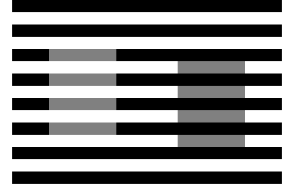
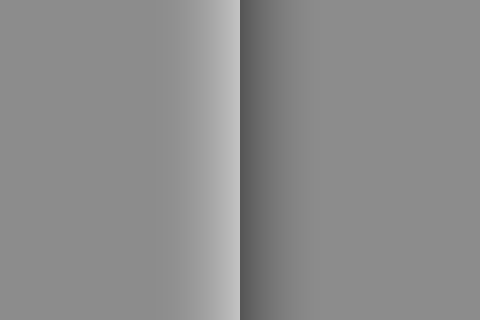
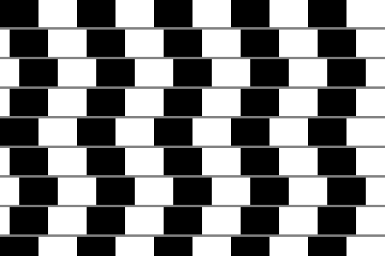

# Colour Illusions

*What the eye sees is not what is on the page*

Colour, brightness, size and shape are not read off the image point by point: the visual system compares each area with its surroundings and guesses what is out there. These illusions show that guessing at work. Not all of them are about hue; several need only the contrast between black and white.

Look at the figures on a screen or on a good colour print, at a comfortable distance. The strength of each illusion varies from person to person. A few use movement or flicker: stop if they bother you.

> All figures were drawn for this document. The texts are short summaries based on the linked Wikipedia articles (available under the CC BY-SA licence).

## Contents

- **Colour**
  - [Simultaneous contrast](#contrast)
  - [Bezold effect](#bezold)
  - [Colour constancy](#constancy)
  - [Negative afterimage](#afterimage)
  - [Lilac chaser](#lilac)
  - [McCollough effect](#mccollough)
  - [Chromostereopsis](#chromostereopsis)
- **Brightness and contrast**
  - [Checker shadow illusion](#checker)
  - [White's illusion and Munker](#white)
  - [Mach bands](#mach)
  - [Cornsweet illusion](#cornsweet)
  - [Grid illusions: Hermann and scintillating](#grid)
  - [Ehrenstein illusion](#ehrenstein)
  - [Irradiation illusion](#irradiation)
- **Size and length**
  - [Ebbinghaus illusion (Titchener circles)](#ebbinghaus)
  - [Müller-Lyer illusion](#muller_lyer)
  - [Ponzo illusion](#ponzo)
- **Bent and tilted lines**
  - [Café wall illusion](#cafe)
  - [Fraser spiral illusion](#fraser)
  - [Hering illusion](#hering)
  - [Wundt illusion](#wundt)
  - [Orbison illusion](#orbison)
  - [Zöllner illusion](#zollner)
  - [Poggendorff illusion](#poggendorff)
  - [Tilt illusion and tilt aftereffect](#tilt)
- **Motion in still pictures**
  - [Illusory motion](#motion)
  - [Peripheral drift illusion](#drift)
- **Figure, ground and impossible objects**
  - [Rubin vase](#rubin)
  - [Penrose triangle](#penrose)

## Colour

### Simultaneous contrast

**What you see.** The four small squares are the same grey. On the dark ground it looks lighter than on the light one; on blue it leans toward yellow, and on yellow toward blue.

**Why it happens.** Colour is judged by difference. A surround pushes the area inside it away from itself, in lightness and in hue.

**Try this.** Cut two holes in a sheet of paper so that only two of the small squares show: the difference disappears.

[Wikipedia article](https://en.wikipedia.org/wiki/Contrast_effect)

### Bezold effect

**What you see.** The red behind the black stripes looks deeper and darker than the red behind the white stripes, which looks paler and pinker. It is one and the same red.

**Why it happens.** When small areas of colour alternate, the eye partly blends them (assimilation): the red takes on some of its neighbour. Wilhelm von Bezold noticed it while redesigning rugs by changing a single colour.

**Try this.** Step back from the page: the further away you are, the stronger the blend.

[Wikipedia article](https://en.wikipedia.org/wiki/Bezold_effect)

### Colour constancy

**What you see.** Two copies of a mosaic are lit by a warm and by a cool light (the discs above). The second tile of the second row looks bluish on the left and yellowish on the right, yet it is the same neutral grey.

**Why it happens.** To keep objects recognisable, the brain estimates the colour of the light and discounts it. A grey seen in a scene that is all orange is read as a bluish surface.

**Try this.** Cover everything except the two grey tiles.

[Wikipedia article](https://en.wikipedia.org/wiki/Color_constancy)

### Negative afterimage

**What you see.** After staring at the dot in the coloured rings, the plain dot on the right seems to be surrounded by rings of other colours: red, green and yellow.

**Why it happens.** The cells that respond to a colour tire (adapt). On a white surface the other cells answer more strongly and you see the complementary colour.

**Try this.** Stare at the left dot for 30 seconds without moving your eyes, then look at the right dot and blink.

[Wikipedia article](https://en.wikipedia.org/wiki/Afterimage)

### Lilac chaser

**What you see.** Staring at the cross, a gap runs round the ring of lilac discs; then the gap turns into a green disc, and after a while the lilac discs may fade away altogether.

**Why it happens.** The moving gap is apparent motion (the phi phenomenon). Where a disc vanishes, an afterimage of the opposite colour, green, appears. The blurred discs that stay still in the periphery fade from awareness (Troxler's effect).

**Try this.** Fix your eyes on the cross for at least 30 seconds. Jeremy Hinton created this animation before 2005.

[Wikipedia article](https://en.wikipedia.org/wiki/Lilac_chaser)

### McCollough effect

**What you see.** After looking in turn at red horizontal and green vertical stripes, the black and white patches below look tinted: greenish where the stripes are horizontal and pink where they are vertical.

**Why it happens.** The visual system adapts to a colour tied to an orientation. Celeste McCollough described it in 1965; it can last for hours and even months.

**Try this.** Alternate between the two coloured gratings, a few seconds each, for several minutes, then look at the small patches. Note that the effect can persist for a long time.

[Wikipedia article](https://en.wikipedia.org/wiki/McCollough_effect)

### Chromostereopsis

**What you see.** Red and blue on black do not seem to lie in the same plane: for most people the red floats in front of the blue, for some it sinks behind.

**Why it happens.** The lens bends short and long wavelengths by different amounts (chromatic aberration), so the two colours land in slightly different places in each eye, and the brain reads the offset as depth.

**Try this.** View it in a dim room, with both eyes; try with and without glasses.

[Wikipedia article](https://en.wikipedia.org/wiki/Chromostereopsis)

## Brightness and contrast

### Checker shadow illusion

**What you see.** Square A looks much darker than square B. They are exactly the same grey, as the bar in the second figure shows.

**Why it happens.** The brain reads a chequered floor with a shadow on it and corrects for the shadow: B must be a light square, so it is seen as light. Edward Adelson published the illusion in 1995.

**Try this.** Hide the rest of the board with two pieces of paper, leaving only A and B.

[Wikipedia article](https://en.wikipedia.org/wiki/Checker_shadow_illusion)

### White's illusion and Munker

**What you see.** The grey bars set into the black stripes look lighter than those set into the white stripes. In the coloured version (Munker), the same red looks orange on one side and purplish on the other.

**Why it happens.** Surprisingly, each bar looks more like the stripe it replaces lies next to, against what simple contrast would predict: the eye seems to group each bar with the stripe it belongs to.

**Try this.** Compare the two groups through a small hole cut in paper.

[Wikipedia article](https://en.wikipedia.org/wiki/White%27s_illusion)

### Mach bands

**What you see.** Each flat grey strip looks darker near its lighter neighbour and lighter near its darker one, as if the strips were fluted.

**Why it happens.** Neighbouring cells in the retina inhibit one another (lateral inhibition), which exaggerates edges. Ernst Mach described the effect in 1865.

**Try this.** Cover all strips but one: it is perfectly even.

[Wikipedia article](https://en.wikipedia.org/wiki/Mach_bands)

### Cornsweet illusion

**What you see.** The left half looks lighter than the right half. Away from the middle, both are the same grey.

**Why it happens.** Only the edge differs, rising on one side and falling on the other. The visual system takes the step at the edge as the difference between the whole areas.

**Try this.** Lay a pencil along the middle line and watch the two halves become equal.

[Wikipedia article](https://en.wikipedia.org/wiki/Cornsweet_illusion)

### Grid illusions: Hermann and scintillating

**What you see.** In the white grid, grey smudges appear at the crossings, except where you look. With discs on a grey grid, black dots seem to flash on and off.

**Why it happens.** Hermann's grid (1870) was long explained by lateral inhibition alone; later experiments (bending the lines removes it) show that it also depends on how the cortex handles straight lines. The scintillating version was reported in the 1990s.

**Try this.** Let your eyes wander over the grid, then fix a single crossing.

[Wikipedia article](https://en.wikipedia.org/wiki/Grid_illusion)

### Ehrenstein illusion

**What you see.** Where the lines stop short of each other, bright discs seem to appear, whiter than the paper.

**Why it happens.** The line ends suggest a shape lying on top and hiding the crossings. The brain draws its outline (an illusory contour) and fills it with brightness.

**Try this.** Close the gaps in your mind, or with a pencil: the discs vanish.

[Wikipedia article](https://en.wikipedia.org/wiki/Ehrenstein_illusion)

### Irradiation illusion

**What you see.** The white square on black looks larger than the black square on white, although they are the same size.

**Why it happens.** Light scatters inside the eye and a bright area spreads on the retina. Galileo mentioned it in 1632; Helmholtz gave it its name.

**Try this.** Measure the two squares.

[Wikipedia article](https://en.wikipedia.org/wiki/Irradiation_illusion)

## Size and length

### Ebbinghaus illusion (Titchener circles)

**What you see.** The orange circle surrounded by large circles looks smaller than the one surrounded by small circles.

**Why it happens.** Size is judged relative to the context; the distance and spacing of the surrounding circles also matter.

**Try this.** Cover the blue circles with your fingers.

[Wikipedia article](https://en.wikipedia.org/wiki/Ebbinghaus_illusion)

### Müller-Lyer illusion

**What you see.** The line with outward fins looks longer than the one with inward fins. Both are equal, like the red line below.

**Why it happens.** The fins shift where the ends of the line seem to be; one account links them to the corners of rooms and buildings seen in depth. Franz Müller-Lyer described it in 1889.

**Try this.** Compare both shafts with the dashed guides.

[Wikipedia article](https://en.wikipedia.org/wiki/M%C3%BCller-Lyer_illusion)

### Ponzo illusion

**What you see.** The upper yellow bar looks longer than the lower one.

**Why it happens.** Converging lines suggest distance, like railway tracks: a bar of the same size on the page, but farther away, would have to be larger.

**Try this.** Measure the two bars, or turn the page upside down.

[Wikipedia article](https://en.wikipedia.org/wiki/Ponzo_illusion)

## Bent and tilted lines

### Café wall illusion

**What you see.** The grey mortar lines seem to slope alternately, although they are parallel and level.

**Why it happens.** The offset black and white tiles, with a mortar of intermediate grey, create small tilted elements along each line. Richard Gregory named it in 1973 after a café wall in Bristol.

**Try this.** Look along a mortar line with the page almost edge-on.

[Wikipedia article](https://en.wikipedia.org/wiki/Caf%C3%A9_wall_illusion)

### Fraser spiral illusion

**What you see.** A spiral seems to wind into the centre. There is no spiral: the black and white strands form concentric circles.

**Why it happens.** Each short strand is tilted, and the twisted background adds to the tilt, so the eye joins them into a spiral. James Fraser described it in 1908.

**Try this.** Put a finger on one strand and follow it: you come back to where you started.

[Wikipedia article](https://en.wikipedia.org/wiki/Fraser_spiral_illusion)

### Hering illusion

**What you see.** The two red lines seem to bow apart near the middle. They are straight and parallel.

**Why it happens.** The angles with the radiating lines are overestimated, and the pattern also suggests motion into depth. Ewald Hering discovered it in 1861.

**Try this.** Hold a ruler along a red line.

[Wikipedia article](https://en.wikipedia.org/wiki/Hering_illusion)

### Wundt illusion

**What you see.** The two red lines seem to bow inward, toward each other, in the middle. They are straight and parallel.

**Why it happens.** It is the counterpart of Hering's figure: the radiating lines now spread from points on either side, so the angles bias the red lines the other way. Wilhelm Wundt described it in 1898.

**Try this.** Compare it with the Hering illusion.

[Wikipedia article](https://en.wikipedia.org/wiki/Wundt_illusion)

### Orbison illusion

**What you see.** The red square looks distorted, its sides bent and its corners pulled.

**Why it happens.** As in Hering's figure, the crossings with the background rings bias the perceived direction of each side. William Orbison described it in 1939.

**Try this.** Check the sides with a ruler.

[Wikipedia article](https://en.wikipedia.org/wiki/Orbison_illusion)

### Zöllner illusion

**What you see.** The long diagonal lines seem to converge and diverge. They are parallel.

**Why it happens.** The short strokes cross them at an angle and the visual system exaggerates acute angles, turning each line a little. Johann Zöllner reported it in 1860.

**Try this.** Look along the long lines from one corner of the page.

[Wikipedia article](https://en.wikipedia.org/wiki/Z%C3%B6llner_illusion)

### Poggendorff illusion

**What you see.** The black line entering the grey block on the left seems to come out as the blue line. It comes out as the upper black one, as the second figure shows.

**Why it happens.** Acute angles between the line and the block are seen as wider than they are, shifting the apparent path. It was noticed in Zöllner's own drawings.

**Try this.** Extend the left line with a ruler.

[Wikipedia article](https://en.wikipedia.org/wiki/Poggendorff_illusion)

### Tilt illusion and tilt aftereffect

**What you see.** The stripes in the two inner discs are both vertical, but seem to lean away from the stripes around them.

**Why it happens.** Cells tuned to nearby orientations inhibit one another, repelling the perceived angle. Looking long at tilted stripes has a similar effect on what you see next.

**Try this.** Cover the outer rings and compare the inner discs.

[Wikipedia article](https://en.wikipedia.org/wiki/Visual_tilt_effects)

## Motion in still pictures

### Illusory motion

**What you see.** The rings seem to turn slowly, especially those you are not looking at directly.

**Why it happens.** Blocks of different contrast are processed with slightly different delays, and each small eye movement restarts the sequence; motion detectors read it as movement.

**Try this.** Move your gaze from one wheel to another, or blink.

[Wikipedia article](https://en.wikipedia.org/wiki/Illusory_motion)

### Peripheral drift illusion

**What you see.** The rings made of grey ramps appear to rotate when seen out of the corner of the eye.

**Why it happens.** A repeating ramp from dark to light (a sawtooth) stimulates motion detectors in the periphery; the motion is seen from dark to light.

**Try this.** Look to the side of the figure and blink quickly.

[Wikipedia article](https://en.wikipedia.org/wiki/Peripheral_drift_illusion)

## Figure, ground and impossible objects

### Rubin vase

**What you see.** A pale vase, or two dark faces looking at each other: one or the other, hardly both at once.

**Why it happens.** The shared outline can belong to only one side at a time: what is taken as the figure gets the shape and the rest becomes background. Edgar Rubin studied it around 1915.

**Try this.** Try to switch at will, and count how often it flips by itself.

[Wikipedia article](https://en.wikipedia.org/wiki/Rubin_vase)

### Penrose triangle

**What you see.** A solid triangle of three square beams, each joined to the next at a right angle.

**Why it happens.** Every corner is consistent on its own, but the three cannot be true together: no such object exists. Oscar Reutersvärd drew it in 1934; Lionel and Roger Penrose made it popular, and it inspired M. C. Escher's Waterfall.

**Try this.** Cover one corner at a time: the rest becomes possible.

[Wikipedia article](https://en.wikipedia.org/wiki/Penrose_triangle)
