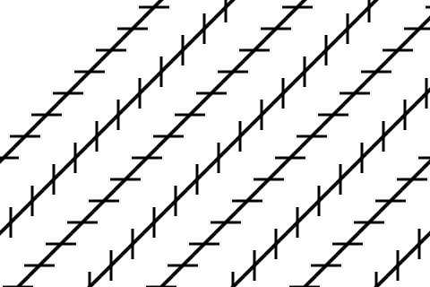

# Ilusiones de Color

*Lo que ve el ojo no es lo que hay en la página*

El color, la luminosidad, el tamaño y la forma no se leen punto por punto en la imagen: el sistema visual compara cada zona con su entorno y estima lo que hay. Estas ilusiones muestran esa estimación en marcha. No todas tienen que ver con el tono; varias solo necesitan el contraste entre blanco y negro.

Mire las figuras en una pantalla o en una buena impresión en color, a una distancia cómoda. La intensidad de cada ilusión varía de una persona a otra. Algunas usan movimiento o parpadeo: deténgase si le molestan.

> Todas las figuras se han dibujado para este documento. Los textos son resúmenes breves basados en los artículos de Wikipedia indicados (disponibles con licencia CC BY-SA).

## Índice

- **Color**
  - [Contraste simultáneo](#contrast)
  - [Efecto Bezold](#bezold)
  - [Constancia del color](#constancy)
  - [Imagen remanente negativa](#afterimage)
  - [Perseguidor lila](#lilac)
  - [Efecto McCollough](#mccollough)
  - [Cromoestereopsis](#chromostereopsis)
- **Luminosidad y contraste**
  - [Ilusión de la sombra en el tablero](#checker)
  - [Ilusión de White y de Munker](#white)
  - [Bandas de Mach](#mach)
  - [Ilusión de Cornsweet](#cornsweet)
  - [Ilusiones de rejilla: Hermann y centelleante](#grid)
  - [Ilusión de Ehrenstein](#ehrenstein)
  - [Ilusión de irradiación](#irradiation)
- **Tamaño y longitud**
  - [Ilusión de Ebbinghaus (círculos de Titchener)](#ebbinghaus)
  - [Ilusión de Müller-Lyer](#muller_lyer)
  - [Ilusión de Ponzo](#ponzo)
- **Líneas curvadas e inclinadas**
  - [Ilusión de la pared del café](#cafe)
  - [Espiral de Fraser](#fraser)
  - [Ilusión de Hering](#hering)
  - [Ilusión de Wundt](#wundt)
  - [Ilusión de Orbison](#orbison)
  - [Ilusión de Zöllner](#zollner)
  - [Ilusión de Poggendorff](#poggendorff)
  - [Ilusión y efecto posterior de inclinación](#tilt)
- **Movimiento en imágenes fijas**
  - [Movimiento ilusorio](#motion)
  - [Deriva periférica](#drift)
- **Figura, fondo y objetos imposibles**
  - [Copa de Rubin](#rubin)
  - [Triángulo de Penrose](#penrose)

## Color

### Contraste simultáneo

**Lo que se ve.** Los cuatro cuadrados pequeños son del mismo gris. Sobre el fondo oscuro parece más claro que sobre el claro; sobre azul tira a amarillo y sobre amarillo tira a azul.

**Por qué ocurre.** El color se juzga por diferencia. El fondo aleja de sí la zona que rodea, en luminosidad y en tono.

**Pruebe.** Haga dos agujeros en un papel para ver solo dos de los cuadrados pequeños: la diferencia desaparece.

[Artículo en Wikipedia](https://es.wikipedia.org/wiki/Efecto_contraste)

### Efecto Bezold

**Lo que se ve.** El rojo entre rayas negras parece más profundo y oscuro que el rojo entre rayas blancas, que parece más pálido y rosado. Es un único rojo.

**Por qué ocurre.** Cuando se alternan pequeñas áreas de color, el ojo las mezcla en parte (asimilación): el rojo toma algo de su vecino. Wilhelm von Bezold lo observó al rediseñar alfombras cambiando un solo color.

**Pruebe.** Aléjese de la página: cuanto más lejos, más fuerte la mezcla.

[Artículo en Wikipedia](https://es.wikipedia.org/wiki/Efecto_Bezold)

### Constancia del color

**Lo que se ve.** Dos copias de un mosaico están iluminadas por una luz cálida y otra fría (los discos de arriba). La segunda pieza de la segunda fila parece azulada a la izquierda y amarillenta a la derecha, pero es el mismo gris neutro.

**Por qué ocurre.** Para reconocer los objetos, el cerebro estima el color de la luz y lo descuenta. Un gris en una escena toda anaranjada se lee como una superficie azulada.

**Pruebe.** Tape todo menos las dos piezas grises.

[Artículo en Wikipedia (en inglés)](https://en.wikipedia.org/wiki/Color_constancy)

### Imagen remanente negativa

**Lo que se ve.** Tras fijar la vista en el punto de los anillos de colores, el punto solo de la derecha parece rodeado de anillos de otros colores: rojo, verde y amarillo.

**Por qué ocurre.** Las células que responden a un color se cansan (se adaptan). Sobre blanco, las demás responden con más fuerza y se ve el color complementario.

**Pruebe.** Mire el punto izquierdo 30 segundos sin mover los ojos, luego mire el punto derecho y parpadee.

[Artículo en Wikipedia](https://es.wikipedia.org/wiki/Imagen_remanente)

### Perseguidor lila

**Lo que se ve.** Con la vista en la cruz, un hueco recorre el anillo de discos lilas; después el hueco se convierte en un disco verde y, al cabo de un rato, los discos lilas pueden desaparecer.

**Por qué ocurre.** El hueco que avanza es movimiento aparente (fenómeno phi). Donde desaparece un disco surge una imagen remanente del color opuesto, verde. Los discos borrosos y quietos en la periferia se desvanecen (efecto Troxler).

**Pruebe.** Fije la cruz al menos 30 segundos. Jeremy Hinton creó esta animación antes de 2005.

[Artículo en Wikipedia](https://es.wikipedia.org/wiki/Perseguidor_del_lila)

### Efecto McCollough

**Lo que se ve.** Tras mirar por turnos rayas horizontales rojas y verticales verdes, las manchas en blanco y negro de abajo parecen teñidas: verdosas donde las rayas son horizontales y rosadas donde son verticales.

**Por qué ocurre.** El sistema visual se adapta a un color ligado a una orientación. Celeste McCollough lo describió en 1965; puede durar horas e incluso meses.

**Pruebe.** Alterne entre las dos rejillas de color, unos segundos en cada una, durante varios minutos, y mire después las manchas pequeñas. Atención: el efecto puede persistir mucho.

[Artículo en Wikipedia](https://es.wikipedia.org/wiki/Efecto_McCollough)

### Cromoestereopsis

**Lo que se ve.** El rojo y el azul sobre negro no parecen estar en el mismo plano: para la mayoría el rojo flota delante del azul; para algunas personas queda detrás.

**Por qué ocurre.** El cristalino desvía de forma distinta las longitudes de onda cortas y largas (aberración cromática), los dos colores caen en sitios algo distintos en cada ojo y el cerebro lee el desfase como profundidad.

**Pruebe.** Mírelo en una sala con poca luz, con ambos ojos; pruebe con gafas y sin ellas.

[Artículo en Wikipedia (en inglés)](https://en.wikipedia.org/wiki/Chromostereopsis)

## Luminosidad y contraste

### Ilusión de la sombra en el tablero

**Lo que se ve.** El cuadrado A parece mucho más oscuro que el B. Son exactamente del mismo gris, como muestra la barra de la segunda figura.

**Por qué ocurre.** El cerebro ve un suelo a cuadros con una sombra y la corrige: B tiene que ser un cuadrado claro, así que se ve claro. Edward Adelson publicó la ilusión en 1995.

**Pruebe.** Tape el resto del tablero con dos papeles, dejando solo A y B.

[Artículo en Wikipedia](https://es.wikipedia.org/wiki/Tablero_de_ajedrez_de_Adelson)

### Ilusión de White y de Munker

**Lo que se ve.** Las barras grises metidas en las rayas negras parecen más claras que las metidas en las rayas blancas. En la versión en color (Munker), el mismo rojo parece anaranjado a un lado y violáceo al otro.

**Por qué ocurre.** Sorprendentemente, el resultado contradice lo que predeciría el contraste simple: el ojo parece agrupar cada barra con la raya a la que pertenece.

**Pruebe.** Compare los dos grupos a través de un agujero pequeño en un papel.

[Artículo en Wikipedia (en inglés)](https://en.wikipedia.org/wiki/White%27s_illusion)

### Bandas de Mach

**Lo que se ve.** Cada franja gris lisa parece más oscura junto a su vecina clara y más clara junto a la oscura, como si las franjas fueran acanaladas.

**Por qué ocurre.** Las células vecinas de la retina se inhiben entre sí (inhibición lateral), lo que exagera los bordes. Ernst Mach describió el efecto en 1865.

**Pruebe.** Tape todas las franjas menos una: es perfectamente uniforme.

[Artículo en Wikipedia](https://es.wikipedia.org/wiki/Bandas_de_Mach)

### Ilusión de Cornsweet

**Lo que se ve.** La mitad izquierda parece más clara que la derecha. Lejos del centro, son del mismo gris.

**Por qué ocurre.** Solo el borde difiere, subiendo a un lado y bajando al otro. El sistema visual toma el escalón del borde como la diferencia entre las áreas enteras.

**Pruebe.** Ponga un lápiz sobre la línea central y verá igualarse las dos mitades.

[Artículo en Wikipedia](https://es.wikipedia.org/wiki/Ilusi%C3%B3n_de_Cornsweet)

### Ilusiones de rejilla: Hermann y centelleante

**Lo que se ve.** En la rejilla blanca aparecen manchas grises en los cruces, salvo donde se mira. Con discos sobre una rejilla gris, puntos negros parecen encenderse y apagarse.

**Por qué ocurre.** La rejilla de Hermann (1870) se explicó mucho tiempo solo por inhibición lateral; experimentos posteriores (curvar las líneas la elimina) muestran que depende también de cómo trata la corteza las líneas rectas. La versión centelleante se describió en los 90.

**Pruebe.** Pasee la mirada por la rejilla y después fije un solo cruce.

[Artículo en Wikipedia (en inglés)](https://en.wikipedia.org/wiki/Grid_illusion)

### Ilusión de Ehrenstein

**Lo que se ve.** Donde las líneas se detienen antes de cruzarse parecen surgir discos luminosos, más blancos que el papel.

**Por qué ocurre.** Los extremos de las líneas sugieren una forma encima que tapa los cruces. El cerebro dibuja su contorno (contorno ilusorio) y lo llena de brillo.

**Pruebe.** Cierre los huecos con la imaginación, o con un lápiz: los discos desaparecen.

[Artículo en Wikipedia](https://es.wikipedia.org/wiki/Ilusi%C3%B3n_de_Ehrenstein)

### Ilusión de irradiación

**Lo que se ve.** El cuadrado blanco sobre negro parece mayor que el negro sobre blanco, pero miden lo mismo.

**Por qué ocurre.** La luz se dispersa dentro del ojo y una zona clara se ensancha en la retina. Galileo la menciona en 1632; Helmholtz le dio nombre.

**Pruebe.** Mida los dos cuadrados.

[Artículo en Wikipedia](https://es.wikipedia.org/wiki/Irradiaci%C3%B3n_%28%C3%B3ptica%29)

## Tamaño y longitud

### Ilusión de Ebbinghaus (círculos de Titchener)

**Lo que se ve.** El círculo naranja rodeado de círculos grandes parece menor que el rodeado de círculos pequeños.

**Por qué ocurre.** El tamaño se juzga según el contexto; la distancia y la separación de los círculos de alrededor también influyen.

**Pruebe.** Tape los círculos azules con los dedos.

[Artículo en Wikipedia](https://es.wikipedia.org/wiki/Ilusi%C3%B3n_de_Ebbinghaus)

### Ilusión de Müller-Lyer

**Lo que se ve.** La línea con las aletas hacia fuera parece más larga que la de las aletas hacia dentro. Son iguales, como la línea roja de abajo.

**Por qué ocurre.** Las aletas desplazan el lugar donde parecen estar los extremos; una explicación las relaciona con las esquinas de salas y edificios vistos en profundidad. Franz Müller-Lyer la describió en 1889.

**Pruebe.** Compare los dos segmentos con las guías discontinuas.

[Artículo en Wikipedia](https://es.wikipedia.org/wiki/Ilusi%C3%B3n_de_M%C3%BCller-Lyer)

### Ilusión de Ponzo

**Lo que se ve.** La barra amarilla de arriba parece más larga que la de abajo.

**Por qué ocurre.** Las líneas convergentes sugieren distancia, como unas vías: una barra del mismo tamaño en la página, pero más lejana, tendría que ser mayor.

**Pruebe.** Mida las dos barras o ponga la página del revés.

[Artículo en Wikipedia](https://es.wikipedia.org/wiki/Ilusi%C3%B3n_de_Ponzo)

## Líneas curvadas e inclinadas

### Ilusión de la pared del café

**Lo que se ve.** Las líneas grises de mortero parecen inclinarse alternadamente, pero son paralelas y horizontales.

**Por qué ocurre.** Las baldosas blancas y negras desplazadas, con un mortero de gris intermedio, crean pequeños elementos inclinados a lo largo de cada línea. Richard Gregory le dio nombre en 1973 por la pared de un café de Bristol.

**Pruebe.** Mire a lo largo de una línea de mortero con la página casi de canto.

[Artículo en Wikipedia](https://es.wikipedia.org/wiki/Ilusi%C3%B3n_de_la_pared_de_la_cafeter%C3%ADa)

### Espiral de Fraser

**Lo que se ve.** Parece haber una espiral que se enrolla hacia el centro. No la hay: los cordones blancos y negros forman círculos concéntricos.

**Por qué ocurre.** Cada tramo corto está inclinado y el fondo retorcido refuerza la inclinación, así que el ojo los une en una espiral. James Fraser la describió en 1908.

**Pruebe.** Ponga un dedo en un cordón y sígalo: volverá al punto de partida.

[Artículo en Wikipedia](https://es.wikipedia.org/wiki/Ilusi%C3%B3n_de_la_espiral_de_Fraser)

### Ilusión de Hering

**Lo que se ve.** Las dos líneas rojas parecen curvarse hacia fuera en el centro. Son rectas y paralelas.

**Por qué ocurre.** Los ángulos con las líneas radiales se sobrestiman y el patrón sugiere además un movimiento en profundidad. Ewald Hering la descubrió en 1861.

**Pruebe.** Apoye una regla en una línea roja.

[Artículo en Wikipedia](https://es.wikipedia.org/wiki/Ilusi%C3%B3n_de_Hering)

### Ilusión de Wundt

**Lo que se ve.** Las dos líneas rojas parecen curvarse hacia dentro, una hacia la otra, en el centro. Son rectas y paralelas.

**Por qué ocurre.** Es el reverso de la figura de Hering: las líneas radiales parten ahora de puntos a un lado y a otro, y los ángulos sesgan las líneas rojas en sentido contrario. Wilhelm Wundt la describió en 1898.

**Pruebe.** Compárela con la ilusión de Hering.

[Artículo en Wikipedia](https://es.wikipedia.org/wiki/Ilusi%C3%B3n_de_Wundt)

### Ilusión de Orbison

**Lo que se ve.** El cuadrado rojo parece deformado, con los lados vencidos y las esquinas estiradas.

**Por qué ocurre.** Como en la figura de Hering, los cruces con los anillos del fondo sesgan la dirección percibida de cada lado. William Orbison la describió en 1939.

**Pruebe.** Compruebe los lados con una regla.

[Artículo en Wikipedia](https://es.wikipedia.org/wiki/Ilusi%C3%B3n_de_Orbison)

### Ilusión de Zöllner

**Lo que se ve.** Las líneas diagonales largas parecen converger y divergir. Son paralelas.

**Por qué ocurre.** Los trazos cortos las cruzan en ángulo y el sistema visual exagera los ángulos agudos, girando un poco cada línea. Johann Zöllner la comunicó en 1860.

**Pruebe.** Mire a lo largo de las líneas largas desde una esquina de la página.

[Artículo en Wikipedia](https://es.wikipedia.org/wiki/Ilusi%C3%B3n_de_Z%C3%B6llner)

### Ilusión de Poggendorff

**Lo que se ve.** La línea negra que entra por la izquierda en el bloque gris parece salir como línea azul. Sale como la negra de arriba, como muestra la segunda figura.

**Por qué ocurre.** Los ángulos agudos entre la línea y el bloque parecen más abiertos de lo que son y desplazan el trayecto aparente. Se advirtió en los propios dibujos de Zöllner.

**Pruebe.** Prolongue la línea izquierda con una regla.

[Artículo en Wikipedia](https://es.wikipedia.org/wiki/Ilusi%C3%B3n_de_Poggendorff)

### Ilusión y efecto posterior de inclinación

**Lo que se ve.** Las rayas de los dos discos interiores son verticales, pero parecen inclinarse en sentido contrario a las de alrededor.

**Por qué ocurre.** Las células sintonizadas a orientaciones próximas se inhiben y alejan el ángulo percibido. Mirar mucho rato rayas inclinadas tiene un efecto parecido sobre lo que se ve después.

**Pruebe.** Tape los anillos exteriores y compare los discos interiores.

[Artículo en Wikipedia (en inglés)](https://en.wikipedia.org/wiki/Visual_tilt_effects)

## Movimiento en imágenes fijas

### Movimiento ilusorio

**Lo que se ve.** Las ruedas parecen girar despacio, sobre todo las que no se miran directamente.

**Por qué ocurre.** Los bloques de distinto contraste se procesan con retrasos algo distintos y cada pequeño movimiento de los ojos reinicia la secuencia; los detectores de movimiento la leen como desplazamiento.

**Pruebe.** Salte la mirada de una rueda a otra, o parpadee.

[Artículo en Wikipedia (en inglés)](https://en.wikipedia.org/wiki/Illusory_motion)

### Deriva periférica

**Lo que se ve.** Los anillos de rampas grises parecen girar cuando se ven con el rabillo del ojo.

**Por qué ocurre.** Una rampa repetida de oscuro a claro (diente de sierra) estimula los detectores de movimiento de la periferia; el movimiento se ve de lo oscuro a lo claro.

**Pruebe.** Mire al lado de la figura y parpadee deprisa.

[Artículo en Wikipedia (en inglés)](https://en.wikipedia.org/wiki/Peripheral_drift_illusion)

## Figura, fondo y objetos imposibles

### Copa de Rubin

**Lo que se ve.** Una copa clara, o dos caras oscuras frente a frente: lo uno o lo otro, difícilmente a la vez.

**Por qué ocurre.** El contorno común solo puede pertenecer a un lado cada vez: lo que se toma como figura recibe la forma y el resto pasa a ser fondo. Edgar Rubin la estudió hacia 1915.

**Pruebe.** Intente alternar a voluntad y cuente cuántas veces cambia sola.

[Artículo en Wikipedia](https://es.wikipedia.org/wiki/Copa_de_Rubin)

### Triángulo de Penrose

**Lo que se ve.** Un triángulo macizo de tres vigas cuadradas, cada una unida a la siguiente en ángulo recto.

**Por qué ocurre.** Cada esquina es coherente por sí sola, pero las tres no pueden ser ciertas a la vez: el objeto no existe. Oscar Reutersvärd lo dibujó en 1934; Lionel y Roger Penrose lo popularizaron, e inspiró la Cascada de M. C. Escher.

**Pruebe.** Tape una esquina cada vez: lo demás se vuelve posible.

[Artículo en Wikipedia](https://es.wikipedia.org/wiki/Tri%C3%A1ngulo_de_Penrose)
