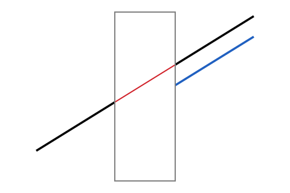

# Illusions de couleur

*Ce que l'œil voit n'est pas ce qui est sur la page*

La couleur, la luminosité, la taille et la forme ne sont pas lues point par point dans l'image : le système visuel compare chaque zone à son entourage et devine ce qui s'y trouve. Ces illusions montrent cette estimation à l'œuvre. Toutes ne portent pas sur la teinte ; plusieurs n'ont besoin que du contraste entre noir et blanc.

Regardez les figures sur un écran ou sur une bonne impression couleur, à une distance confortable. La force de chaque illusion varie d'une personne à l'autre. Quelques-unes utilisent le mouvement ou le clignotement : arrêtez si cela vous gêne.

> Toutes les figures ont été dessinées pour ce document. Les textes sont de courts résumés fondés sur les articles Wikipédia indiqués (disponibles sous licence CC BY-SA).

## Sommaire

- **Couleur**
  - [Contraste simultané](#contrast)
  - [Effet Bezold](#bezold)
  - [Constance des couleurs](#constancy)
  - [Image rémanente négative](#afterimage)
  - [Chasseur lilas](#lilac)
  - [Effet McCollough](#mccollough)
  - [Chromostéréopsie](#chromostereopsis)
- **Luminosité et contraste**
  - [Échiquier d'Adelson](#checker)
  - [Illusions de White et de Munker](#white)
  - [Bandes de Mach](#mach)
  - [Illusion de Cornsweet](#cornsweet)
  - [Illusions de grille : Hermann et scintillante](#grid)
  - [Illusion d'Ehrenstein](#ehrenstein)
  - [Illusion d'irradiation](#irradiation)
- **Taille et longueur**
  - [Illusion d'Ebbinghaus (cercles de Titchener)](#ebbinghaus)
  - [Illusion de Müller-Lyer](#muller_lyer)
  - [Illusion de Ponzo](#ponzo)
- **Lignes courbées et inclinées**
  - [Illusion du mur du café](#cafe)
  - [Spirale de Fraser](#fraser)
  - [Illusion de Hering](#hering)
  - [Illusion de Wundt](#wundt)
  - [Illusion d'Orbison](#orbison)
  - [Illusion de Zöllner](#zollner)
  - [Illusion de Poggendorff](#poggendorff)
  - [Illusion et effet consécutif d'inclinaison](#tilt)
- **Mouvement dans des images fixes**
  - [Mouvement illusoire](#motion)
  - [Dérive périphérique](#drift)
- **Figure, fond et objets impossibles**
  - [Vase de Rubin](#rubin)
  - [Triangle de Penrose](#penrose)

## Couleur

### Contraste simultané

**Ce que l'on voit.** Les quatre petits carrés sont du même gris. Il paraît plus clair sur le fond sombre que sur le fond clair ; sur le bleu il tire vers le jaune, et sur le jaune vers le bleu.

**Pourquoi.** La couleur est jugée par différence. Le fond repousse loin de lui la zone qu'il entoure, en luminosité et en teinte.

**Essayez.** Percez deux trous dans une feuille pour ne voir que deux des petits carrés : la différence disparaît.

[Article Wikipédia](https://fr.wikipedia.org/wiki/Loi_du_contraste_simultan%C3%A9_des_couleurs)

### Effet Bezold

**Ce que l'on voit.** Le rouge entre les rayures noires paraît plus profond et plus sombre que le rouge entre les rayures blanches, qui paraît plus pâle et rosé. C'est un seul et même rouge.

**Pourquoi.** Quand de petites surfaces de couleur alternent, l'œil les mélange en partie (assimilation) : le rouge prend un peu de sa voisine. Wilhelm von Bezold l'a remarqué en redessinant des tapis en changeant une seule couleur.

**Essayez.** Éloignez-vous de la page : plus on est loin, plus le mélange est fort.

[Article Wikipédia](https://fr.wikipedia.org/wiki/Effet_Bezold)

### Constance des couleurs

**Ce que l'on voit.** Deux copies d'une mosaïque sont éclairées par une lumière chaude et par une lumière froide (les disques au-dessus). Le deuxième carreau de la deuxième rangée paraît bleuté à gauche et jaunâtre à droite, alors que c'est le même gris neutre.

**Pourquoi.** Pour que les objets restent reconnaissables, le cerveau estime la couleur de l'éclairage et la retranche. Un gris vu dans une scène tout orangée est lu comme une surface bleutée.

**Essayez.** Cachez tout sauf les deux carreaux gris.

[Article Wikipédia](https://fr.wikipedia.org/wiki/Constance_de_couleur)

### Image rémanente négative

**Ce que l'on voit.** Après avoir fixé le point au centre des anneaux colorés, le point seul à droite semble entouré d'anneaux d'autres couleurs : rouge, vert et jaune.

**Pourquoi.** Les cellules qui répondent à une couleur se fatiguent (adaptation). Sur le blanc, les autres répondent davantage et l'on voit la couleur complémentaire.

**Essayez.** Fixez le point de gauche pendant 30 secondes sans bouger les yeux, puis regardez le point de droite et clignez.

[Article Wikipédia](https://fr.wikipedia.org/wiki/Image_r%C3%A9manente)

### Chasseur lilas

**Ce que l'on voit.** En fixant la croix, un vide parcourt la couronne de disques lilas ; puis le vide devient un disque vert et, au bout d'un moment, les disques lilas peuvent disparaître complètement.

**Pourquoi.** Le vide qui se déplace est un mouvement apparent (phénomène phi). Là où un disque disparaît apparaît une image rémanente de la couleur opposée, verte. Les disques flous et immobiles en périphérie s'effacent de la conscience (effet Troxler).

**Essayez.** Fixez la croix au moins 30 secondes. Jeremy Hinton a créé cette animation avant 2005.

[Article Wikipédia (en anglais)](https://en.wikipedia.org/wiki/Lilac_chaser)

### Effet McCollough

**Ce que l'on voit.** Après avoir regardé tour à tour des rayures horizontales rouges et verticales vertes, les carrés en noir et blanc du dessous paraissent teintés : verdâtres là où les rayures sont horizontales, rosés là où elles sont verticales.

**Pourquoi.** Le système visuel s'adapte à une couleur liée à une orientation. Celeste McCollough l'a décrit en 1965 ; il peut durer des heures, voire des mois.

**Essayez.** Alternez entre les deux grilles colorées, quelques secondes chacune, pendant plusieurs minutes, puis regardez les petits carrés. Attention : l'effet peut persister longtemps.

[Article Wikipédia](https://fr.wikipedia.org/wiki/Effet_McCollough)

### Chromostéréopsie

**Ce que l'on voit.** Le rouge et le bleu sur fond noir ne semblent pas être dans le même plan : pour la plupart des gens le rouge flotte devant le bleu, pour certains il s'enfonce derrière.

**Pourquoi.** Le cristallin dévie différemment les longueurs d'onde courtes et longues (aberration chromatique) : les deux couleurs tombent à des endroits un peu différents dans chaque œil, et le cerveau lit ce décalage comme du relief.

**Essayez.** Regardez dans une pièce peu éclairée, des deux yeux ; essayez avec et sans lunettes.

[Article Wikipédia](https://fr.wikipedia.org/wiki/Chromostereopsis)

## Luminosité et contraste

### Échiquier d'Adelson

**Ce que l'on voit.** La case A paraît beaucoup plus sombre que la case B. Elles sont exactement du même gris, comme le montre la barre de la deuxième figure.

**Pourquoi.** Le cerveau lit un damier avec une ombre et corrige l'ombre : B doit être une case claire, elle est donc vue comme claire. Edward Adelson a publié l'illusion en 1995.

**Essayez.** Cachez le reste de l'échiquier avec deux papiers en ne laissant que A et B.

[Article Wikipédia](https://fr.wikipedia.org/wiki/%C3%89chiquier_d%27Adelson)

### Illusions de White et de Munker

**Ce que l'on voit.** Les barres grises insérées dans les rayures noires paraissent plus claires que celles insérées dans les blanches. Dans la version en couleur (Munker), le même rouge paraît orange d'un côté et violacé de l'autre.

**Pourquoi.** Contrairement à ce que laisserait prévoir le simple contraste, l'œil semble regrouper chaque barre avec la rayure dans laquelle elle est insérée.

**Essayez.** Comparez les deux groupes à travers un petit trou découpé dans du papier.

[Article Wikipédia (en anglais)](https://en.wikipedia.org/wiki/White%27s_illusion)

### Bandes de Mach

**Ce que l'on voit.** Chaque bande grise uniforme paraît plus sombre près de sa voisine plus claire et plus claire près de sa voisine plus sombre, comme si les bandes étaient cannelées.

**Pourquoi.** Des cellules voisines de la rétine s'inhibent mutuellement (inhibition latérale), ce qui exagère les bords. Ernst Mach a décrit l'effet en 1865.

**Essayez.** Cachez toutes les bandes sauf une : elle est parfaitement uniforme.

[Article Wikipédia](https://fr.wikipedia.org/wiki/Bandes_de_Mach)

### Illusion de Cornsweet

**Ce que l'on voit.** La moitié gauche paraît plus claire que la droite. Loin du milieu, les deux sont du même gris.

**Pourquoi.** Seul le bord diffère, montant d'un côté et descendant de l'autre. Le système visuel prend la marche du bord pour la différence entre les surfaces entières.

**Essayez.** Posez un crayon sur la ligne du milieu : les deux moitiés deviennent égales.

[Article Wikipédia](https://fr.wikipedia.org/wiki/Illusion_de_Cornsweet)

### Illusions de grille : Hermann et scintillante

**Ce que l'on voit.** Dans la grille blanche, des taches grises apparaissent aux croisements, sauf là où l'on regarde. Avec des disques sur une grille grise, des points noirs semblent s'allumer et s'éteindre.

**Pourquoi.** La grille de Hermann (1870) a longtemps été expliquée par la seule inhibition latérale ; des expériences ultérieures (courber les lignes la supprime) montrent qu'elle dépend aussi du traitement des droites par le cortex. La version scintillante a été signalée dans les années 1990.

**Essayez.** Promenez le regard sur la grille, puis fixez un seul croisement.

[Article Wikipédia (en anglais)](https://en.wikipedia.org/wiki/Grid_illusion)

### Illusion d'Ehrenstein

**Ce que l'on voit.** Là où les lignes s'arrêtent avant de se croiser semblent apparaître des disques clairs, plus blancs que le papier.

**Pourquoi.** Les extrémités des lignes suggèrent une forme posée par-dessus et cachant les croisements. Le cerveau en trace le contour (contour illusoire) et le remplit de clarté.

**Essayez.** Fermez les vides en pensée ou au crayon : les disques disparaissent.

[Article Wikipédia (en anglais)](https://en.wikipedia.org/wiki/Ehrenstein_illusion)

### Illusion d'irradiation

**Ce que l'on voit.** Le carré blanc sur fond noir paraît plus grand que le carré noir sur fond blanc, alors qu'ils ont la même taille.

**Pourquoi.** La lumière se diffuse dans l'œil et une zone claire s'étale sur la rétine. Galilée l'a mentionnée en 1632 ; Helmholtz lui a donné son nom.

**Essayez.** Mesurez les deux carrés.

[Article Wikipédia (en anglais)](https://en.wikipedia.org/wiki/Irradiation_illusion)

## Taille et longueur

### Illusion d'Ebbinghaus (cercles de Titchener)

**Ce que l'on voit.** Le disque orange entouré de grands disques paraît plus petit que celui entouré de petits disques.

**Pourquoi.** La taille est jugée par rapport au contexte ; la distance et l'espacement des disques voisins comptent aussi.

**Essayez.** Cachez les disques bleus avec les doigts.

[Article Wikipédia](https://fr.wikipedia.org/wiki/Illusion_d%27Ebbinghaus)

### Illusion de Müller-Lyer

**Ce que l'on voit.** Le segment aux pointes tournées vers l'extérieur paraît plus long que celui aux pointes tournées vers l'intérieur. Ils sont égaux, comme la ligne rouge du dessous.

**Pourquoi.** Les pointes déplacent l'endroit où semblent se trouver les extrémités ; une explication les rapproche des coins de pièces et de bâtiments vus en profondeur. Franz Müller-Lyer l'a décrite en 1889.

**Essayez.** Comparez les deux segments avec les repères en pointillé.

[Article Wikipédia](https://fr.wikipedia.org/wiki/Illusion_de_M%C3%BCller-Lyer)

### Illusion de Ponzo

**Ce que l'on voit.** La barre jaune du haut paraît plus longue que celle du bas.

**Pourquoi.** Des lignes convergentes suggèrent la distance, comme des rails : une barre de même taille sur la page, mais plus lointaine, devrait être plus grande.

**Essayez.** Mesurez les deux barres ou retournez la page.

[Article Wikipédia (en anglais)](https://en.wikipedia.org/wiki/Ponzo_illusion)

## Lignes courbées et inclinées

### Illusion du mur du café

**Ce que l'on voit.** Les joints gris semblent pencher alternativement, alors qu'ils sont parallèles et horizontaux.

**Pourquoi.** Les carreaux noirs et blancs décalés, avec un joint d'un gris intermédiaire, créent de petits éléments inclinés le long de chaque ligne. Richard Gregory l'a nommée en 1973 d'après le mur d'un café de Bristol.

**Essayez.** Regardez le long d'un joint en tenant la page presque de chant.

[Article Wikipédia](https://fr.wikipedia.org/wiki/Illusion_du_mur_du_caf%C3%A9)

### Spirale de Fraser

**Ce que l'on voit.** Une spirale semble s'enrouler vers le centre. Il n'y a pas de spirale : les torsades noires et blanches forment des cercles concentriques.

**Pourquoi.** Chaque petit brin est incliné et le fond tordu renforce l'inclinaison, si bien que l'œil les relie en spirale. James Fraser l'a décrite en 1908.

**Essayez.** Posez un doigt sur une torsade et suivez-la : vous revenez au point de départ.

[Article Wikipédia](https://fr.wikipedia.org/wiki/Spirale_de_Fraser)

### Illusion de Hering

**Ce que l'on voit.** Les deux lignes rouges semblent se bomber vers l'extérieur au milieu. Elles sont droites et parallèles.

**Pourquoi.** Les angles avec les lignes rayonnantes sont surestimés et le motif suggère aussi un mouvement en profondeur. Ewald Hering l'a découverte en 1861.

**Essayez.** Posez une règle contre une ligne rouge.

[Article Wikipédia](https://fr.wikipedia.org/wiki/Illusion_de_Hering)

### Illusion de Wundt

**Ce que l'on voit.** Les deux lignes rouges semblent se courber vers l'intérieur, l'une vers l'autre, au milieu. Elles sont droites et parallèles.

**Pourquoi.** C'est le pendant de la figure de Hering : les rayons partent ici de points situés de part et d'autre, et les angles dévient les lignes rouges dans l'autre sens. Wilhelm Wundt l'a décrite en 1898.

**Essayez.** Comparez avec l'illusion de Hering.

[Article Wikipédia](https://fr.wikipedia.org/wiki/Illusion_de_Wundt)

### Illusion d'Orbison

**Ce que l'on voit.** Le carré rouge paraît déformé, ses côtés fléchis et ses coins tirés.

**Pourquoi.** Comme dans la figure de Hering, les croisements avec les anneaux du fond faussent la direction perçue de chaque côté. William Orbison l'a décrite en 1939.

**Essayez.** Vérifiez les côtés avec une règle.

[Article Wikipédia](https://fr.wikipedia.org/wiki/Illusion_de_Orbison)

### Illusion de Zöllner

**Ce que l'on voit.** Les longues diagonales semblent converger et diverger. Elles sont parallèles.

**Pourquoi.** Les petits traits les coupent de biais et le système visuel exagère les angles aigus, faisant un peu tourner chaque ligne. Johann Zöllner l'a signalée en 1860.

**Essayez.** Regardez le long des grandes lignes depuis un coin de la page.

[Article Wikipédia](https://fr.wikipedia.org/wiki/Illusion_de_Zollner)

### Illusion de Poggendorff

**Ce que l'on voit.** La ligne noire qui entre à gauche dans le bloc gris semble ressortir sous la forme de la ligne bleue. Elle ressort comme la noire du haut, comme le montre la deuxième figure.

**Pourquoi.** Les angles aigus entre la ligne et le bloc sont vus plus ouverts qu'ils ne sont, ce qui décale le trajet apparent. On l'a remarquée sur les dessins de Zöllner lui-même.

**Essayez.** Prolongez la ligne de gauche avec une règle.

[Article Wikipédia](https://fr.wikipedia.org/wiki/Illusion_de_Poggendorff)

### Illusion et effet consécutif d'inclinaison

**Ce que l'on voit.** Les rayures des deux disques centraux sont verticales, mais semblent pencher à l'opposé des rayures qui les entourent.

**Pourquoi.** Les cellules accordées à des orientations voisines s'inhibent, ce qui repousse l'angle perçu. Regarder longtemps des rayures inclinées a un effet semblable sur ce que l'on voit ensuite.

**Essayez.** Cachez les couronnes extérieures et comparez les disques centraux.

[Article Wikipédia (en anglais)](https://en.wikipedia.org/wiki/Visual_tilt_effects)

## Mouvement dans des images fixes

### Mouvement illusoire

**Ce que l'on voit.** Les roues semblent tourner lentement, surtout celles que l'on ne regarde pas directement.

**Pourquoi.** Des blocs de contrastes différents sont traités avec des délais un peu différents, et chaque petit mouvement des yeux relance la séquence ; les détecteurs de mouvement y lisent un déplacement.

**Essayez.** Passez le regard d'une roue à l'autre, ou clignez.

[Article Wikipédia (en anglais)](https://en.wikipedia.org/wiki/Illusory_motion)

### Dérive périphérique

**Ce que l'on voit.** Les anneaux faits de dégradés de gris paraissent tourner quand on les voit du coin de l'œil.

**Pourquoi.** Un dégradé répété du sombre au clair (en dents de scie) stimule les détecteurs de mouvement de la périphérie ; le mouvement est vu du sombre vers le clair.

**Essayez.** Regardez à côté de la figure et clignez rapidement.

[Article Wikipédia (en anglais)](https://en.wikipedia.org/wiki/Peripheral_drift_illusion)

## Figure, fond et objets impossibles

### Vase de Rubin

**Ce que l'on voit.** Un vase clair, ou deux visages sombres face à face : l'un ou l'autre, difficilement les deux à la fois.

**Pourquoi.** Le contour commun ne peut appartenir qu'à un côté à la fois : ce qui est pris pour la figure reçoit la forme, le reste devient le fond. Edgar Rubin l'a étudié vers 1915.

**Essayez.** Essayez de basculer à volonté et comptez les bascules spontanées.

[Article Wikipédia (en anglais)](https://en.wikipedia.org/wiki/Rubin_vase)

### Triangle de Penrose

**Ce que l'on voit.** Un triangle plein de trois poutres carrées, chacune jointe à la suivante à angle droit.

**Pourquoi.** Chaque coin est cohérent isolément, mais les trois ne peuvent être vrais ensemble : un tel objet n'existe pas. Oscar Reutersvärd l'a dessiné en 1934 ; Lionel et Roger Penrose l'ont popularisé, et il a inspiré La Chute d'eau de M. C. Escher.

**Essayez.** Cachez un coin à la fois : le reste devient possible.

[Article Wikipédia](https://fr.wikipedia.org/wiki/Triangle_de_Penrose)
