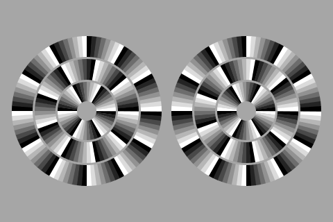

# Illusioni di colore

*Ciò che l'occhio vede non è ciò che sta sulla pagina*

Colore, luminosità, dimensione e forma non vengono letti punto per punto nell'immagine: il sistema visivo confronta ogni zona con ciò che la circonda e fa una stima di quello che c'è. Queste illusioni mostrano la stima all'opera. Non tutte riguardano la tinta; diverse richiedono solo il contrasto tra bianco e nero.

Guardate le figure su uno schermo o in una buona stampa a colori, a una distanza comoda. L'intensità di ogni illusione varia da persona a persona. Alcune usano movimento o sfarfallio: smettete se danno fastidio.

> Tutte le figure sono state disegnate per questo documento. I testi sono brevi riassunti basati sulle voci di Wikipedia indicate (disponibili con licenza CC BY-SA).

## Indice

- **Colore**
  - [Contrasto simultaneo](#contrast)
  - [Effetto Bezold](#bezold)
  - [Costanza del colore](#constancy)
  - [Immagine residua negativa](#afterimage)
  - [Inseguitore lilla](#lilac)
  - [Effetto McCollough](#mccollough)
  - [Cromostereopsi](#chromostereopsis)
- **Luminosità e contrasto**
  - [Scacchiera di Adelson](#checker)
  - [Illusione di White e di Munker](#white)
  - [Bande di Mach](#mach)
  - [Illusione di Cornsweet](#cornsweet)
  - [Illusioni della griglia: Hermann e scintillante](#grid)
  - [Illusione di Ehrenstein](#ehrenstein)
  - [Illusione di irradiazione](#irradiation)
- **Dimensione e lunghezza**
  - [Illusione di Ebbinghaus (cerchi di Titchener)](#ebbinghaus)
  - [Illusione di Müller-Lyer](#muller_lyer)
  - [Illusione di Ponzo](#ponzo)
- **Linee curve e inclinate**
  - [Illusione del muro del caffè](#cafe)
  - [Spirale di Fraser](#fraser)
  - [Illusione di Hering](#hering)
  - [Illusione di Wundt](#wundt)
  - [Illusione di Orbison](#orbison)
  - [Illusione di Zöllner](#zollner)
  - [Illusione di Poggendorff](#poggendorff)
  - [Illusione ed effetto consecutivo di inclinazione](#tilt)
- **Movimento in immagini ferme**
  - [Movimento illusorio](#motion)
  - [Deriva periferica](#drift)
- **Figura, sfondo e oggetti impossibili**
  - [Vaso di Rubin](#rubin)
  - [Triangolo di Penrose](#penrose)

## Colore

### Contrasto simultaneo

**Cosa si vede.** I quattro quadratini sono dello stesso grigio. Sul fondo scuro sembra più chiaro che su quello chiaro; sul blu tende al giallo e sul giallo tende al blu.

**Perché accade.** Il colore è giudicato per differenza. Lo sfondo spinge lontano da sé la zona che racchiude, in luminosità e in tinta.

**Provate.** Fate due fori in un foglio così da vedere solo due dei quadratini: la differenza sparisce.

[Voce di Wikipedia (in inglese)](https://en.wikipedia.org/wiki/Contrast_effect)

### Effetto Bezold

**Cosa si vede.** Il rosso tra le righe nere sembra più intenso e scuro del rosso tra le righe bianche, che sembra più pallido e rosato. È un unico rosso.

**Perché accade.** Quando piccole aree di colore si alternano, l'occhio in parte le fonde (assimilazione): il rosso prende un po' dal vicino. Wilhelm von Bezold lo notò ridisegnando tappeti cambiando un solo colore.

**Provate.** Allontanatevi dalla pagina: più si è lontani, più forte è la fusione.

[Voce di Wikipedia (in inglese)](https://en.wikipedia.org/wiki/Bezold_effect)

### Costanza del colore

**Cosa si vede.** Due copie di un mosaico sono illuminate da una luce calda e da una fredda (i dischi in alto). La seconda tessera della seconda riga sembra bluastra a sinistra e giallastra a destra, ma è lo stesso grigio neutro.

**Perché accade.** Per continuare a riconoscere gli oggetti, il cervello stima il colore della luce e lo sottrae. Un grigio visto in una scena tutta arancione è letto come una superficie bluastra.

**Provate.** Coprite tutto tranne le due tessere grigie.

[Voce di Wikipedia (in inglese)](https://en.wikipedia.org/wiki/Color_constancy)

### Immagine residua negativa

**Cosa si vede.** Dopo aver fissato il punto negli anelli colorati, il punto isolato a destra sembra circondato da anelli di altri colori: rosso, verde e giallo.

**Perché accade.** Le cellule che rispondono a un colore si stancano (adattamento). Sul bianco le altre rispondono di più e si vede il colore complementare.

**Provate.** Fissate il punto a sinistra per 30 secondi senza muovere gli occhi, poi guardate quello a destra e sbattete le palpebre.

[Voce di Wikipedia (in inglese)](https://en.wikipedia.org/wiki/Afterimage)

### Inseguitore lilla

**Cosa si vede.** Fissando la croce, un vuoto corre lungo l'anello di dischi lilla; poi il vuoto diventa un disco verde e dopo un po' i dischi lilla possono sparire del tutto.

**Perché accade.** Il vuoto in movimento è moto apparente (fenomeno phi). Dove un disco sparisce compare un'immagine residua del colore opposto, il verde. I dischi sfocati e fermi in periferia svaniscono dalla coscienza (effetto Troxler).

**Provate.** Fissate la croce per almeno 30 secondi. Jeremy Hinton creò questa animazione prima del 2005.

[Voce di Wikipedia (in inglese)](https://en.wikipedia.org/wiki/Lilac_chaser)

### Effetto McCollough

**Cosa si vede.** Dopo aver guardato a turno righe orizzontali rosse e verticali verdi, i riquadri in bianco e nero in basso sembrano colorati: verdastri dove le righe sono orizzontali e rosati dove sono verticali.

**Perché accade.** Il sistema visivo si adatta a un colore legato a un orientamento. Celeste McCollough lo descrisse nel 1965; può durare ore e persino mesi.

**Provate.** Alternate le due griglie colorate, pochi secondi ciascuna, per alcuni minuti, poi guardate i riquadri piccoli. Attenzione: l'effetto può persistere a lungo.

[Voce di Wikipedia (in inglese)](https://en.wikipedia.org/wiki/McCollough_effect)

### Cromostereopsi

**Cosa si vede.** Rosso e blu su nero non sembrano stare sullo stesso piano: per la maggior parte delle persone il rosso sta davanti al blu, per alcune dietro.

**Perché accade.** Il cristallino devia in modo diverso le lunghezze d'onda corte e lunghe (aberrazione cromatica): i due colori cadono in punti un po' diversi in ciascun occhio e il cervello legge lo scarto come profondità.

**Provate.** Guardate in una stanza poco illuminata, con entrambi gli occhi; provate con e senza occhiali.

[Voce di Wikipedia (in inglese)](https://en.wikipedia.org/wiki/Chromostereopsis)

## Luminosità e contrasto

### Scacchiera di Adelson

**Cosa si vede.** Il riquadro A sembra molto più scuro del B. Sono esattamente dello stesso grigio, come mostra la barra della seconda figura.

**Perché accade.** Il cervello legge un pavimento a scacchi con un'ombra e corregge l'ombra: B deve essere una casella chiara, quindi è visto chiaro. Edward Adelson pubblicò l'illusione nel 1995.

**Provate.** Nascondete il resto della scacchiera con due fogli, lasciando solo A e B.

[Voce di Wikipedia (in inglese)](https://en.wikipedia.org/wiki/Checker_shadow_illusion)

### Illusione di White e di Munker

**Cosa si vede.** Le barre grigie inserite nelle strisce nere sembrano più chiare di quelle inserite nelle bianche. Nella versione a colori (Munker), lo stesso rosso sembra arancione da un lato e violaceo dall'altro.

**Perché accade.** Contro quello che farebbe prevedere il semplice contrasto, l'occhio sembra raggruppare ogni barra con la striscia in cui è inserita.

**Provate.** Confrontate i due gruppi attraverso un piccolo foro in un foglio.

[Voce di Wikipedia (in inglese)](https://en.wikipedia.org/wiki/White%27s_illusion)

### Bande di Mach

**Cosa si vede.** Ogni striscia grigia uniforme sembra più scura vicino alla vicina più chiara e più chiara vicino alla più scura, come se fosse scanalata.

**Perché accade.** Cellule vicine della retina si inibiscono a vicenda (inibizione laterale), esagerando i bordi. Ernst Mach descrisse l'effetto nel 1865.

**Provate.** Coprite tutte le strisce tranne una: è perfettamente uniforme.

[Voce di Wikipedia](https://it.wikipedia.org/wiki/Effetto_Mach)

### Illusione di Cornsweet

**Cosa si vede.** La metà sinistra sembra più chiara della destra. Lontano dal centro sono dello stesso grigio.

**Perché accade.** Differisce solo il bordo, che sale da un lato e scende dall'altro. Il sistema visivo prende il gradino al bordo come differenza tra le intere aree.

**Provate.** Appoggiate una matita sulla linea centrale: le due metà diventano uguali.

[Voce di Wikipedia (in inglese)](https://en.wikipedia.org/wiki/Cornsweet_illusion)

### Illusioni della griglia: Hermann e scintillante

**Cosa si vede.** Nella griglia bianca compaiono macchie grigie agli incroci, tranne dove si guarda. Con dischi su una griglia grigia, punti neri sembrano accendersi e spegnersi.

**Perché accade.** La griglia di Hermann (1870) è stata a lungo spiegata con la sola inibizione laterale; esperimenti successivi (curvare le linee la elimina) mostrano che dipende anche da come la corteccia tratta le rette. La versione scintillante fu segnalata negli anni Novanta.

**Provate.** Lasciate vagare lo sguardo sulla griglia, poi fissate un solo incrocio.

[Voce di Wikipedia (in inglese)](https://en.wikipedia.org/wiki/Grid_illusion)

### Illusione di Ehrenstein

**Cosa si vede.** Dove le linee si interrompono prima di incrociarsi sembrano apparire dischi chiari, più bianchi della carta.

**Perché accade.** Le estremità delle linee suggeriscono una forma sovrapposta che nasconde gli incroci. Il cervello ne traccia il contorno (contorno illusorio) e lo riempie di luce.

**Provate.** Chiudete i vuoti con la mente o con una matita: i dischi spariscono.

[Voce di Wikipedia (in inglese)](https://en.wikipedia.org/wiki/Ehrenstein_illusion)

### Illusione di irradiazione

**Cosa si vede.** Il quadrato bianco su nero sembra più grande del quadrato nero su bianco, benché siano uguali.

**Perché accade.** La luce si diffonde dentro l'occhio e un'area chiara si allarga sulla retina. Galileo ne parlò nel 1632; Helmholtz le diede il nome.

**Provate.** Misurate i due quadrati.

[Voce di Wikipedia (in inglese)](https://en.wikipedia.org/wiki/Irradiation_illusion)

## Dimensione e lunghezza

### Illusione di Ebbinghaus (cerchi di Titchener)

**Cosa si vede.** Il cerchio arancione circondato da cerchi grandi sembra più piccolo di quello circondato da cerchi piccoli.

**Perché accade.** La dimensione è giudicata rispetto al contesto; contano anche la distanza e la spaziatura dei cerchi intorno.

**Provate.** Coprite i cerchi blu con le dita.

[Voce di Wikipedia (in inglese)](https://en.wikipedia.org/wiki/Ebbinghaus_illusion)

### Illusione di Müller-Lyer

**Cosa si vede.** La linea con le alette verso l'esterno sembra più lunga di quella con le alette verso l'interno. Sono uguali, come la linea rossa in basso.

**Perché accade.** Le alette spostano il punto in cui sembrano trovarsi le estremità; una spiegazione le collega agli angoli di stanze ed edifici visti in profondità. Franz Müller-Lyer la descrisse nel 1889.

**Provate.** Confrontate le due linee con le guide tratteggiate.

[Voce di Wikipedia](https://it.wikipedia.org/wiki/Illusione_di_M%C3%BCller-Lyer)

### Illusione di Ponzo

**Cosa si vede.** La barra gialla in alto sembra più lunga di quella in basso.

**Perché accade.** Linee convergenti suggeriscono la distanza, come binari: una barra della stessa misura sulla pagina, ma più lontana, dovrebbe essere più grande.

**Provate.** Misurate le due barre o capovolgete la pagina.

[Voce di Wikipedia](https://it.wikipedia.org/wiki/Illusione_di_Ponzo)

## Linee curve e inclinate

### Illusione del muro del caffè

**Cosa si vede.** Le fughe grigie sembrano inclinarsi alternativamente, benché siano parallele e orizzontali.

**Perché accade.** Le piastrelle nere e bianche sfalsate, con una fuga di grigio intermedio, creano piccoli elementi inclinati lungo ogni linea. Richard Gregory la battezzò nel 1973 dal muro di un caffè di Bristol.

**Provate.** Guardate lungo una fuga tenendo la pagina quasi di taglio.

[Voce di Wikipedia (in inglese)](https://en.wikipedia.org/wiki/Caf%C3%A9_wall_illusion)

### Spirale di Fraser

**Cosa si vede.** Una spirale sembra avvolgersi verso il centro. Non c'è alcuna spirale: i cordoni bianchi e neri formano cerchi concentrici.

**Perché accade.** Ogni breve tratto è inclinato e lo sfondo ritorto accentua l'inclinazione, così l'occhio li unisce in una spirale. James Fraser la descrisse nel 1908.

**Provate.** Mettete un dito su un cordone e seguitelo: tornate al punto di partenza.

[Voce di Wikipedia (in inglese)](https://en.wikipedia.org/wiki/Fraser_spiral_illusion)

### Illusione di Hering

**Cosa si vede.** Le due linee rosse sembrano incurvarsi verso l'esterno al centro. Sono rette e parallele.

**Perché accade.** Gli angoli con le linee a raggiera sono sovrastimati e il motivo suggerisce anche un movimento in profondità. Ewald Hering la scoprì nel 1861.

**Provate.** Appoggiate un righello a una linea rossa.

[Voce di Wikipedia (in inglese)](https://en.wikipedia.org/wiki/Hering_illusion)

### Illusione di Wundt

**Cosa si vede.** Le due linee rosse sembrano incurvarsi verso l'interno, l'una verso l'altra, al centro. Sono rette e parallele.

**Perché accade.** È il rovescio della figura di Hering: i raggi partono qui da punti ai due lati e gli angoli deviano le linee rosse nel senso opposto. Wilhelm Wundt la descrisse nel 1898.

**Provate.** Confrontatela con l'illusione di Hering.

[Voce di Wikipedia (in inglese)](https://en.wikipedia.org/wiki/Wundt_illusion)

### Illusione di Orbison

**Cosa si vede.** Il quadrato rosso sembra deformato, con i lati piegati e gli angoli tirati.

**Perché accade.** Come nella figura di Hering, gli incroci con gli anelli dello sfondo alterano la direzione percepita di ogni lato. William Orbison la descrisse nel 1939.

**Provate.** Controllate i lati con un righello.

[Voce di Wikipedia (in inglese)](https://en.wikipedia.org/wiki/Orbison_illusion)

### Illusione di Zöllner

**Cosa si vede.** Le lunghe diagonali sembrano convergere e divergere. Sono parallele.

**Perché accade.** I trattini le attraversano di sbieco e il sistema visivo esagera gli angoli acuti, ruotando un poco ogni linea. Johann Zöllner la segnalò nel 1860.

**Provate.** Guardate lungo le linee lunghe da un angolo della pagina.

[Voce di Wikipedia (in inglese)](https://en.wikipedia.org/wiki/Z%C3%B6llner_illusion)

### Illusione di Poggendorff

**Cosa si vede.** La linea nera che entra da sinistra nel blocco grigio sembra uscire come la linea blu. Esce come quella nera in alto, come mostra la seconda figura.

**Perché accade.** Gli angoli acuti tra la linea e il blocco sono visti più ampi di quanto sono, spostando il percorso apparente. Fu notata nei disegni dello stesso Zöllner.

**Provate.** Prolungate la linea di sinistra con un righello.

[Voce di Wikipedia (in inglese)](https://en.wikipedia.org/wiki/Poggendorff_illusion)

### Illusione ed effetto consecutivo di inclinazione

**Cosa si vede.** Le righe dei due dischi interni sono verticali, ma sembrano pendere in senso opposto alle righe che le circondano.

**Perché accade.** Cellule sintonizzate su orientamenti vicini si inibiscono, allontanando l'angolo percepito. Guardare a lungo righe inclinate ha un effetto simile su ciò che si vede dopo.

**Provate.** Coprite gli anelli esterni e confrontate i dischi interni.

[Voce di Wikipedia (in inglese)](https://en.wikipedia.org/wiki/Visual_tilt_effects)

## Movimento in immagini ferme

### Movimento illusorio

**Cosa si vede.** Le ruote sembrano girare lentamente, soprattutto quelle che non si guardano direttamente.

**Perché accade.** Blocchi di contrasto diverso sono elaborati con ritardi leggermente diversi e ogni piccolo movimento degli occhi riavvia la sequenza; i rilevatori di moto la leggono come movimento.

**Provate.** Spostate lo sguardo da una ruota all'altra, o sbattete le palpebre.

[Voce di Wikipedia (in inglese)](https://en.wikipedia.org/wiki/Illusory_motion)

### Deriva periferica

**Cosa si vede.** Gli anelli fatti di sfumature di grigio sembrano ruotare se visti con la coda dell'occhio.

**Perché accade.** Una sfumatura ripetuta da scuro a chiaro (a dente di sega) stimola i rilevatori di moto in periferia; il moto è visto dallo scuro al chiaro.

**Provate.** Guardate di lato alla figura e sbattete rapidamente le palpebre.

[Voce di Wikipedia (in inglese)](https://en.wikipedia.org/wiki/Peripheral_drift_illusion)

## Figura, sfondo e oggetti impossibili

### Vaso di Rubin

**Cosa si vede.** Un vaso chiaro, o due volti scuri che si guardano: l'uno o l'altro, difficilmente entrambi insieme.

**Perché accade.** Il contorno comune può appartenere a un solo lato alla volta: ciò che è preso come figura riceve la forma e il resto diventa sfondo. Edgar Rubin lo studiò verso il 1915.

**Provate.** Provate a passare dall'uno all'altro a volontà e contate i cambi spontanei.

[Voce di Wikipedia (in inglese)](https://en.wikipedia.org/wiki/Rubin_vase)

### Triangolo di Penrose

**Cosa si vede.** Un triangolo solido di tre travi quadrate, ognuna unita alla successiva ad angolo retto.

**Perché accade.** Ogni angolo è coerente da solo, ma i tre non possono essere veri insieme: un tale oggetto non esiste. Oscar Reutersvärd lo disegnò nel 1934; Lionel e Roger Penrose lo resero famoso, e ispirò la Cascata di M. C. Escher.

**Provate.** Coprite un angolo alla volta: il resto diventa possibile.

[Voce di Wikipedia](https://it.wikipedia.org/wiki/Triangolo_di_Penrose)
