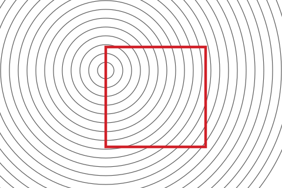

# 色の錯視

*目に見えるものは、紙に描かれたものとは違う*

色、明るさ、大きさ、形は、画像から一点ずつ読み取られるわけではありません。視覚系は各領域を周囲と比べ、そこに何があるかを推測します。ここに挙げる錯視は、その推測の働きを見せてくれます。すべてが色相に関するものではなく、白と黒の対比だけで起こるものもあります。

画面か質の良いカラー印刷で、楽な距離から見てください。錯視の強さには個人差があります。動きや点滅を使うものもあるので、不快に感じたら中止してください。

> 図はすべてこの文書のために描いたものです。本文は、リンク先のウィキペディアの記事（CC BY-SA ライセンスで公開）をもとにした短い要約です。

## 目次

- **色**
  - [同時対比](#contrast)
  - [ベツォルト効果](#bezold)
  - [色の恒常性](#constancy)
  - [陰性残像](#afterimage)
  - [ライラックチェイサー](#lilac)
  - [マッカロー効果](#mccollough)
  - [色立体視](#chromostereopsis)
- **明るさと対比**
  - [チェッカーシャドー錯視](#checker)
  - [ホワイト錯視とムンカー錯視](#white)
  - [マッハバンド](#mach)
  - [コーンスウィート錯視](#cornsweet)
  - [格子の錯視：ヘルマンときらめき](#grid)
  - [エーレンシュタイン錯視](#ehrenstein)
  - [光滲錯視](#irradiation)
- **大きさと長さ**
  - [エビングハウス錯視（ティチェナー円）](#ebbinghaus)
  - [ミュラー・リヤー錯視](#muller_lyer)
  - [ポンゾ錯視](#ponzo)
- **曲がって見える線・傾いて見える線**
  - [カフェウォール錯視](#cafe)
  - [フレーザーの渦巻き](#fraser)
  - [ヘリング錯視](#hering)
  - [ヴント錯視](#wundt)
  - [オービソン錯視](#orbison)
  - [ツェルナー錯視](#zollner)
  - [ポゲンドルフ錯視](#poggendorff)
  - [傾き錯視と傾き残効](#tilt)
- **静止画の中の動き**
  - [運動錯視](#motion)
  - [周辺ドリフト錯視](#drift)
- **図と地、不可能な立体**
  - [ルビンの壺](#rubin)
  - [ペンローズの三角形](#penrose)

## 色

### 同時対比

**どう見えるか**：四つの小さな正方形は同じ灰色です。暗い地の上では明るい地の上より明るく見え、青の上では黄みを、黄の上では青みを帯びます。

**なぜ起こるのか**：色は差によって判断されます。周囲の色は、内側の領域を明度と色相の両方で自分から遠ざけます。

**試してみる**：紙に穴を二つ開け、小さな正方形を二つだけ見えるようにすると、違いは消えます。

[ウィキペディアの記事](https://ja.wikipedia.org/wiki/%E5%AF%BE%E6%AF%94%E5%8A%B9%E6%9E%9C)

### ベツォルト効果

**どう見えるか**：黒い縞の間の赤は深く暗く見え、白い縞の間の赤は薄くピンクがかって見えます。どちらも同じ赤です。

**なぜ起こるのか**：小さな色面が交互に並ぶと、目はそれらを部分的に混ぜ合わせます（同化）。赤は隣の色を少し帯びます。ヴィルヘルム・フォン・ベツォルトは、一色だけ変えてじゅうたんの意匠を作り直すうちにこれに気づきました。

**試してみる**：ページから離れてみてください。遠いほど混色は強くなります。

[ウィキペディアの記事](https://ja.wikipedia.org/wiki/%E3%83%99%E3%83%84%E3%82%A9%E3%83%AB%E3%83%88%E5%8A%B9%E6%9E%9C)

### 色の恒常性

**どう見えるか**：同じモザイクが暖かい光と冷たい光で照らされています（上の円）。2段目の左から2番目のタイルは左では青っぽく、右では黄色っぽく見えますが、同じ中性の灰色です。

**なぜ起こるのか**：物を見分けられるように、脳は照明の色を推定して差し引きます。全体がオレンジ色の場面にある灰色は、青っぽい表面と解釈されます。

**試してみる**：二つの灰色のタイル以外をすべて隠してみてください。

[ウィキペディアの記事](https://ja.wikipedia.org/wiki/%E8%89%B2%E3%81%AE%E6%81%92%E5%B8%B8%E6%80%A7)

### 陰性残像

**どう見えるか**：色の輪の中心の点を見つめた後で右の点を見ると、点の周りに別の色の輪（赤、緑、黄）が現れるように見えます。

**なぜ起こるのか**：ある色に反応する細胞は疲れます（順応）。白い面では他の細胞が強く反応し、補色が見えます。

**試してみる**：目を動かさずに左の点を30秒見つめ、それから右の点を見てまばたきします。

[ウィキペディアの記事](https://ja.wikipedia.org/wiki/%E6%AE%8B%E5%83%8F%E5%8A%B9%E6%9E%9C)

### ライラックチェイサー

**どう見えるか**：十字を見つめると、薄紫の円の輪を欠けた所が回ります。やがてそこは緑の円になり、しばらくすると薄紫の円がすっかり消えることもあります。

**なぜ起こるのか**：動く欠けは仮現運動（ファイ現象）です。円が消えた場所には反対色である緑の残像が現れます。周辺視野で動かないぼやけた円は意識から消えます（トロクスラー効果）。

**試してみる**：少なくとも30秒、十字から目を離さないでください。このアニメーションはジェレミー・ヒントンが2005年以前に作りました。

[ウィキペディアの記事 (英語)](https://en.wikipedia.org/wiki/Lilac_chaser)

### マッカロー効果

**どう見えるか**：赤い横縞と緑の縦縞を交互に見た後では、下の白黒の模様に色がついて見えます。横縞の部分は緑がかり、縦縞の部分はピンクがかります。

**なぜ起こるのか**：視覚系が、向きと結びついた色に順応するためです。セレステ・マッカローが1965年に報告しました。数時間から数か月続くこともあります。

**試してみる**：二つの色つきの縞を数秒ずつ数分間交互に見てから、小さな模様を見てください。注意：効果が長く残ることがあります。

[ウィキペディアの記事 (英語)](https://en.wikipedia.org/wiki/McCollough_effect)

### 色立体視

**どう見えるか**：黒地の赤と青は同じ面にあるように見えません。多くの人には赤が青より手前に、一部の人には奥に見えます。

**なぜ起こるのか**：水晶体は短い波長と長い波長を異なる角度で屈折させます（色収差）。そのため二色は左右の目で少しずれた位置に結像し、脳はそのずれを奥行きと解釈します。

**試してみる**：薄暗い部屋で両目で見てください。眼鏡のあり・なしでも試してみましょう。

[ウィキペディアの記事 (英語)](https://en.wikipedia.org/wiki/Chromostereopsis)

## 明るさと対比

### チェッカーシャドー錯視

**どう見えるか**：マス A はマス B よりずっと暗く見えます。実際には全く同じ灰色で、2番目の図の帯がそれを示します。

**なぜ起こるのか**：脳は影の落ちた市松模様の床と解釈し、影の分を補正します。B は明るいマスのはずなので、明るく見えます。エドワード・アデルソンが1995年に発表しました。

**試してみる**：紙2枚で盤の他の部分を隠し、A と B だけを残してみてください。

[ウィキペディアの記事](https://ja.wikipedia.org/wiki/%E3%83%81%E3%82%A7%E3%83%83%E3%82%AB%E3%83%BC%E3%82%B7%E3%83%A3%E3%83%89%E3%83%BC%E9%8C%AF%E8%A6%96)

### ホワイト錯視とムンカー錯視

**どう見えるか**：黒い縞にはめ込まれた灰色の棒は、白い縞にはめ込まれたものより明るく見えます。カラー版（ムンカー）では、同じ赤が一方ではオレンジに、もう一方では紫がかって見えます。

**なぜ起こるのか**：単純な対比から予想されるのとは逆に、目は各々の棒を、はめ込まれた縞と同じまとまりとして扱うようです。

**試してみる**：紙に開けた小さな穴から二つのグループを比べてください。

[ウィキペディアの記事](https://ja.wikipedia.org/wiki/%E3%83%9B%E3%83%AF%E3%82%A4%E3%83%88%E5%8A%B9%E6%9E%9C)

### マッハバンド

**どう見えるか**：一様な灰色の帯が、明るい隣に接する側では暗く、暗い隣に接する側では明るく見え、溝があるように感じられます。

**なぜ起こるのか**：網膜の隣り合う細胞が互いに抑制し合い（側抑制）、境界が強調されます。エルンスト・マッハが1865年に述べました。

**試してみる**：一本を残して他の帯を隠すと、完全に一様だとわかります。

[ウィキペディアの記事](https://ja.wikipedia.org/wiki/%E3%83%9E%E3%83%83%E3%83%8F%E3%83%90%E3%83%B3%E3%83%89)

### コーンスウィート錯視

**どう見えるか**：左半分は右半分より明るく見えます。中央から離れた所は、どちらも同じ灰色です。

**なぜ起こるのか**：違うのは境界だけで、一方では明るく、もう一方では暗く変化します。視覚系は境界の段差を領域全体の差とみなします。

**試してみる**：中央の線に鉛筆を置くと、左右が同じになります。

[ウィキペディアの記事](https://ja.wikipedia.org/wiki/%E3%82%AF%E3%83%AC%E3%82%A4%E3%82%AF%E3%83%BB%E3%82%AA%E3%83%96%E3%83%A9%E3%82%A4%E3%82%A8%E3%83%B3%E3%83%BB%E3%82%B3%E3%83%BC%E3%83%B3%E3%82%B9%E3%82%A6%E3%82%A3%E3%83%BC%E3%83%88%E9%8C%AF%E8%A6%96)

### 格子の錯視：ヘルマンときらめき

**どう見えるか**：白い格子の交差点に灰色のしみが現れますが、見つめた所には現れません。灰色の格子に円を置くと、黒い点が明滅するように見えます。

**なぜ起こるのか**：ヘルマン格子（1870年）は長く側抑制だけで説明されてきましたが、後の実験（線を曲げると消える）から、大脳皮質の直線の処理にも依存することがわかりました。きらめき版は1990年代に報告されました。

**試してみる**：格子の上で視線を泳がせてから、一つの交差点を見つめてください。

[ウィキペディアの記事 (英語)](https://en.wikipedia.org/wiki/Grid_illusion)

### エーレンシュタイン錯視

**どう見えるか**：線が交差の手前で途切れている所に、紙より白い明るい円盤が現れるように見えます。

**なぜ起こるのか**：線の端は、上に何かの形が重なって交差点を隠していることを暗示します。脳はその輪郭（主観的輪郭）を描き、明るさで満たします。

**試してみる**：頭の中か鉛筆ですき間をつなぐと、円盤は消えます。

[ウィキペディアの記事](https://ja.wikipedia.org/wiki/%E3%82%A8%E3%83%BC%E3%83%AC%E3%83%B3%E3%82%B7%E3%83%A5%E3%82%BF%E3%82%A4%E3%83%B3%E9%8C%AF%E8%A6%96)

### 光滲錯視

**どう見えるか**：黒地の白い正方形は、白地の黒い正方形より大きく見えますが、同じ大きさです。

**なぜ起こるのか**：光が目の中で散乱し、明るい領域が網膜上で広がります。ガリレオが1632年に触れ、ヘルムホルツが名づけました。

**試してみる**：二つの正方形を測ってみてください。

[ウィキペディアの記事 (英語)](https://en.wikipedia.org/wiki/Irradiation_illusion)

## 大きさと長さ

### エビングハウス錯視（ティチェナー円）

**どう見えるか**：大きな円に囲まれたオレンジの円は、小さな円に囲まれたものより小さく見えます。

**なぜ起こるのか**：大きさは文脈との比較で判断されます。周りの円との距離や間隔も影響します。

**試してみる**：青い円を指で隠してみてください。

[ウィキペディアの記事](https://ja.wikipedia.org/wiki/%E3%82%A8%E3%83%93%E3%83%B3%E3%82%B0%E3%83%8F%E3%82%A6%E3%82%B9%E9%8C%AF%E8%A6%96)

### ミュラー・リヤー錯視

**どう見えるか**：矢羽が外向きの線は、内向きの線より長く見えます。実際は下の赤い線と同じで、等しい長さです。

**なぜ起こるのか**：矢羽が線の端の見かけの位置をずらします。奥行きをもって見る部屋や建物の角と結びつける説もあります。フランツ・ミュラー・リヤーが1889年に発表しました。

**試してみる**：破線の補助線で二本の線を比べてください。

[ウィキペディアの記事](https://ja.wikipedia.org/wiki/%E3%83%9F%E3%83%A5%E3%83%A9%E3%83%BC%E3%83%BB%E3%83%AA%E3%83%A4%E3%83%BC%E9%8C%AF%E8%A6%96)

### ポンゾ錯視

**どう見えるか**：上の黄色い棒は下の棒より長く見えます。

**なぜ起こるのか**：収束する線は線路のように遠近を感じさせます。紙の上で同じ大きさでも遠くにある棒なら、実際はもっと大きいはずだからです。

**試してみる**：二本の棒を測るか、ページを逆さにしてみてください。

[ウィキペディアの記事](https://ja.wikipedia.org/wiki/%E3%83%9D%E3%83%B3%E3%82%BE%E9%8C%AF%E8%A6%96)

## 曲がって見える線・傾いて見える線

### カフェウォール錯視

**どう見えるか**：灰色の目地の線は、平行で水平なのに、交互に傾いて見えます。

**なぜ起こるのか**：ずらして並べた白黒のタイルと中間の灰色の目地が、線に沿って小さな傾いた要素を作ります。リチャード・グレゴリーが1973年、ブリストルのカフェの壁にちなんで名づけました。

**試してみる**：ページをほとんど横から見るようにして目地に沿って眺めてください。

[ウィキペディアの記事](https://ja.wikipedia.org/wiki/%E3%82%AB%E3%83%95%E3%82%A7%E3%82%A6%E3%82%A9%E3%83%BC%E3%83%AB%E9%8C%AF%E8%A6%96)

### フレーザーの渦巻き

**どう見えるか**：渦巻きが中心へ向かって巻いているように見えます。実は渦巻きはなく、白黒のひもは同心円です。

**なぜ起こるのか**：短い各部分が傾いていて、ねじれた背景がそれを強めるため、目はそれらを渦巻きにつなげます。ジェームズ・フレーザーが1908年に発表しました。

**試してみる**：指をひもの上に置いてたどると、出発点に戻ります。

[ウィキペディアの記事](https://ja.wikipedia.org/wiki/%E3%83%95%E3%83%AC%E3%82%A4%E3%82%B6%E3%83%BC%E9%8C%AF%E8%A6%96)

### ヘリング錯視

**どう見えるか**：2本の赤い線は中央で外側にふくらんで見えます。実際はまっすぐで平行です。

**なぜ起こるのか**：放射状の線との角度が過大に見積もられ、模様が奥行き方向の動きも感じさせます。エヴァルト・ヘリングが1861年に発見しました。

**試してみる**：赤い線に定規を当ててみてください。

[ウィキペディアの記事](https://ja.wikipedia.org/wiki/%E3%83%98%E3%83%AA%E3%83%B3%E3%82%B0%E9%8C%AF%E8%A6%96)

### ヴント錯視

**どう見えるか**：2本の赤い線は中央で内側に、互いに近づくように曲がって見えます。実際はまっすぐで平行です。

**なぜ起こるのか**：ヘリングの図形の対になるもので、放射線が左右の点から広がるため、角度が赤い線を逆向きに歪めます。ヴィルヘルム・ヴントが1898年に述べました。

**試してみる**：ヘリング錯視と比べてみてください。

[ウィキペディアの記事](https://ja.wikipedia.org/wiki/%E3%83%B4%E3%83%B3%E3%83%88%E9%8C%AF%E8%A6%96)

### オービソン錯視

**どう見えるか**：赤い正方形は、辺が曲がり角が引っ張られたように歪んで見えます。

**なぜ起こるのか**：ヘリングの図形と同じく、背景の円との交差が各辺の知覚される向きを偏らせます。ウィリアム・オービソンが1939年に報告しました。

**試してみる**：定規で辺を確かめてください。

[ウィキペディアの記事](https://ja.wikipedia.org/wiki/%E3%82%AA%E3%83%BC%E3%83%93%E3%82%BD%E3%83%B3%E9%8C%AF%E8%A6%96)

### ツェルナー錯視

**どう見えるか**：長い斜線は近づいたり離れたりして見えますが、平行です。

**なぜ起こるのか**：短い線が斜めに交わり、視覚系が鋭角を過大視するため、各線が少し回転して見えます。ヨハン・ツェルナーが1860年に報告しました。

**試してみる**：ページの角から長い線に沿って眺めてください。

[ウィキペディアの記事](https://ja.wikipedia.org/wiki/%E3%83%84%E3%82%A7%E3%83%AB%E3%83%8A%E3%83%BC%E9%8C%AF%E8%A6%96)

### ポゲンドルフ錯視

**どう見えるか**：左から灰色の帯に入る黒い線は、青い線となって出てくるように見えます。実際につながるのは上の黒い線で、2番目の図がそれを示します。

**なぜ起こるのか**：線と帯の間の鋭角が実際より大きく見え、見かけの経路がずれます。ツェルナー自身の図で気づかれました。

**試してみる**：定規で左の線を延長してみてください。

[ウィキペディアの記事](https://ja.wikipedia.org/wiki/%E3%83%9D%E3%82%B2%E3%83%B3%E3%83%89%E3%83%AB%E3%83%95%E9%8C%AF%E8%A6%96)

### 傾き錯視と傾き残効

**どう見えるか**：内側の二つの円の縞はどちらも垂直ですが、周りの縞と反対側に傾いて見えます。

**なぜ起こるのか**：近い向きに反応する細胞が抑制し合い、知覚される角度を引き離します。傾いた縞を長く見ると、その後に見るものにも同様の影響が出ます。

**試してみる**：外側の輪を隠して内側の円を比べてください。

[ウィキペディアの記事 (英語)](https://en.wikipedia.org/wiki/Visual_tilt_effects)

## 静止画の中の動き

### 運動錯視

**どう見えるか**：輪がゆっくり回っているように見えます。特に直接見ていない輪でよく起こります。

**なぜ起こるのか**：コントラストの異なる区画はわずかに違う遅れで処理され、小さな眼球運動のたびにこの順序がやり直されます。運動検出器はそれを動きと読み取ります。

**試してみる**：視線を輪から輪へ移すか、まばたきしてください。

[ウィキペディアの記事](https://ja.wikipedia.org/wiki/%E9%81%8B%E5%8B%95%E9%8C%AF%E8%A6%9A)

### 周辺ドリフト錯視

**どう見えるか**：灰色のグラデーションでできた輪は、目の端で見ると回転して見えます。

**なぜ起こるのか**：暗から明へ繰り返す勾配（のこぎり波）が周辺視野の運動検出器を刺激し、暗い方から明るい方へ動いて見えます。

**試してみる**：図の横を見ながら素早くまばたきしてください。

[ウィキペディアの記事 (英語)](https://en.wikipedia.org/wiki/Peripheral_drift_illusion)

## 図と地、不可能な立体

### ルビンの壺

**どう見えるか**：明るい壺か、向かい合う二つの暗い横顔か。どちらか一方で、両方を同時に見ることはほぼできません。

**なぜ起こるのか**：共有する輪郭は一度に片方にしか属せません。図とされた側が形を得て、残りは地になります。エドガー・ルビンが1915年頃に研究しました。

**試してみる**：意識して切り替えてみて、ひとりでに反転した回数も数えてください。

[ウィキペディアの記事](https://ja.wikipedia.org/wiki/%E3%83%AB%E3%83%93%E3%83%B3%E3%81%AE%E5%A3%BA)

### ペンローズの三角形

**どう見えるか**：三本の角材が、それぞれ次の角材と直角につながった立体の三角形です。

**なぜ起こるのか**：どの角も単独ではつじつまが合いますが、三つ同時には成り立たず、そのような物体は存在しません。オスカー・ロイテルスヴァルトが1934年に描き、ライオネルとロジャー・ペンローズが広め、M・C・エッシャーの「滝」に影響を与えました。

**試してみる**：角を一つずつ隠すと、残りはあり得る形になります。

[ウィキペディアの記事](https://ja.wikipedia.org/wiki/%E3%83%9A%E3%83%B3%E3%83%AD%E3%83%BC%E3%82%BA%E3%81%AE%E4%B8%89%E8%A7%92%E5%BD%A2)
