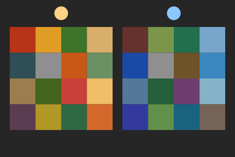
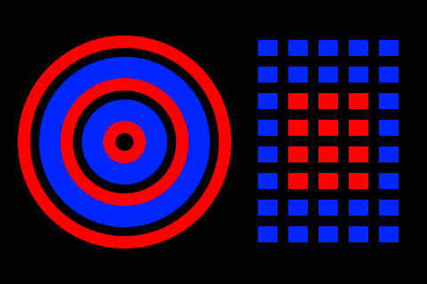
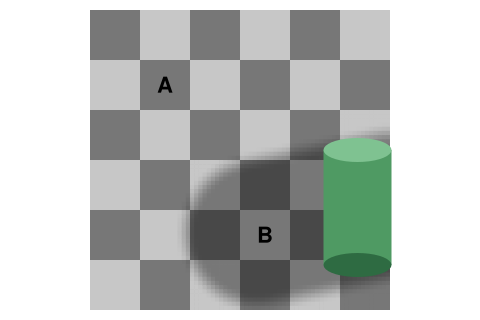
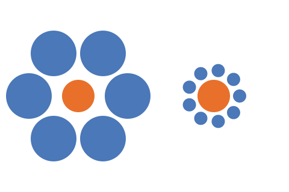

# 색 착시

*눈이 보는 것은 종이에 그려진 것과 다릅니다*

색, 밝기, 크기, 모양은 그림에서 점 하나하나 읽어 내는 것이 아닙니다. 시각계는 각 영역을 주변과 비교하여 거기에 무엇이 있는지 추측합니다. 여기의 착시들은 그 추측이 작동하는 모습을 보여 줍니다. 모두 색상에 관한 것은 아니며, 몇몇은 검정과 흰색의 대비만으로 일어납니다.

화면이나 품질 좋은 컬러 인쇄물로, 편안한 거리에서 보세요. 착시의 세기는 사람마다 다릅니다. 일부는 움직임이나 깜박임을 사용하니, 불편하면 멈추세요.

> 모든 그림은 이 문서를 위해 새로 그렸습니다. 글은 연결된 위키백과 문서(CC BY-SA 라이선스로 제공)를 바탕으로 한 짧은 요약입니다.

## 차례

- **색**
  - [동시 대비](#contrast)
  - [베졸트 효과](#bezold)
  - [색채 항등성](#constancy)
  - [음성 잔상](#afterimage)
  - [라일락 추적자](#lilac)
  - [매컬러 효과](#mccollough)
  - [색입체시](#chromostereopsis)
- **밝기와 대비**
  - [체커 그림자 착시](#checker)
  - [화이트 착시와 뭉커 착시](#white)
  - [마흐 밴드](#mach)
  - [콘스위트 착시](#cornsweet)
  - [격자 착시: 헤르만과 반짝이는 격자](#grid)
  - [에렌슈타인 착시](#ehrenstein)
  - [광삼 착시](#irradiation)
- **크기와 길이**
  - [에빙하우스 착시(티치너 원)](#ebbinghaus)
  - [뮐러-라이어 착시](#muller_lyer)
  - [폰조 착시](#ponzo)
- **휘고 기울어 보이는 선**
  - [카페 벽 착시](#cafe)
  - [프레이저 나선](#fraser)
  - [헤링 착시](#hering)
  - [분트 착시](#wundt)
  - [오비슨 착시](#orbison)
  - [쵤너 착시](#zollner)
  - [포겐도르프 착시](#poggendorff)
  - [기울기 착시와 기울기 잔효](#tilt)
- **정지 그림 속의 움직임**
  - [착시 운동](#motion)
  - [주변 표류 착시](#drift)
- **그림과 배경, 불가능한 물체**
  - [루빈의 꽃병](#rubin)
  - [펜로즈 삼각형](#penrose)

## 색

### 동시 대비

**어떻게 보이나.** 네 개의 작은 정사각형은 같은 회색입니다. 어두운 바탕에서는 밝은 바탕에서보다 밝아 보이고, 파랑 위에서는 노란 기가, 노랑 위에서는 파란 기가 돕니다.

**왜 그런가.** 색은 차이로 판단됩니다. 주변은 안쪽 영역을 명도와 색상 면에서 자신과 멀어지게 만듭니다.

**해 보기.** 종이에 구멍 두 개를 뚫어 작은 정사각형 두 개만 보이게 하면 차이가 사라집니다.

[위키백과 문서 (영어)](https://en.wikipedia.org/wiki/Contrast_effect)

### 베졸트 효과

**어떻게 보이나.** 검은 줄 사이의 빨강은 더 깊고 어두워 보이고, 흰 줄 사이의 빨강은 더 연하고 분홍빛으로 보입니다. 둘은 같은 빨강입니다.

**왜 그런가.** 작은 색면이 번갈아 놓이면 눈은 이를 부분적으로 섞습니다(동화). 빨강이 이웃의 색을 조금 띱니다. 빌헬름 폰 베졸트는 한 가지 색만 바꿔 양탄자를 새로 디자인하다가 이를 알아챘습니다.

**해 보기.** 페이지에서 물러서 보세요. 멀수록 섞임이 강해집니다.

[위키백과 문서 (영어)](https://en.wikipedia.org/wiki/Bezold_effect)

### 색채 항등성

**어떻게 보이나.** 같은 모자이크 두 벌에 따뜻한 빛과 차가운 빛을 비췄습니다(위의 원). 둘째 줄 둘째 타일은 왼쪽에서는 푸르스름하고 오른쪽에서는 누르스름해 보이지만, 같은 무채색 회색입니다.

**왜 그런가.** 사물을 계속 알아볼 수 있도록 뇌는 조명의 색을 추정해 빼냅니다. 온통 주황빛인 장면 속의 회색은 푸르스름한 표면으로 해석됩니다.

**해 보기.** 두 회색 타일만 남기고 모두 가려 보세요.

[위키백과 문서](https://ko.wikipedia.org/wiki/%EC%83%89%EC%B1%84%ED%95%AD%EB%93%B1%EC%84%B1)

### 음성 잔상

**어떻게 보이나.** 색 고리 가운데의 점을 응시한 뒤 오른쪽의 점을 보면, 점 둘레에 다른 색 고리(빨강, 초록, 노랑)가 있는 듯 보입니다.

**왜 그런가.** 한 색에 반응하는 세포는 지칩니다(순응). 흰 면에서는 다른 세포들이 더 강하게 반응해 보색이 보입니다.

**해 보기.** 눈을 움직이지 말고 왼쪽 점을 30초 동안 본 다음, 오른쪽 점을 보며 눈을 깜박이세요.

[위키백과 문서](https://ko.wikipedia.org/wiki/%EC%9E%94%EC%83%81)

### 라일락 추적자

**어떻게 보이나.** 십자를 응시하면 빈자리가 연보라 원들의 고리를 따라 돕니다. 이어 빈자리가 초록 원으로 바뀌고, 잠시 뒤에는 연보라 원들이 아예 사라지기도 합니다.

**왜 그런가.** 움직이는 빈자리는 가현 운동(파이 현상)입니다. 원이 사라진 자리에는 반대색인 초록의 잔상이 나타납니다. 주변시에서 가만히 있는 흐릿한 원들은 의식에서 사라집니다(트록슬러 효과).

**해 보기.** 적어도 30초 동안 십자에서 눈을 떼지 마세요. 이 애니메이션은 제러미 힌턴이 2005년 이전에 만들었습니다.

[위키백과 문서 (영어)](https://en.wikipedia.org/wiki/Lilac_chaser)

### 매컬러 효과

**어떻게 보이나.** 빨간 가로줄과 초록 세로줄을 번갈아 본 뒤에는 아래의 흑백 무늬에 색이 어려 보입니다. 가로줄 부분은 초록빛, 세로줄 부분은 분홍빛입니다.

**왜 그런가.** 시각계가 방향과 묶인 색에 순응하기 때문입니다. 셀레스트 매컬러가 1965년에 기술했으며, 몇 시간에서 몇 달까지 지속될 수 있습니다.

**해 보기.** 몇 분 동안 두 색 줄무늬를 몇 초씩 번갈아 본 다음 작은 무늬를 보세요. 주의: 효과가 오래 남을 수 있습니다.

[위키백과 문서 (영어)](https://en.wikipedia.org/wiki/McCollough_effect)

### 색입체시

**어떻게 보이나.** 검정 바탕의 빨강과 파랑은 같은 평면에 있지 않은 듯 보입니다. 대부분에게는 빨강이 파랑 앞에, 일부에게는 뒤에 있어 보입니다.

**왜 그런가.** 수정체가 짧은 파장과 긴 파장을 서로 다르게 굴절시켜(색수차) 두 색이 양 눈에서 조금 다른 곳에 맺히고, 뇌는 이 어긋남을 깊이로 읽습니다.

**해 보기.** 어둑한 방에서 두 눈으로 보세요. 안경을 쓰고도, 벗고도 해 보세요.

[위키백과 문서 (영어)](https://en.wikipedia.org/wiki/Chromostereopsis)

## 밝기와 대비

### 체커 그림자 착시

**어떻게 보이나.** 칸 A는 칸 B보다 훨씬 어두워 보입니다. 둘은 두 번째 그림의 띠가 보여 주듯 정확히 같은 회색입니다.

**왜 그런가.** 뇌는 그림자가 드리운 바둑판 바닥으로 읽고 그림자를 보정합니다. B는 밝은 칸이어야 하므로 밝게 보입니다. 에드워드 아델슨이 1995년에 발표했습니다.

**해 보기.** 종이 두 장으로 판의 나머지를 가려 A와 B만 남겨 보세요.

[위키백과 문서](https://ko.wikipedia.org/wiki/%EC%B2%B4%EC%BB%A4_%EA%B7%B8%EB%A6%BC%EC%9E%90_%EC%B0%A9%EC%8B%9C)

### 화이트 착시와 뭉커 착시

**어떻게 보이나.** 검은 줄에 끼운 회색 막대는 흰 줄에 끼운 것보다 밝아 보입니다. 색 있는 판(뭉커)에서는 같은 빨강이 한쪽에서는 주황, 다른 쪽에서는 보랏빛으로 보입니다.

**왜 그런가.** 단순한 대비로 예측되는 것과 반대로, 눈은 각 막대를 그것이 끼워진 줄과 한 묶음으로 보는 듯합니다.

**해 보기.** 종이에 뚫은 작은 구멍으로 두 무리를 비교해 보세요.

[위키백과 문서 (영어)](https://en.wikipedia.org/wiki/White%27s_illusion)

### 마흐 밴드

**어떻게 보이나.** 균일한 회색 띠가 밝은 이웃 쪽에서는 더 어둡게, 어두운 이웃 쪽에서는 더 밝게 보여 홈이 파인 듯합니다.

**왜 그런가.** 망막의 이웃 세포들이 서로 억제해(측면 억제) 경계를 과장합니다. 에른스트 마흐가 1865년에 기술했습니다.

**해 보기.** 띠 하나만 남기고 모두 가리면 완전히 균일합니다.

[위키백과 문서](https://ko.wikipedia.org/wiki/%EB%A7%88%ED%9D%90_%EB%B0%B4%EB%93%9C)

### 콘스위트 착시

**어떻게 보이나.** 왼쪽 절반이 오른쪽 절반보다 밝아 보입니다. 가운데에서 떨어진 곳은 둘 다 같은 회색입니다.

**왜 그런가.** 다른 것은 경계뿐으로, 한쪽은 밝아지고 다른 쪽은 어두워집니다. 시각계는 경계의 단차를 영역 전체의 차이로 받아들입니다.

**해 보기.** 가운데 선에 연필을 놓으면 두 절반이 같아집니다.

[위키백과 문서 (영어)](https://en.wikipedia.org/wiki/Cornsweet_illusion)

### 격자 착시: 헤르만과 반짝이는 격자

**어떻게 보이나.** 흰 격자의 교차점에 회색 얼룩이 나타나지만 바라보는 곳에는 없습니다. 회색 격자에 원을 놓으면 검은 점이 깜박이는 듯합니다.

**왜 그런가.** 헤르만 격자(1870)는 오랫동안 측면 억제만으로 설명되었으나, 이후 실험(선을 구부리면 사라짐)은 대뇌 피질의 직선 처리 방식에도 달려 있음을 보여 줍니다. 반짝이는 판은 1990년대에 보고되었습니다.

**해 보기.** 격자 위로 눈길을 옮기다가 교차점 하나를 응시해 보세요.

[위키백과 문서 (영어)](https://en.wikipedia.org/wiki/Grid_illusion)

### 에렌슈타인 착시

**어떻게 보이나.** 선이 교차하기 전에 끊긴 곳에 종이보다 하얀 밝은 원판이 나타나는 듯합니다.

**왜 그런가.** 선 끝은 위에 어떤 형태가 놓여 교차점을 가리고 있음을 암시합니다. 뇌는 그 윤곽(착시 윤곽)을 그리고 밝기로 채웁니다.

**해 보기.** 마음속으로나 연필로 틈을 이으면 원판이 사라집니다.

[위키백과 문서 (영어)](https://en.wikipedia.org/wiki/Ehrenstein_illusion)

### 광삼 착시

**어떻게 보이나.** 검정 위의 흰 정사각형은 흰색 위의 검은 정사각형보다 커 보이지만 크기가 같습니다.

**왜 그런가.** 빛이 눈 속에서 산란해 밝은 영역이 망막에서 퍼집니다. 갈릴레오가 1632년에 언급했고 헬름홀츠가 이름을 붙였습니다.

**해 보기.** 두 정사각형을 재 보세요.

[위키백과 문서 (영어)](https://en.wikipedia.org/wiki/Irradiation_illusion)

## 크기와 길이

### 에빙하우스 착시(티치너 원)

**어떻게 보이나.** 큰 원들에 둘러싸인 주황색 원은 작은 원들에 둘러싸인 것보다 작아 보입니다.

**왜 그런가.** 크기는 맥락에 비추어 판단됩니다. 둘레 원들의 거리와 간격도 영향을 줍니다.

**해 보기.** 파란 원들을 손가락으로 가려 보세요.

[위키백과 문서](https://ko.wikipedia.org/wiki/%EC%97%90%EB%B9%99%ED%95%98%EC%9A%B0%EC%8A%A4_%EC%B0%A9%EC%8B%9C)

### 뮐러-라이어 착시

**어떻게 보이나.** 화살깃이 바깥으로 향한 선이 안으로 향한 선보다 길어 보입니다. 아래의 빨간 선처럼 둘은 길이가 같습니다.

**왜 그런가.** 화살깃이 선 끝이 있어 보이는 위치를 옮깁니다. 입체로 보는 방과 건물의 모서리와 연결하는 설명도 있습니다. 프란츠 뮐러-라이어가 1889년에 기술했습니다.

**해 보기.** 점선 보조선으로 두 선을 비교해 보세요.

[위키백과 문서](https://ko.wikipedia.org/wiki/%EB%AE%90%EB%9F%AC-%EB%9D%BC%EC%9D%B4%EC%96%B4_%EC%B0%A9%EC%8B%9C)

### 폰조 착시

**어떻게 보이나.** 위의 노란 막대가 아래 것보다 길어 보입니다.

**왜 그런가.** 모여드는 선은 철길처럼 거리감을 줍니다. 종이에서 크기가 같아도 더 멀리 있는 막대라면 실제로는 더 커야 하기 때문입니다.

**해 보기.** 두 막대를 재 보거나 페이지를 거꾸로 돌려 보세요.

[위키백과 문서](https://ko.wikipedia.org/wiki/%ED%8F%B0%EC%A1%B0_%EC%B0%A9%EC%8B%9C)

## 휘고 기울어 보이는 선

### 카페 벽 착시

**어떻게 보이나.** 회색 줄눈선은 평행하고 수평인데도 번갈아 기울어 보입니다.

**왜 그런가.** 엇갈리게 놓인 흑백 타일과 중간 회색 줄눈이 선을 따라 작은 기울어진 요소를 만듭니다. 리처드 그레고리가 1973년 브리스틀의 한 카페 벽에서 이름을 따왔습니다.

**해 보기.** 페이지를 거의 옆으로 눕혀 줄눈을 따라 보세요.

[위키백과 문서 (영어)](https://en.wikipedia.org/wiki/Caf%C3%A9_wall_illusion)

### 프레이저 나선

**어떻게 보이나.** 나선이 중심으로 감겨 드는 듯합니다. 나선은 없습니다. 흑백의 끈은 동심원입니다.

**왜 그런가.** 짧은 조각마다 기울어 있고 꼬인 배경이 기울기를 더해, 눈이 이를 나선으로 잇습니다. 제임스 프레이저가 1908년에 기술했습니다.

**해 보기.** 손가락을 끈 하나에 대고 따라가면 출발점으로 돌아옵니다.

[위키백과 문서 (영어)](https://en.wikipedia.org/wiki/Fraser_spiral_illusion)

### 헤링 착시

**어떻게 보이나.** 두 빨간 선은 가운데가 바깥으로 불룩해 보입니다. 실제로는 곧고 평행합니다.

**왜 그런가.** 방사선과 이루는 각이 과대평가되고, 무늬가 깊이 방향의 움직임도 암시합니다. 에발트 헤링이 1861년에 발견했습니다.

**해 보기.** 빨간 선에 자를 대어 보세요.

[위키백과 문서](https://ko.wikipedia.org/wiki/%ED%97%A4%EB%A7%81_%EC%B0%A9%EC%8B%9C)

### 분트 착시

**어떻게 보이나.** 두 빨간 선은 가운데가 안쪽으로, 서로를 향해 휘어 보입니다. 실제로는 곧고 평행합니다.

**왜 그런가.** 헤링 도형의 짝으로, 방사선이 양옆의 점에서 퍼져 각들이 빨간 선을 반대 방향으로 왜곡합니다. 빌헬름 분트가 1898년에 기술했습니다.

**해 보기.** 헤링 착시와 비교해 보세요.

[위키백과 문서](https://ko.wikipedia.org/wiki/%EB%B6%84%ED%8A%B8_%EC%B0%A9%EC%8B%9C)

### 오비슨 착시

**어떻게 보이나.** 빨간 정사각형은 변이 휘고 모서리가 당겨진 듯 일그러져 보입니다.

**왜 그런가.** 헤링 도형처럼, 배경 고리와의 교차가 각 변의 지각된 방향을 치우치게 합니다. 윌리엄 오비슨이 1939년에 기술했습니다.

**해 보기.** 자로 변을 확인해 보세요.

[위키백과 문서](https://ko.wikipedia.org/wiki/%EC%98%A4%EB%B9%84%EC%8A%A8_%EC%B0%A9%EC%8B%9C)

### 쵤너 착시

**어떻게 보이나.** 긴 대각선들이 모였다 벌어졌다 하는 듯하지만 평행합니다.

**왜 그런가.** 짧은 획이 비스듬히 가로지르고 시각계가 예각을 과장해 각 선이 조금 돌아간 듯 보입니다. 요한 쵤너가 1860년에 보고했습니다.

**해 보기.** 페이지 모서리에서 긴 선을 따라 보세요.

[위키백과 문서](https://ko.wikipedia.org/wiki/%EC%B5%A4%EB%84%88_%EC%B0%A9%EC%8B%9C)

### 포겐도르프 착시

**어떻게 보이나.** 왼쪽에서 회색 블록으로 들어가는 검은 선은 파란 선으로 나오는 듯합니다. 두 번째 그림이 보여 주듯 위의 검은 선으로 나옵니다.

**왜 그런가.** 선과 블록 사이의 예각이 실제보다 넓게 보여 겉보기 경로가 어긋납니다. 쵤너 자신의 그림에서 발견되었습니다.

**해 보기.** 자로 왼쪽 선을 연장해 보세요.

[위키백과 문서](https://ko.wikipedia.org/wiki/%ED%8F%AC%EA%B2%90%EB%8F%84%EB%A5%B4%ED%94%84_%EC%B0%A9%EC%8B%9C)

### 기울기 착시와 기울기 잔효

**어떻게 보이나.** 안쪽 두 원의 줄은 모두 수직이지만 둘레 줄과 반대쪽으로 기울어 보입니다.

**왜 그런가.** 비슷한 방향에 맞춰진 세포들이 서로 억제해 지각된 각을 밀어냅니다. 기운 줄을 오래 보면 다음에 보는 것에도 비슷한 영향이 있습니다.

**해 보기.** 바깥 고리를 가리고 안쪽 원을 비교해 보세요.

[위키백과 문서 (영어)](https://en.wikipedia.org/wiki/Visual_tilt_effects)

## 정지 그림 속의 움직임

### 착시 운동

**어떻게 보이나.** 고리들이 천천히 도는 듯합니다. 특히 똑바로 보지 않는 것이 그렇습니다.

**왜 그런가.** 대비가 다른 조각들은 조금씩 다른 지연으로 처리되고, 작은 눈 움직임마다 이 순서가 다시 시작됩니다. 운동 탐지기는 이를 움직임으로 읽습니다.

**해 보기.** 눈길을 바퀴에서 바퀴로 옮기거나 깜박여 보세요.

[위키백과 문서 (영어)](https://en.wikipedia.org/wiki/Illusory_motion)

### 주변 표류 착시

**어떻게 보이나.** 회색 계조로 된 고리는 곁눈으로 볼 때 회전하는 듯합니다.

**왜 그런가.** 어둠에서 밝음으로 반복되는 계조(톱니파)가 주변시의 운동 탐지기를 자극해, 어두운 쪽에서 밝은 쪽으로 움직여 보입니다.

**해 보기.** 그림 옆을 보며 빠르게 눈을 깜박이세요.

[위키백과 문서 (영어)](https://en.wikipedia.org/wiki/Peripheral_drift_illusion)

## 그림과 배경, 불가능한 물체

### 루빈의 꽃병

**어떻게 보이나.** 밝은 꽃병 또는 마주 보는 두 어두운 얼굴: 이것 아니면 저것이며, 둘을 동시에 보기는 어렵습니다.

**왜 그런가.** 함께 쓰는 윤곽은 한 번에 한쪽에만 속합니다. 그림으로 받아들인 쪽이 형태를 갖고 나머지는 배경이 됩니다. 에드가 루빈이 1915년경 연구했습니다.

**해 보기.** 마음대로 바꿔 보고, 저절로 뒤집힌 횟수도 세어 보세요.

[위키백과 문서](https://ko.wikipedia.org/wiki/%EB%A3%A8%EB%B9%88%EC%9D%98_%EA%BD%83%EB%B3%91)

### 펜로즈 삼각형

**어떻게 보이나.** 사각 막대 세 개가 각각 다음 것과 직각으로 이어진 입체 삼각형입니다.

**왜 그런가.** 모서리 하나하나는 맞지만 셋이 함께 참일 수는 없습니다. 그런 물체는 없습니다. 오스카르 레우테르스베르드가 1934년에 그렸고, 라이오넬과 로저 펜로즈가 널리 알렸으며, M. C. 에셔의 「폭포」에 영감을 주었습니다.

**해 보기.** 모서리를 하나씩 가리면 나머지는 가능해집니다.

[위키백과 문서](https://ko.wikipedia.org/wiki/%ED%8E%9C%EB%A1%9C%EC%A6%88_%EC%82%BC%EA%B0%81%ED%98%95)
