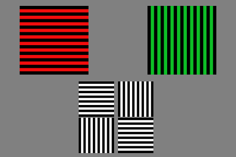
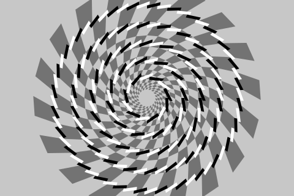

# Kleurillusies

*Wat het oog ziet, is niet wat er op de bladzijde staat*

Kleur, helderheid, grootte en vorm worden niet punt voor punt van het beeld afgelezen: het visuele systeem vergelijkt elk vlak met zijn omgeving en schat wat er is. Deze illusies laten dat schatten aan het werk zien. Niet alle gaan over tint; verscheidene hebben alleen het contrast tussen zwart en wit nodig.

Bekijk de figuren op een scherm of in een goede kleurenafdruk, op een prettige afstand. De sterkte van elke illusie verschilt per persoon. Enkele gebruiken beweging of geflikker: stop als dat hindert.

> Alle figuren zijn voor dit document getekend. De teksten zijn korte samenvattingen op basis van de gelinkte Wikipedia-artikelen (beschikbaar onder de licentie CC BY-SA).

## Inhoud

- **Kleur**
  - [Simultaancontrast](#contrast)
  - [Bezold-effect](#bezold)
  - [Kleurconstantie](#constancy)
  - [Negatief nabeeld](#afterimage)
  - [Lila jager](#lilac)
  - [McCollough-effect](#mccollough)
  - [Chromostereopsis](#chromostereopsis)
- **Helderheid en contrast**
  - [Dambord van Adelson](#checker)
  - [Illusie van White en Munker](#white)
  - [Mach-banden](#mach)
  - [Cornsweet-illusie](#cornsweet)
  - [Roosterillusies: Hermann en fonkelend](#grid)
  - [Ehrenstein-illusie](#ehrenstein)
  - [Irradiatie-illusie](#irradiation)
- **Grootte en lengte**
  - [Ebbinghaus-illusie (cirkels van Titchener)](#ebbinghaus)
  - [Müller-Lyer-illusie](#muller_lyer)
  - [Ponzo-illusie](#ponzo)
- **Gebogen en schuine lijnen**
  - [Cafémuur-illusie](#cafe)
  - [Fraser-spiraal](#fraser)
  - [Hering-illusie](#hering)
  - [Wundt-illusie](#wundt)
  - [Orbison-illusie](#orbison)
  - [Zöllner-illusie](#zollner)
  - [Poggendorff-illusie](#poggendorff)
  - [Kantelillusie en kantelnawerking](#tilt)
- **Beweging in stilstaande beelden**
  - [Illusoire beweging](#motion)
  - [Perifere drift](#drift)
- **Figuur, achtergrond en onmogelijke objecten**
  - [Vaas van Rubin](#rubin)
  - [Penrose-driehoek](#penrose)

## Kleur

### Simultaancontrast

**Wat je ziet.** De vier kleine vierkanten zijn hetzelfde grijs. Op de donkere ondergrond lijkt het lichter dan op de lichte; op blauw neigt het naar geel en op geel naar blauw.

**Waarom het gebeurt.** Kleur wordt op verschil beoordeeld. De omgeving duwt het vlak erbinnen van zich af, in helderheid en in tint.

**Probeer dit.** Knip twee gaatjes in een vel zodat alleen twee van de vierkantjes te zien zijn: het verschil verdwijnt.

[Wikipedia-artikel (in het Engels)](https://en.wikipedia.org/wiki/Contrast_effect)

### Bezold-effect

**Wat je ziet.** Het rood tussen de zwarte strepen lijkt dieper en donkerder dan het rood tussen de witte strepen, dat bleker en rozer lijkt. Het is één en hetzelfde rood.

**Waarom het gebeurt.** Als kleine kleurvlakken elkaar afwisselen, mengt het oog ze gedeeltelijk (assimilatie): het rood neemt iets van zijn buur over. Wilhelm von Bezold merkte het toen hij tapijten herontwierp door één kleur te veranderen.

**Probeer dit.** Ga verder van de bladzijde staan: hoe verder weg, hoe sterker de menging.

[Wikipedia-artikel](https://nl.wikipedia.org/wiki/Bezoldeffect)

### Kleurconstantie

**Wat je ziet.** Twee kopieën van een mozaïek worden met warm en met koel licht beschenen (de schijven erboven). Het tweede vakje van de tweede rij lijkt links blauwig en rechts gelig, maar is hetzelfde neutrale grijs.

**Waarom het gebeurt.** Om voorwerpen herkenbaar te houden schat het brein de kleur van het licht en trekt die ervan af. Een grijs in een geheel oranje tafereel wordt als een blauwig oppervlak gelezen.

**Probeer dit.** Dek alles af behalve de twee grijze vakjes.

[Wikipedia-artikel](https://nl.wikipedia.org/wiki/Kleurconstantie)

### Negatief nabeeld

**Wat je ziet.** Na het staren naar de stip in de gekleurde ringen lijkt de losse stip rechts omringd door ringen in andere kleuren: rood, groen en geel.

**Waarom het gebeurt.** De cellen die op een kleur reageren, raken vermoeid (adaptatie). Op wit reageren de andere sterker en zie je de complementaire kleur.

**Probeer dit.** Staar 30 seconden naar de linker stip zonder je ogen te bewegen, kijk dan naar de rechter en knipper.

[Wikipedia-artikel](https://nl.wikipedia.org/wiki/Nabeeld)

### Lila jager

**Wat je ziet.** Kijk je naar het kruis, dan loopt een gat door de ring van lila schijven; daarna wordt het gat een groene schijf, en na een tijdje kunnen de lila schijven helemaal verdwijnen.

**Waarom het gebeurt.** Het bewegende gat is schijnbeweging (phi-fenomeen). Waar een schijf verdwijnt, verschijnt een nabeeld in de tegenkleur groen. De wazige, stilstaande schijven in de periferie vervagen uit het bewustzijn (Troxler-effect).

**Probeer dit.** Houd je blik minstens 30 seconden op het kruis. Jeremy Hinton maakte deze animatie vóór 2005.

[Wikipedia-artikel (in het Engels)](https://en.wikipedia.org/wiki/Lilac_chaser)

### McCollough-effect

**Wat je ziet.** Na om beurten naar rode horizontale en groene verticale strepen te kijken, lijken de zwart-witte vakken eronder getint: groenig bij horizontale en roze bij verticale strepen.

**Waarom het gebeurt.** Het visuele systeem past zich aan een kleur aan die aan een richting gekoppeld is. Celeste McCollough beschreef het in 1965; het kan uren en zelfs maanden duren.

**Probeer dit.** Wissel enkele minuten lang om de paar seconden tussen de twee gekleurde roosters en kijk dan naar de kleine vakken. Let op: het effect kan lang aanhouden.

[Wikipedia-artikel (in het Engels)](https://en.wikipedia.org/wiki/McCollough_effect)

### Chromostereopsis

**Wat je ziet.** Rood en blauw op zwart lijken niet in hetzelfde vlak te liggen: voor de meeste mensen zweeft het rood vóór het blauw, voor sommigen ligt het erachter.

**Waarom het gebeurt.** De ooglens breekt korte en lange golflengten verschillend (chromatische aberratie), zodat de twee kleuren in elk oog op iets andere plekken vallen, en het brein leest die verschuiving als diepte.

**Probeer dit.** Kijk in een schemerige kamer met beide ogen; probeer het met en zonder bril.

[Wikipedia-artikel (in het Engels)](https://en.wikipedia.org/wiki/Chromostereopsis)

## Helderheid en contrast

### Dambord van Adelson

**Wat je ziet.** Vak A lijkt veel donkerder dan vak B. Ze zijn precies hetzelfde grijs, zoals de balk in de tweede figuur laat zien.

**Waarom het gebeurt.** Het brein leest een geblokte vloer met een schaduw erop en corrigeert voor de schaduw: B moet een licht vak zijn en wordt dus als licht gezien. Edward Adelson publiceerde de illusie in 1995.

**Probeer dit.** Bedek de rest van het bord met twee papiertjes zodat alleen A en B overblijven.

[Wikipedia-artikel](https://nl.wikipedia.org/wiki/Dambord_van_Adelson)

### Illusie van White en Munker

**Wat je ziet.** De grijze balken in de zwarte strepen lijken lichter dan die in de witte. In de gekleurde versie (Munker) lijkt hetzelfde rood aan de ene kant oranje en aan de andere paarsig.

**Waarom het gebeurt.** Anders dan eenvoudig contrast zou voorspellen, lijkt het oog elke balk te groeperen met de streep waarin hij is gezet.

**Probeer dit.** Vergelijk de twee groepen door een klein gaatje in een papier.

[Wikipedia-artikel (in het Engels)](https://en.wikipedia.org/wiki/White%27s_illusion)

### Mach-banden

**Wat je ziet.** Elke egaal grijze strook lijkt donkerder naast zijn lichtere buur en lichter naast zijn donkerdere, alsof de stroken geribbeld zijn.

**Waarom het gebeurt.** Naburige cellen in het netvlies remmen elkaar (laterale inhibitie), wat randen overdrijft. Ernst Mach beschreef het effect in 1865.

**Probeer dit.** Dek alle stroken op één na af: die is volmaakt egaal.

[Wikipedia-artikel (in het Engels)](https://en.wikipedia.org/wiki/Mach_bands)

### Cornsweet-illusie

**Wat je ziet.** De linkerhelft lijkt lichter dan de rechter. Weg van het midden zijn beide hetzelfde grijs.

**Waarom het gebeurt.** Alleen de rand verschilt: aan de ene kant loopt hij op, aan de andere af. Het visuele systeem neemt de sprong aan de rand als het verschil tussen de hele vlakken.

**Probeer dit.** Leg een potlood op de middellijn en zie de twee helften gelijk worden.

[Wikipedia-artikel (in het Engels)](https://en.wikipedia.org/wiki/Cornsweet_illusion)

### Roosterillusies: Hermann en fonkelend

**Wat je ziet.** In het witte rooster verschijnen grijze vlekjes op de kruispunten, behalve waar je kijkt. Met schijfjes op een grijs rooster lijken zwarte stippen aan en uit te flitsen.

**Waarom het gebeurt.** Het rooster van Hermann (1870) werd lang alleen met laterale inhibitie verklaard; latere proeven (de lijnen buigen heft het op) tonen dat het ook afhangt van hoe de hersenschors rechte lijnen verwerkt. De fonkelende versie werd in de jaren negentig gemeld.

**Probeer dit.** Laat je ogen over het rooster dwalen en fixeer dan één kruispunt.

[Wikipedia-artikel (in het Engels)](https://en.wikipedia.org/wiki/Grid_illusion)

### Ehrenstein-illusie

**Wat je ziet.** Waar de lijnen vóór de kruising stoppen, lijken heldere schijven te verschijnen, witter dan het papier.

**Waarom het gebeurt.** De lijneinden suggereren een vorm die erbovenop ligt en de kruisingen verbergt. Het brein tekent de omtrek ervan (illusoire contour) en vult die met helderheid.

**Probeer dit.** Sluit de gaten in gedachten of met een potlood: de schijven verdwijnen.

[Wikipedia-artikel (in het Engels)](https://en.wikipedia.org/wiki/Ehrenstein_illusion)

### Irradiatie-illusie

**Wat je ziet.** Het witte vierkant op zwart lijkt groter dan het zwarte op wit, hoewel ze even groot zijn.

**Waarom het gebeurt.** Licht verstrooit in het oog en een helder vlak spreidt zich uit op het netvlies. Galilei noemde het in 1632; Helmholtz gaf het zijn naam.

**Probeer dit.** Meet de twee vierkanten.

[Wikipedia-artikel](https://nl.wikipedia.org/wiki/Irradiatie)

## Grootte en lengte

### Ebbinghaus-illusie (cirkels van Titchener)

**Wat je ziet.** De oranje cirkel tussen grote cirkels lijkt kleiner dan die tussen kleine cirkels.

**Waarom het gebeurt.** Grootte wordt ten opzichte van de context beoordeeld; ook de afstand en spreiding van de omringende cirkels tellen mee.

**Probeer dit.** Bedek de blauwe cirkels met je vingers.

[Wikipedia-artikel](https://nl.wikipedia.org/wiki/Ebbinghaus-illusie)

### Müller-Lyer-illusie

**Wat je ziet.** De lijn met pijlpunten naar buiten lijkt langer dan die met pijlpunten naar binnen. Ze zijn even lang, net als de rode lijn eronder.

**Waarom het gebeurt.** De vinnen verschuiven waar de lijneinden lijken te liggen; een verklaring brengt ze in verband met hoeken van kamers en gebouwen in perspectief. Franz Müller-Lyer beschreef de illusie in 1889.

**Probeer dit.** Vergelijk beide lijnen met de gestippelde hulplijnen.

[Wikipedia-artikel](https://nl.wikipedia.org/wiki/M%C3%BCller-Lyer-illusie)

### Ponzo-illusie

**Wat je ziet.** De bovenste gele balk lijkt langer dan de onderste.

**Waarom het gebeurt.** Samenlopende lijnen suggereren afstand, zoals spoorrails: een balk die op de bladzijde even groot is maar verder weg ligt, zou groter moeten zijn.

**Probeer dit.** Meet de twee balken of draai de bladzijde ondersteboven.

[Wikipedia-artikel](https://nl.wikipedia.org/wiki/Ponzo-illusie)

## Gebogen en schuine lijnen

### Cafémuur-illusie

**Wat je ziet.** De grijze voegen lijken om en om schuin te lopen, hoewel ze evenwijdig en horizontaal zijn.

**Waarom het gebeurt.** De verschoven zwarte en witte tegels, met een voeg in middelgrijs, vormen kleine schuine elementjes langs elke lijn. Richard Gregory noemde haar in 1973 naar de muur van een café in Bristol.

**Probeer dit.** Kijk langs een voeg met de bladzijde bijna op zijn kant.

[Wikipedia-artikel](https://nl.wikipedia.org/wiki/Caf%C3%A9muur-illusie)

### Fraser-spiraal

**Wat je ziet.** Een spiraal lijkt naar het midden te draaien. Er is geen spiraal: de zwart-witte koorden vormen concentrische cirkels.

**Waarom het gebeurt.** Elk kort stukje staat schuin en de gedraaide achtergrond versterkt dat, zodat het oog ze tot een spiraal verbindt. James Fraser beschreef haar in 1908.

**Probeer dit.** Zet een vinger op een koord en volg het: je komt uit waar je begon.

[Wikipedia-artikel](https://nl.wikipedia.org/wiki/Fraser-spiraal)

### Hering-illusie

**Wat je ziet.** De twee rode lijnen lijken in het midden naar buiten te buigen. Ze zijn recht en evenwijdig.

**Waarom het gebeurt.** De hoeken met de uitstralende lijnen worden overschat, en het patroon suggereert ook beweging de diepte in. Ewald Hering ontdekte haar in 1861.

**Probeer dit.** Houd een liniaal langs een rode lijn.

[Wikipedia-artikel](https://nl.wikipedia.org/wiki/Hering-illusie)

### Wundt-illusie

**Wat je ziet.** De twee rode lijnen lijken in het midden naar binnen, naar elkaar toe, te buigen. Ze zijn recht en evenwijdig.

**Waarom het gebeurt.** Het is de tegenhanger van de figuur van Hering: de stralen komen nu uit punten aan weerszijden, zodat de hoeken de rode lijnen de andere kant op vertekenen. Wilhelm Wundt beschreef haar in 1898.

**Probeer dit.** Vergelijk met de Hering-illusie.

[Wikipedia-artikel](https://nl.wikipedia.org/wiki/Wundt-illusie)

### Orbison-illusie

**Wat je ziet.** Het rode vierkant lijkt vervormd, met gebogen zijden en getrokken hoeken.

**Waarom het gebeurt.** Net als bij Hering vertekenen de kruisingen met de ringen op de achtergrond de waargenomen richting van elke zijde. William Orbison beschreef haar in 1939.

**Probeer dit.** Controleer de zijden met een liniaal.

[Wikipedia-artikel](https://nl.wikipedia.org/wiki/Orbison-illusie)

### Zöllner-illusie

**Wat je ziet.** De lange diagonalen lijken naar elkaar toe en van elkaar af te lopen. Ze zijn evenwijdig.

**Waarom het gebeurt.** De korte streepjes kruisen ze schuin en het visuele systeem overdrijft scherpe hoeken, waardoor elke lijn iets draait. Johann Zöllner meldde het in 1860.

**Probeer dit.** Kijk vanuit een hoek van de bladzijde langs de lange lijnen.

[Wikipedia-artikel](https://nl.wikipedia.org/wiki/Z%C3%B6llner-illusie)

### Poggendorff-illusie

**Wat je ziet.** De zwarte lijn die links het grijze blok ingaat, lijkt er als de blauwe lijn uit te komen. Ze komt er als de bovenste zwarte uit, zoals de tweede figuur toont.

**Waarom het gebeurt.** Scherpe hoeken tussen lijn en blok worden wijder gezien dan ze zijn, waardoor het schijnbare verloop verschuift. Het werd opgemerkt in Zöllners eigen tekeningen.

**Probeer dit.** Verleng de linker lijn met een liniaal.

[Wikipedia-artikel (in het Engels)](https://en.wikipedia.org/wiki/Poggendorff_illusion)

### Kantelillusie en kantelnawerking

**Wat je ziet.** De strepen in de twee binnenste schijven zijn verticaal, maar lijken weg te hellen van de strepen eromheen.

**Waarom het gebeurt.** Cellen voor naburige richtingen remmen elkaar, waardoor de waargenomen hoek wordt afgestoten. Lang naar schuine strepen kijken werkt net zo op wat je daarna ziet.

**Probeer dit.** Bedek de buitenste ringen en vergelijk de binnenste schijven.

[Wikipedia-artikel (in het Engels)](https://en.wikipedia.org/wiki/Visual_tilt_effects)

## Beweging in stilstaande beelden

### Illusoire beweging

**Wat je ziet.** De wielen lijken langzaam te draaien, vooral die waar je niet recht naar kijkt.

**Waarom het gebeurt.** Blokken met verschillend contrast worden met iets verschillende vertraging verwerkt, en elke kleine oogbeweging start de reeks opnieuw; bewegingsdetectoren lezen die als beweging.

**Probeer dit.** Verplaats je blik van wiel naar wiel, of knipper.

[Wikipedia-artikel (in het Engels)](https://en.wikipedia.org/wiki/Illusory_motion)

### Perifere drift

**Wat je ziet.** De ringen van grijsverlopen lijken te draaien als je ze uit je ooghoek ziet.

**Waarom het gebeurt.** Een herhaald verloop van donker naar licht (zaagtand) prikkelt bewegingsdetectoren in de periferie; de beweging wordt van donker naar licht gezien.

**Probeer dit.** Kijk naast de figuur en knipper snel.

[Wikipedia-artikel](https://nl.wikipedia.org/wiki/Perifere_drift-illusie_%28gezichtsbedrog%29)

## Figuur, achtergrond en onmogelijke objecten

### Vaas van Rubin

**Wat je ziet.** Een lichte vaas, of twee donkere gezichten die elkaar aankijken: het een of het ander, bijna nooit beide tegelijk.

**Waarom het gebeurt.** De gedeelde omtrek kan maar bij één kant tegelijk horen: wat als figuur geldt, krijgt de vorm en de rest wordt achtergrond. Edgar Rubin bestudeerde haar rond 1915.

**Probeer dit.** Probeer naar wens te wisselen en tel hoe vaak het vanzelf omslaat.

[Wikipedia-artikel](https://nl.wikipedia.org/wiki/Vaas_van_Rubin)

### Penrose-driehoek

**Wat je ziet.** Een massieve driehoek van drie vierkante balken, elk haaks verbonden met de volgende.

**Waarom het gebeurt.** Elke hoek klopt op zichzelf, maar de drie kunnen niet samen waar zijn: zo'n voorwerp bestaat niet. Oscar Reutersvärd tekende het in 1934; Lionel en Roger Penrose maakten het bekend, en het inspireerde M. C. Eschers Waterval.

**Probeer dit.** Bedek telkens één hoek: de rest wordt mogelijk.

[Wikipedia-artikel](https://nl.wikipedia.org/wiki/Penrose-driehoek)
