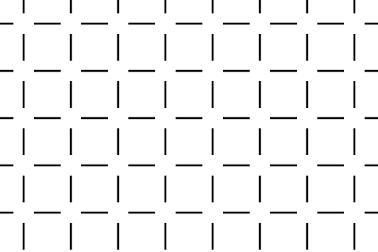

# Złudzenia barwne

*To, co widzi oko, to nie to, co jest na stronie*

Barwy, jasności, wielkości i kształtu nie odczytujemy z obrazu punkt po punkcie: układ wzrokowy porównuje każdy obszar z otoczeniem i zgaduje, co tam jest. Te złudzenia pokazują to zgadywanie w działaniu. Nie wszystkie dotyczą odcienia; kilku wystarcza kontrast czerni i bieli.

Oglądaj rysunki na ekranie lub na dobrym kolorowym wydruku, z wygodnej odległości. Siła każdego złudzenia różni się u różnych osób. Kilka wykorzystuje ruch lub migotanie: przerwij, jeśli przeszkadzają.

> Wszystkie rysunki powstały na potrzeby tego dokumentu. Teksty to krótkie streszczenia na podstawie podlinkowanych artykułów Wikipedii (dostępnych na licencji CC BY-SA).

## Spis treści

- **Barwa**
  - [Kontrast równoczesny](#contrast)
  - [Efekt Bezolda](#bezold)
  - [Stałość barwy](#constancy)
  - [Powidok negatywowy](#afterimage)
  - [Liliowy ścigacz](#lilac)
  - [Efekt McCollough](#mccollough)
  - [Chromostereopsja](#chromostereopsis)
- **Jasność i kontrast**
  - [Szachownica Adelsona](#checker)
  - [Złudzenie White’a i Munkera](#white)
  - [Pasma Macha](#mach)
  - [Złudzenie Cornsweeta](#cornsweet)
  - [Złudzenia kratowe: Hermanna i migocące](#grid)
  - [Złudzenie Ehrensteina](#ehrenstein)
  - [Złudzenie irradiacji](#irradiation)
- **Wielkość i długość**
  - [Złudzenie Ebbinghausa (koła Titchenera)](#ebbinghaus)
  - [Złudzenie Müllera-Lyera](#muller_lyer)
  - [Złudzenie Ponza](#ponzo)
- **Wygięte i pochylone linie**
  - [Złudzenie ściany kawiarni](#cafe)
  - [Spirala Frasera](#fraser)
  - [Złudzenie Heringa](#hering)
  - [Złudzenie Wundta](#wundt)
  - [Złudzenie Orbisona](#orbison)
  - [Złudzenie Zöllnera](#zollner)
  - [Złudzenie Poggendorffa](#poggendorff)
  - [Złudzenie i następczy efekt pochylenia](#tilt)
- **Ruch w nieruchomych obrazach**
  - [Ruch pozorny](#motion)
  - [Dryf peryferyjny](#drift)
- **Figura, tło i przedmioty niemożliwe**
  - [Waza Rubina](#rubin)
  - [Trójkąt Penrose’a](#penrose)

## Barwa

### Kontrast równoczesny

**Co widać.** Cztery małe kwadraty są tak samo szare. Na ciemnym tle szarość wydaje się jaśniejsza niż na jasnym; na niebieskim skłania się ku żółci, a na żółtym ku błękitowi.

**Dlaczego tak jest.** Barwę oceniamy przez różnicę. Otoczenie odpycha od siebie zamknięty w nim obszar, w jasności i w odcieniu.

**Spróbuj.** Wytnij w kartce dwa otwory, by widać było tylko dwa małe kwadraty: różnica znika.

[Artykuł w Wikipedii](https://pl.wikipedia.org/wiki/Efekt_kontrastu)

### Efekt Bezolda

**Co widać.** Czerwień między czarnymi paskami wydaje się głębsza i ciemniejsza niż między białymi, gdzie jest bledsza i bardziej różowa. To jedna i ta sama czerwień.

**Dlaczego tak jest.** Gdy małe plamy barwne występują na przemian, oko częściowo je miesza (asymilacja): czerwień przejmuje coś od sąsiada. Wilhelm von Bezold zauważył to, przeprojektowując dywany przez zmianę jednego koloru.

**Spróbuj.** Odsuń się od strony: im dalej, tym silniejsze mieszanie.

[Artykuł w Wikipedii (po angielsku)](https://en.wikipedia.org/wiki/Bezold_effect)

### Stałość barwy

**Co widać.** Dwie kopie mozaiki oświetlono światłem ciepłym i zimnym (krążki u góry). Drugie pole drugiego rzędu wydaje się po lewej niebieskawe, a po prawej żółtawe, choć to ta sama neutralna szarość.

**Dlaczego tak jest.** Aby przedmioty pozostały rozpoznawalne, mózg szacuje barwę światła i ją odejmuje. Szarość w całkiem pomarańczowej scenie odczytuje jako niebieskawą powierzchnię.

**Spróbuj.** Zakryj wszystko oprócz dwóch szarych pól.

[Artykuł w Wikipedii (po angielsku)](https://en.wikipedia.org/wiki/Color_constancy)

### Powidok negatywowy

**Co widać.** Po wpatrywaniu się w kropkę wśród kolorowych pierścieni samotna kropka po prawej wydaje się otoczona pierścieniami o innych barwach: czerwonej, zielonej i żółtej.

**Dlaczego tak jest.** Komórki reagujące na dany kolor męczą się (adaptacja). Na bieli pozostałe odpowiadają silniej i widać barwę dopełniającą.

**Spróbuj.** Przez 30 sekund patrz na lewą kropkę, nie ruszając oczami, potem spójrz na prawą i mrugnij.

[Artykuł w Wikipedii](https://pl.wikipedia.org/wiki/Kontrast_nast%C4%99pczy)

### Liliowy ścigacz

**Co widać.** Gdy patrzysz na krzyżyk, luka biegnie po pierścieniu liliowych krążków; potem zamienia się w zielony krążek, a po chwili liliowe krążki mogą całkiem zniknąć.

**Dlaczego tak jest.** Wędrująca luka to ruch pozorny (zjawisko phi). Tam, gdzie krążek znika, pojawia się powidok barwy przeciwnej, zielonej. Rozmyte, nieruchome krążki na obrzeżach wypadają ze świadomości (efekt Troxlera).

**Spróbuj.** Wpatruj się w krzyżyk przez co najmniej 30 sekund. Animację stworzył Jeremy Hinton przed 2005 rokiem.

[Artykuł w Wikipedii (po angielsku)](https://en.wikipedia.org/wiki/Lilac_chaser)

### Efekt McCollough

**Co widać.** Po oglądaniu na przemian czerwonych poziomych i zielonych pionowych pasków czarno-białe pola poniżej wydają się zabarwione: zielonkawo przy paskach poziomych i różowo przy pionowych.

**Dlaczego tak jest.** Układ wzrokowy adaptuje się do barwy powiązanej z orientacją. Celeste McCollough opisała to w 1965 roku; efekt może trwać godziny, a nawet miesiące.

**Spróbuj.** Przez kilka minut przenoś wzrok co parę sekund między dwiema kolorowymi kratami, potem spójrz na małe pola. Uwaga: efekt może utrzymywać się długo.

[Artykuł w Wikipedii](https://pl.wikipedia.org/wiki/Efekt_McCollough)

### Chromostereopsja

**Co widać.** Czerwień i błękit na czerni nie wydają się leżeć w jednej płaszczyźnie: większości osób czerwień unosi się przed błękitem, niektórym chowa się za nim.

**Dlaczego tak jest.** Soczewka załamuje krótkie i długie fale w różnym stopniu (aberracja chromatyczna), więc obie barwy trafiają w każdym oku w nieco inne miejsca, a mózg odczytuje to przesunięcie jako głębię.

**Spróbuj.** Oglądaj w przyciemnionym pokoju obojgiem oczu; spróbuj w okularach i bez nich.

[Artykuł w Wikipedii (po angielsku)](https://en.wikipedia.org/wiki/Chromostereopsis)

## Jasność i kontrast

### Szachownica Adelsona

**Co widać.** Pole A wydaje się znacznie ciemniejsze niż pole B. Są dokładnie tak samo szare, co pokazuje pas na drugim rysunku.

**Dlaczego tak jest.** Mózg widzi szachownicę z padającym cieniem i poprawia na cień: B musi być jasnym polem, więc widzimy je jako jasne. Edward Adelson opublikował złudzenie w 1995 roku.

**Spróbuj.** Zasłoń resztę planszy dwiema kartkami, zostawiając tylko A i B.

[Artykuł w Wikipedii](https://pl.wikipedia.org/wiki/Szachownica_Adelsona)

### Złudzenie White’a i Munkera

**Co widać.** Szare belki wstawione w czarne pasy wydają się jaśniejsze niż te w białych. W wersji kolorowej (Munker) ta sama czerwień z jednej strony wygląda na pomarańczową, z drugiej na fioletową.

**Dlaczego tak jest.** Wbrew temu, co przewidywałby zwykły kontrast, oko zdaje się grupować każdą belkę z pasem, w który ją wstawiono.

**Spróbuj.** Porównaj obie grupy przez mały otwór w kartce.

[Artykuł w Wikipedii (po angielsku)](https://en.wikipedia.org/wiki/White%27s_illusion)

### Pasma Macha

**Co widać.** Każdy jednolity szary pas wydaje się ciemniejszy przy jaśniejszym sąsiedzie i jaśniejszy przy ciemniejszym, jakby pasy były żłobkowane.

**Dlaczego tak jest.** Sąsiednie komórki siatkówki hamują się nawzajem (hamowanie oboczne), co wzmacnia krawędzie. Ernst Mach opisał zjawisko w 1865 roku.

**Spróbuj.** Zakryj wszystkie pasy oprócz jednego: jest idealnie równy.

[Artykuł w Wikipedii](https://pl.wikipedia.org/wiki/Pasmo_Macha)

### Złudzenie Cornsweeta

**Co widać.** Lewa połowa wydaje się jaśniejsza od prawej. Z dala od środka obie są tak samo szare.

**Dlaczego tak jest.** Różni się tylko krawędź, która z jednej strony narasta, a z drugiej opada. Układ wzrokowy traktuje skok na krawędzi jak różnicę całych obszarów.

**Spróbuj.** Połóż ołówek na linii środkowej, a obie połowy staną się jednakowe.

[Artykuł w Wikipedii (po angielsku)](https://en.wikipedia.org/wiki/Cornsweet_illusion)

### Złudzenia kratowe: Hermanna i migocące

**Co widać.** W białej kracie na skrzyżowaniach pojawiają się szare plamki, poza tym, na które patrzysz. Z krążkami na szarej kracie czarne kropki zdają się zapalać i gasnąć.

**Dlaczego tak jest.** Kratę Hermanna (1870) długo tłumaczono samym hamowaniem obocznym; późniejsze doświadczenia (wygięcie linii je usuwa) pokazują, że zależy też od tego, jak kora przetwarza proste. Wersję migocącą opisano w latach 90.

**Spróbuj.** Błądź wzrokiem po kracie, a potem wpatrz się w jedno skrzyżowanie.

[Artykuł w Wikipedii (po angielsku)](https://en.wikipedia.org/wiki/Grid_illusion)

### Złudzenie Ehrensteina

**Co widać.** Tam, gdzie linie urywają się przed skrzyżowaniem, zdają się pojawiać jasne krążki, bielsze od papieru.

**Dlaczego tak jest.** Końce linii sugerują leżący na wierzchu kształt, który zasłania skrzyżowania. Mózg rysuje jego obrys (kontur pozorny) i wypełnia go jasnością.

**Spróbuj.** Domknij przerwy w myślach albo ołówkiem: krążki znikają.

[Artykuł w Wikipedii (po angielsku)](https://en.wikipedia.org/wiki/Ehrenstein_illusion)

### Złudzenie irradiacji

**Co widać.** Biały kwadrat na czerni wydaje się większy niż czarny na bieli, choć są równe.

**Dlaczego tak jest.** Światło rozprasza się w oku i jasny obszar rozlewa się na siatkówce. Wspominał o tym Galileusz w 1632 roku; nazwę nadał Helmholtz.

**Spróbuj.** Zmierz oba kwadraty.

[Artykuł w Wikipedii](https://pl.wikipedia.org/wiki/Irradiacja_%28fizyka%29)

## Wielkość i długość

### Złudzenie Ebbinghausa (koła Titchenera)

**Co widać.** Pomarańczowe koło otoczone dużymi kołami wydaje się mniejsze niż otoczone małymi.

**Dlaczego tak jest.** Wielkość oceniamy względem kontekstu; liczą się też odległość i rozstaw otaczających kół.

**Spróbuj.** Zakryj niebieskie koła palcami.

[Artykuł w Wikipedii](https://pl.wikipedia.org/wiki/Z%C5%82udzenie_Ebbinghausa)

### Złudzenie Müllera-Lyera

**Co widać.** Odcinek ze skrzydełkami na zewnątrz wydaje się dłuższy niż ten ze skrzydełkami do środka. Są równe, jak czerwona linia poniżej.

**Dlaczego tak jest.** Skrzydełka przesuwają miejsce, w którym zdają się leżeć końce odcinka; jedno z wyjaśnień wiąże je z narożnikami pokoi i budynków widzianych w głębi. Franz Müller-Lyer opisał je w 1889 roku.

**Spróbuj.** Porównaj oba odcinki z przerywanymi liniami pomocniczymi.

[Artykuł w Wikipedii (po angielsku)](https://en.wikipedia.org/wiki/M%C3%BCller-Lyer_illusion)

### Złudzenie Ponza

**Co widać.** Górna żółta belka wydaje się dłuższa od dolnej.

**Dlaczego tak jest.** Zbiegające się linie sugerują odległość jak tory kolejowe: belka tej samej wielkości na stronie, ale dalsza, musiałaby być większa.

**Spróbuj.** Zmierz obie belki albo obróć stronę do góry nogami.

[Artykuł w Wikipedii (po angielsku)](https://en.wikipedia.org/wiki/Ponzo_illusion)

## Wygięte i pochylone linie

### Złudzenie ściany kawiarni

**Co widać.** Szare fugi wydają się na przemian pochylone, choć są równoległe i poziome.

**Dlaczego tak jest.** Przesunięte czarne i białe płytki z fugą w pośredniej szarości tworzą wzdłuż każdej linii drobne skośne elementy. Richard Gregory nazwał je w 1973 roku od ściany kawiarni w Bristolu.

**Spróbuj.** Popatrz wzdłuż fugi, trzymając stronę prawie bokiem.

[Artykuł w Wikipedii (po angielsku)](https://en.wikipedia.org/wiki/Caf%C3%A9_wall_illusion)

### Spirala Frasera

**Co widać.** Spirala zdaje się zwijać ku środkowi. Spirali nie ma: czarno-białe sznury tworzą okręgi współśrodkowe.

**Dlaczego tak jest.** Każdy krótki odcinek jest pochylony, a skręcone tło to wzmacnia, więc oko łączy je w spiralę. James Fraser opisał złudzenie w 1908 roku.

**Spróbuj.** Połóż palec na sznurze i idź po nim: wrócisz do punktu wyjścia.

[Artykuł w Wikipedii (po angielsku)](https://en.wikipedia.org/wiki/Fraser_spiral_illusion)

### Złudzenie Heringa

**Co widać.** Dwie czerwone linie wydają się w środku wyginać na zewnątrz. Są proste i równoległe.

**Dlaczego tak jest.** Kąty z promienistymi liniami są przeceniane, a wzór sugeruje też ruch w głąb. Ewald Hering odkrył je w 1861 roku.

**Spróbuj.** Przyłóż linijkę do czerwonej linii.

[Artykuł w Wikipedii (po angielsku)](https://en.wikipedia.org/wiki/Hering_illusion)

### Złudzenie Wundta

**Co widać.** Dwie czerwone linie wydają się w środku wyginać do wewnątrz, ku sobie. Są proste i równoległe.

**Dlaczego tak jest.** To odpowiednik figury Heringa: promienie wychodzą tu z punktów po obu stronach, więc kąty odchylają czerwone linie w przeciwną stronę. Wilhelm Wundt opisał je w 1898 roku.

**Spróbuj.** Porównaj ze złudzeniem Heringa.

[Artykuł w Wikipedii (po angielsku)](https://en.wikipedia.org/wiki/Wundt_illusion)

### Złudzenie Orbisona

**Co widać.** Czerwony kwadrat wydaje się zniekształcony, z wygiętymi bokami i wyciągniętymi rogami.

**Dlaczego tak jest.** Jak u Heringa, przecięcia z pierścieniami tła zaburzają postrzegany kierunek każdego boku. William Orbison opisał je w 1939 roku.

**Spróbuj.** Sprawdź boki linijką.

[Artykuł w Wikipedii (po angielsku)](https://en.wikipedia.org/wiki/Orbison_illusion)

### Złudzenie Zöllnera

**Co widać.** Długie ukośne linie zdają się zbiegać i rozbiegać. Są równoległe.

**Dlaczego tak jest.** Krótkie kreski przecinają je pod kątem, a układ wzrokowy przesadza kąty ostre, lekko obracając każdą linię. Johann Zöllner opisał to w 1860 roku.

**Spróbuj.** Popatrz wzdłuż długich linii z rogu strony.

[Artykuł w Wikipedii (po angielsku)](https://en.wikipedia.org/wiki/Z%C3%B6llner_illusion)

### Złudzenie Poggendorffa

**Co widać.** Czarna linia wchodząca z lewej w szary blok zdaje się wychodzić jako niebieska. Wychodzi jako górna czarna, co pokazuje drugi rysunek.

**Dlaczego tak jest.** Kąty ostre między linią a blokiem widzimy jako większe, niż są, co przesuwa pozorny przebieg. Zauważono to na rysunkach samego Zöllnera.

**Spróbuj.** Przedłuż lewą linię linijką.

[Artykuł w Wikipedii (po angielsku)](https://en.wikipedia.org/wiki/Poggendorff_illusion)

### Złudzenie i następczy efekt pochylenia

**Co widać.** Paski w dwóch środkowych krążkach są pionowe, ale zdają się odchylać od pasków dookoła.

**Dlaczego tak jest.** Komórki dostrojone do bliskich orientacji hamują się, odpychając postrzegany kąt. Długie patrzenie na pochylone paski działa podobnie na to, co widzimy potem.

**Spróbuj.** Zakryj zewnętrzne pierścienie i porównaj środkowe krążki.

[Artykuł w Wikipedii (po angielsku)](https://en.wikipedia.org/wiki/Visual_tilt_effects)

## Ruch w nieruchomych obrazach

### Ruch pozorny

**Co widać.** Koła zdają się powoli obracać, zwłaszcza te, na które nie patrzysz wprost.

**Dlaczego tak jest.** Bloki o różnym kontraście są przetwarzane z nieco innym opóźnieniem, a każdy drobny ruch oka uruchamia sekwencję od nowa; detektory ruchu odczytują ją jako ruch.

**Spróbuj.** Przenoś wzrok z koła na koło albo mrugaj.

[Artykuł w Wikipedii (po angielsku)](https://en.wikipedia.org/wiki/Illusory_motion)

### Dryf peryferyjny

**Co widać.** Pierścienie z szarych gradientów zdają się wirować, gdy patrzymy kątem oka.

**Dlaczego tak jest.** Powtarzany gradient od ciemnego do jasnego (piłokształtny) pobudza detektory ruchu na obrzeżach pola widzenia; ruch widać od ciemnego ku jasnemu.

**Spróbuj.** Patrz obok rysunku i szybko mrugaj.

[Artykuł w Wikipedii (po angielsku)](https://en.wikipedia.org/wiki/Peripheral_drift_illusion)

## Figura, tło i przedmioty niemożliwe

### Waza Rubina

**Co widać.** Jasna waza albo dwie ciemne twarze zwrócone ku sobie: jedno lub drugie, rzadko oba naraz.

**Dlaczego tak jest.** Wspólny kontur może należeć naraz tylko do jednej strony: to, co uznane za figurę, dostaje kształt, a reszta staje się tłem. Edgar Rubin badał to około 1915 roku.

**Spróbuj.** Spróbuj przełączać na życzenie i policz, ile razy zmieni się samo.

[Artykuł w Wikipedii (po angielsku)](https://en.wikipedia.org/wiki/Rubin_vase)

### Trójkąt Penrose’a

**Co widać.** Lity trójkąt z trzech kwadratowych belek, każda połączona z następną pod kątem prostym.

**Dlaczego tak jest.** Każdy róg osobno jest spójny, ale wszystkie trzy nie mogą być prawdziwe naraz: taki przedmiot nie istnieje. Oscar Reutersvärd narysował go w 1934 roku; spopularyzowali go Lionel i Roger Penrose, a zainspirował „Wodospad” M. C. Eschera.

**Spróbuj.** Zakrywaj po jednym rogu: reszta staje się możliwa.

[Artykuł w Wikipedii](https://pl.wikipedia.org/wiki/Tr%C3%B3jk%C4%85t_Penrose%E2%80%99a)
