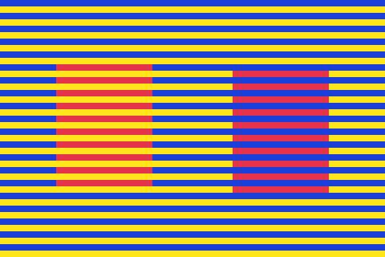

# Ilusões de Cor

*O que o olho vê não é o que está na página*

Cor, luminosidade, tamanho e forma não são lidos ponto a ponto na imagem: o sistema visual compara cada área com o que está em volta e faz uma estimativa do que existe ali. Estas ilusões mostram essa estimativa em ação. Nem todas têm a ver com o matiz; várias só precisam do contraste entre preto e branco.

Observe as figuras em uma tela ou em uma boa impressão colorida, a uma distância confortável. A intensidade de cada ilusão varia de pessoa para pessoa. Algumas usam movimento ou cintilação: pare se incomodarem.

> Todas as figuras foram desenhadas para este documento. Os textos são resumos curtos baseados nos artigos da Wikipédia indicados (disponíveis sob a licença CC BY-SA).

## Sumário

- **Cor**
  - [Contraste simultâneo](#contrast)
  - [Efeito Bezold](#bezold)
  - [Constância de cor](#constancy)
  - [Pós-imagem negativa](#afterimage)
  - [Perseguidor lilás](#lilac)
  - [Efeito McCollough](#mccollough)
  - [Cromostereopsia](#chromostereopsis)
- **Luminosidade e contraste**
  - [Ilusão da sombra no xadrez](#checker)
  - [Ilusão de White e de Munker](#white)
  - [Bandas de Mach](#mach)
  - [Ilusão de Cornsweet](#cornsweet)
  - [Ilusões de grade: Hermann e cintilante](#grid)
  - [Ilusão de Ehrenstein](#ehrenstein)
  - [Ilusão de irradiação](#irradiation)
- **Tamanho e comprimento**
  - [Ilusão de Ebbinghaus (círculos de Titchener)](#ebbinghaus)
  - [Ilusão de Müller-Lyer](#muller_lyer)
  - [Ilusão de Ponzo](#ponzo)
- **Linhas curvas e inclinadas**
  - [Ilusão da parede do café](#cafe)
  - [Espiral de Fraser](#fraser)
  - [Ilusão de Hering](#hering)
  - [Ilusão de Wundt](#wundt)
  - [Ilusão de Orbison](#orbison)
  - [Ilusão de Zöllner](#zollner)
  - [Ilusão de Poggendorff](#poggendorff)
  - [Ilusão e pós-efeito de inclinação](#tilt)
- **Movimento em imagens paradas**
  - [Movimento ilusório](#motion)
  - [Deriva periférica](#drift)
- **Figura, fundo e objetos impossíveis**
  - [Vaso de Rubin](#rubin)
  - [Triângulo de Penrose](#penrose)

## Cor

### Contraste simultâneo

**O que se vê.** Os quatro quadrados pequenos são do mesmo cinza. No fundo escuro ele parece mais claro do que no claro; sobre azul puxa para o amarelo e sobre amarelo puxa para o azul.

**Por que acontece.** A cor é avaliada por diferença. O fundo afasta de si a área que envolve, na luminosidade e no matiz.

**Experimente.** Faça dois furos em uma folha de modo a ver só dois dos quadrados pequenos: a diferença desaparece.

[Artigo na Wikipédia (em inglês)](https://en.wikipedia.org/wiki/Contrast_effect)

### Efeito Bezold

**O que se vê.** O vermelho entre listras pretas parece mais profundo e escuro do que o vermelho entre listras brancas, que parece mais pálido e rosado. É um único vermelho.

**Por que acontece.** Quando pequenas áreas de cor se alternam, o olho as mistura em parte (assimilação): o vermelho pega um pouco da cor vizinha. Wilhelm von Bezold notou isso ao redesenhar tapetes mudando uma só cor.

**Experimente.** Afaste-se da página: quanto mais longe, mais forte a mistura.

[Artigo na Wikipédia (em inglês)](https://en.wikipedia.org/wiki/Bezold_effect)

### Constância de cor

**O que se vê.** Duas cópias de um mosaico são iluminadas por uma luz quente e por uma luz fria (os discos acima). A segunda peça da segunda fileira parece azulada à esquerda e amarelada à direita, mas é o mesmo cinza neutro.

**Por que acontece.** Para continuar reconhecendo os objetos, o cérebro estima a cor da luz e a desconta. Um cinza visto em uma cena toda alaranjada é lido como uma superfície azulada.

**Experimente.** Cubra tudo menos as duas peças cinzas.

[Artigo na Wikipédia (em inglês)](https://en.wikipedia.org/wiki/Color_constancy)

### Pós-imagem negativa

**O que se vê.** Depois de fixar o ponto dos anéis coloridos, o ponto sozinho da direita parece rodeado de anéis de outras cores: vermelho, verde e amarelo.

**Por que acontece.** As células que respondem a uma cor se cansam (adaptação). Sobre branco, as outras respondem com mais força e vê-se a cor complementar.

**Experimente.** Fixe o ponto da esquerda por 30 segundos sem mover os olhos; depois olhe o ponto da direita e pisque.

[Artigo na Wikipédia (em inglês)](https://en.wikipedia.org/wiki/Afterimage)

### Perseguidor lilás

**O que se vê.** Fixando a cruz, uma falha corre pelo anel de discos lilases; depois a falha vira um disco verde e, com o tempo, os discos lilases podem sumir por completo.

**Por que acontece.** A falha em movimento é movimento aparente (fenômeno phi). Onde um disco some, surge uma pós-imagem da cor oposta, verde. Os discos desfocados e parados na periferia desaparecem da consciência (efeito Troxler).

**Experimente.** Fixe os olhos na cruz por pelo menos 30 segundos. Jeremy Hinton criou esta animação antes de 2005.

[Artigo na Wikipédia (em inglês)](https://en.wikipedia.org/wiki/Lilac_chaser)

### Efeito McCollough

**O que se vê.** Depois de olhar alternadamente listras horizontais vermelhas e verticais verdes, os quadros em preto e branco abaixo parecem tingidos: esverdeados onde as listras são horizontais e rosados onde são verticais.

**Por que acontece.** O sistema visual se adapta a uma cor ligada a uma orientação. Celeste McCollough o descreveu em 1965; pode durar horas e até meses.

**Experimente.** Alterne entre as duas grades coloridas, alguns segundos em cada, por vários minutos, e depois olhe os quadros pequenos. Atenção: o efeito pode persistir por muito tempo.

[Artigo na Wikipédia (em inglês)](https://en.wikipedia.org/wiki/McCollough_effect)

### Cromostereopsia

**O que se vê.** Vermelho e azul sobre preto não parecem estar no mesmo plano: para a maioria das pessoas o vermelho fica à frente do azul, para algumas fica atrás.

**Por que acontece.** O cristalino desvia de forma diferente os comprimentos de onda curtos e longos (aberração cromática); as duas cores caem em pontos um pouco diferentes em cada olho e o cérebro lê a diferença como profundidade.

**Experimente.** Observe em um ambiente pouco iluminado, com os dois olhos; experimente com e sem óculos.

[Artigo na Wikipédia (em inglês)](https://en.wikipedia.org/wiki/Chromostereopsis)

## Luminosidade e contraste

### Ilusão da sombra no xadrez

**O que se vê.** O quadrado A parece muito mais escuro que o B. Eles são exatamente do mesmo cinza, como mostra a barra da segunda figura.

**Por que acontece.** O cérebro lê um piso xadrez com uma sombra e corrige a sombra: B tem de ser uma casa clara, por isso é visto como claro. Edward Adelson publicou a ilusão em 1995.

**Experimente.** Esconda o resto do tabuleiro com dois papéis, deixando só A e B.

[Artigo na Wikipédia (em inglês)](https://en.wikipedia.org/wiki/Checker_shadow_illusion)

### Ilusão de White e de Munker

**O que se vê.** As barras cinzas inseridas nas listras pretas parecem mais claras que as inseridas nas brancas. Na versão colorida (Munker), o mesmo vermelho parece laranja de um lado e arroxeado do outro.

**Por que acontece.** Ao contrário do que o contraste simples faria esperar, o olho parece agrupar cada barra com a listra em que ela se insere.

**Experimente.** Compare os dois grupos através de um pequeno furo em um papel.

[Artigo na Wikipédia (em inglês)](https://en.wikipedia.org/wiki/White%27s_illusion)

### Bandas de Mach

**O que se vê.** Cada faixa cinza uniforme parece mais escura junto da vizinha mais clara e mais clara junto da vizinha mais escura, como se fosse canelada.

**Por que acontece.** Células vizinhas da retina se inibem (inibição lateral), o que exagera as bordas. Ernst Mach descreveu o efeito em 1865.

**Experimente.** Cubra todas as faixas menos uma: ela é perfeitamente uniforme.

[Artigo na Wikipédia](https://pt.wikipedia.org/wiki/Bandas_de_Mach)

### Ilusão de Cornsweet

**O que se vê.** A metade esquerda parece mais clara que a direita. Longe do meio, as duas são do mesmo cinza.

**Por que acontece.** Só a borda é diferente, subindo de um lado e descendo do outro. O sistema visual toma o degrau da borda como a diferença entre as áreas inteiras.

**Experimente.** Coloque um lápis sobre a linha do meio e veja as duas metades ficarem iguais.

[Artigo na Wikipédia (em inglês)](https://en.wikipedia.org/wiki/Cornsweet_illusion)

### Ilusões de grade: Hermann e cintilante

**O que se vê.** Na grade branca surgem manchas cinzas nos cruzamentos, exceto onde se olha. Com discos sobre uma grade cinza, pontos pretos parecem acender e apagar.

**Por que acontece.** A grade de Hermann (1870) foi por muito tempo explicada só pela inibição lateral; experiências posteriores (curvar as linhas a elimina) mostram que depende também de como o córtex trata as retas. A versão cintilante foi relatada nos anos 1990.

**Experimente.** Deixe os olhos passearem pela grade e depois fixe um único cruzamento.

[Artigo na Wikipédia](https://pt.wikipedia.org/wiki/Ilus%C3%A3o_da_grelha)

### Ilusão de Ehrenstein

**O que se vê.** Onde as linhas param antes de se cruzar, parecem surgir discos claros, mais brancos que o papel.

**Por que acontece.** As pontas das linhas sugerem uma forma por cima, escondendo os cruzamentos. O cérebro desenha o contorno dela (contorno ilusório) e a enche de brilho.

**Experimente.** Feche os vazios mentalmente ou com um lápis: os discos somem.

[Artigo na Wikipédia (em inglês)](https://en.wikipedia.org/wiki/Ehrenstein_illusion)

### Ilusão de irradiação

**O que se vê.** O quadrado branco sobre preto parece maior que o quadrado preto sobre branco, embora tenham o mesmo tamanho.

**Por que acontece.** A luz se espalha dentro do olho e uma área clara se alarga na retina. Galileu a mencionou em 1632; Helmholtz lhe deu o nome.

**Experimente.** Meça os dois quadrados.

[Artigo na Wikipédia (em inglês)](https://en.wikipedia.org/wiki/Irradiation_illusion)

## Tamanho e comprimento

### Ilusão de Ebbinghaus (círculos de Titchener)

**O que se vê.** O círculo laranja rodeado de círculos grandes parece menor que o rodeado de círculos pequenos.

**Por que acontece.** O tamanho é avaliado em relação ao contexto; a distância e o espaçamento dos círculos em volta também contam.

**Experimente.** Cubra os círculos azuis com os dedos.

[Artigo na Wikipédia](https://pt.wikipedia.org/wiki/Ilus%C3%A3o_de_Ebbinghaus)

### Ilusão de Müller-Lyer

**O que se vê.** A linha com as setas para fora parece mais comprida que a das setas para dentro. Elas são iguais, como a linha vermelha abaixo.

**Por que acontece.** As setas deslocam o lugar onde as pontas da linha parecem estar; uma explicação as liga aos cantos de salas e prédios vistos em profundidade. Franz Müller-Lyer a descreveu em 1889.

**Experimente.** Compare as duas hastes com as guias tracejadas.

[Artigo na Wikipédia](https://pt.wikipedia.org/wiki/Ilus%C3%A3o_de_M%C3%BCller-Lyer)

### Ilusão de Ponzo

**O que se vê.** A barra amarela de cima parece mais comprida que a de baixo.

**Por que acontece.** Linhas que convergem sugerem distância, como trilhos de trem: uma barra do mesmo tamanho na página, mas mais longe, teria de ser maior.

**Experimente.** Meça as duas barras ou vire a página de cabeça para baixo.

[Artigo na Wikipédia (em inglês)](https://en.wikipedia.org/wiki/Ponzo_illusion)

## Linhas curvas e inclinadas

### Ilusão da parede do café

**O que se vê.** As linhas cinzas de argamassa parecem inclinar-se alternadamente, embora sejam paralelas e horizontais.

**Por que acontece.** Os azulejos pretos e brancos deslocados, com argamassa de um cinza intermediário, criam pequenos elementos inclinados ao longo de cada linha. Richard Gregory a batizou em 1973 a partir da parede de um café em Bristol.

**Experimente.** Olhe ao longo de uma linha de argamassa com a página quase de perfil.

[Artigo na Wikipédia](https://pt.wikipedia.org/wiki/Ilus%C3%A3o_de_M%C3%BCnsterberg)

### Espiral de Fraser

**O que se vê.** Uma espiral parece enrolar-se até o centro. Não há espiral: os cordões pretos e brancos formam círculos concêntricos.

**Por que acontece.** Cada pequeno traço é inclinado e o fundo torcido aumenta a inclinação, por isso o olho os une em espiral. James Fraser a descreveu em 1908.

**Experimente.** Ponha um dedo em um cordão e siga-o: você volta ao ponto de partida.

[Artigo na Wikipédia (em inglês)](https://en.wikipedia.org/wiki/Fraser_spiral_illusion)

### Ilusão de Hering

**O que se vê.** As duas linhas vermelhas parecem curvar-se para fora no meio. São retas e paralelas.

**Por que acontece.** Os ângulos com as linhas radiais são superestimados e o padrão sugere também movimento em profundidade. Ewald Hering a descobriu em 1861.

**Experimente.** Encoste uma régua em uma linha vermelha.

[Artigo na Wikipédia (em inglês)](https://en.wikipedia.org/wiki/Hering_illusion)

### Ilusão de Wundt

**O que se vê.** As duas linhas vermelhas parecem curvar-se para dentro, uma em direção à outra, no meio. São retas e paralelas.

**Por que acontece.** É o inverso da figura de Hering: as linhas radiais agora partem de pontos de um lado e do outro, e os ângulos desviam as linhas vermelhas no sentido contrário. Wilhelm Wundt a descreveu em 1898.

**Experimente.** Compare com a ilusão de Hering.

[Artigo na Wikipédia (em inglês)](https://en.wikipedia.org/wiki/Wundt_illusion)

### Ilusão de Orbison

**O que se vê.** O quadrado vermelho parece deformado, com os lados vergados e os cantos puxados.

**Por que acontece.** Como na figura de Hering, os cruzamentos com os anéis do fundo distorcem a direção percebida de cada lado. William Orbison a descreveu em 1939.

**Experimente.** Confira os lados com uma régua.

[Artigo na Wikipédia (em inglês)](https://en.wikipedia.org/wiki/Orbison_illusion)

### Ilusão de Zöllner

**O que se vê.** As longas linhas diagonais parecem convergir e divergir. São paralelas.

**Por que acontece.** Os traços curtos as cruzam em ângulo e o sistema visual exagera os ângulos agudos, girando um pouco cada linha. Johann Zöllner a relatou em 1860.

**Experimente.** Olhe ao longo das linhas compridas a partir de um canto da página.

[Artigo na Wikipédia](https://pt.wikipedia.org/wiki/Ilus%C3%A3o_de_Z%C3%B6llner)

### Ilusão de Poggendorff

**O que se vê.** A linha preta que entra no bloco cinza pela esquerda parece sair como a linha azul. Ela sai como a preta de cima, como mostra a segunda figura.

**Por que acontece.** Os ângulos agudos entre a linha e o bloco são vistos como maiores do que são, o que desloca o trajeto aparente. Foi notada nos próprios desenhos de Zöllner.

**Experimente.** Prolongue a linha da esquerda com uma régua.

[Artigo na Wikipédia](https://pt.wikipedia.org/wiki/Ilus%C3%A3o_de_Poggendorff)

### Ilusão e pós-efeito de inclinação

**O que se vê.** As listras dos dois discos centrais são verticais, mas parecem inclinar-se para o lado oposto ao das listras em volta.

**Por que acontece.** Células ajustadas a orientações próximas se inibem, o que afasta o ângulo percebido. Olhar muito tempo para listras inclinadas tem efeito parecido no que se vê em seguida.

**Experimente.** Cubra os anéis de fora e compare os discos centrais.

[Artigo na Wikipédia (em inglês)](https://en.wikipedia.org/wiki/Visual_tilt_effects)

## Movimento em imagens paradas

### Movimento ilusório

**O que se vê.** Os anéis parecem girar devagar, sobretudo aqueles para os quais não se olha diretamente.

**Por que acontece.** Blocos de contraste diferente são processados com atrasos um pouco diferentes e cada pequeno movimento dos olhos reinicia a sequência; os detectores de movimento leem isso como movimento.

**Experimente.** Passe o olhar de uma roda para outra, ou pisque.

[Artigo na Wikipédia (em inglês)](https://en.wikipedia.org/wiki/Illusory_motion)

### Deriva periférica

**O que se vê.** Os anéis feitos de gradientes de cinza parecem girar quando vistos com o canto do olho.

**Por que acontece.** Um gradiente repetido do escuro ao claro (dente de serra) estimula os detectores de movimento da periferia; vê-se movimento do escuro para o claro.

**Experimente.** Olhe para o lado da figura e pisque rapidamente.

[Artigo na Wikipédia (em inglês)](https://en.wikipedia.org/wiki/Peripheral_drift_illusion)

## Figura, fundo e objetos impossíveis

### Vaso de Rubin

**O que se vê.** Um vaso claro ou dois rostos escuros que se olham: um ou outro, dificilmente os dois ao mesmo tempo.

**Por que acontece.** O contorno comum só pode pertencer a um lado de cada vez: o que é tomado como figura recebe a forma e o resto vira fundo. Edgar Rubin o estudou por volta de 1915.

**Experimente.** Tente alternar quando quiser e conte quantas vezes muda sozinho.

[Artigo na Wikipédia](https://pt.wikipedia.org/wiki/Vaso_de_Rubin)

### Triângulo de Penrose

**O que se vê.** Um triângulo maciço de três barras quadradas, cada uma ligada à seguinte em ângulo reto.

**Por que acontece.** Cada canto é coerente sozinho, mas os três não podem ser verdadeiros ao mesmo tempo: tal objeto não existe. Oscar Reutersvärd o desenhou em 1934; Lionel e Roger Penrose o popularizaram, e ele inspirou a Queda d'água de M. C. Escher.

**Experimente.** Cubra um canto de cada vez: o resto se torna possível.

[Artigo na Wikipédia](https://pt.wikipedia.org/wiki/Tri%C3%A2ngulo_de_Penrose)
