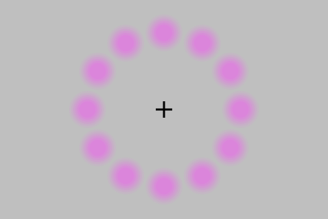
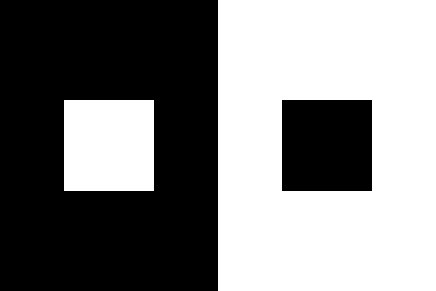
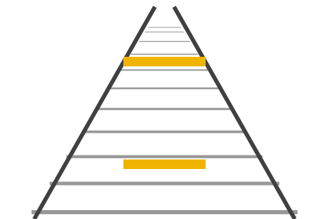
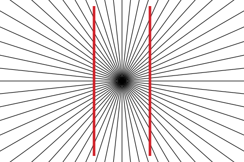
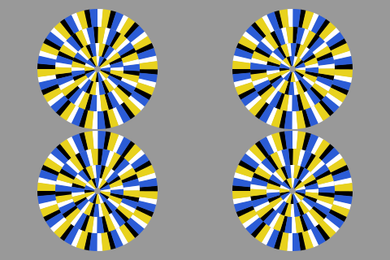

# Ilusões de Cor

*O que o olho vê não é o que está na página*

A cor, a luminosidade, o tamanho e a forma não são lidos ponto a ponto na imagem: o sistema visual compara cada zona com o que a rodeia e faz uma estimativa do que lá está. Estas ilusões mostram essa estimativa em ação. Nem todas dizem respeito ao matiz; várias só precisam do contraste entre preto e branco.

Veja as figuras num ecrã ou numa boa impressão a cores, a uma distância confortável. A intensidade de cada ilusão varia de pessoa para pessoa. Algumas usam movimento ou cintilação: pare se incomodarem.

> Todas as figuras foram desenhadas para este documento. Os textos são resumos curtos baseados nos artigos da Wikipédia indicados (disponíveis sob a licença CC BY-SA).

## Índice

- **Cor**
  - [Contraste simultâneo](#contrast)
  - [Efeito Bezold](#bezold)
  - [Constância da cor](#constancy)
  - [Pós-imagem negativa](#afterimage)
  - [Perseguidor lilás](#lilac)
  - [Efeito McCollough](#mccollough)
  - [Cromostereopsia](#chromostereopsis)
- **Luminosidade e contraste**
  - [Ilusão da sombra no xadrez](#checker)
  - [Ilusão de White e de Munker](#white)
  - [Bandas de Mach](#mach)
  - [Ilusão de Cornsweet](#cornsweet)
  - [Ilusões de grelha: Hermann e cintilante](#grid)
  - [Ilusão de Ehrenstein](#ehrenstein)
  - [Ilusão de irradiação](#irradiation)
- **Tamanho e comprimento**
  - [Ilusão de Ebbinghaus (círculos de Titchener)](#ebbinghaus)
  - [Ilusão de Müller-Lyer](#muller_lyer)
  - [Ilusão de Ponzo](#ponzo)
- **Linhas curvadas e inclinadas**
  - [Ilusão da parede do café](#cafe)
  - [Espiral de Fraser](#fraser)
  - [Ilusão de Hering](#hering)
  - [Ilusão de Wundt](#wundt)
  - [Ilusão de Orbison](#orbison)
  - [Ilusão de Zöllner](#zollner)
  - [Ilusão de Poggendorff](#poggendorff)
  - [Ilusão e pós-efeito de inclinação](#tilt)
- **Movimento em imagens paradas**
  - [Movimento ilusório](#motion)
  - [Deriva periférica](#drift)
- **Figura, fundo e objetos impossíveis**
  - [Vaso de Rubin](#rubin)
  - [Triângulo de Penrose](#penrose)

## Cor

### Contraste simultâneo

**O que se vê.** Os quatro quadrados pequenos são do mesmo cinzento. No fundo escuro parece mais claro do que no claro; sobre azul puxa para o amarelo e sobre amarelo puxa para o azul.

**Porque acontece.** A cor é avaliada por diferença. O fundo afasta de si a zona que envolve, na luminosidade e no matiz.

**Experimente.** Faça dois furos numa folha de modo a ver só dois dos quadrados pequenos: a diferença desaparece.

[Artigo na Wikipédia (em inglês)](https://en.wikipedia.org/wiki/Contrast_effect)

### Efeito Bezold

**O que se vê.** O vermelho entre riscas pretas parece mais profundo e escuro do que o vermelho entre riscas brancas, que parece mais pálido e rosado. É um único vermelho.

**Porque acontece.** Quando pequenas áreas de cor se alternam, o olho mistura-as em parte (assimilação): o vermelho fica com um pouco do vizinho. Wilhelm von Bezold reparou nisto ao redesenhar tapetes mudando uma só cor.

**Experimente.** Afaste-se da página: quanto mais longe, mais forte a mistura.

[Artigo na Wikipédia (em inglês)](https://en.wikipedia.org/wiki/Bezold_effect)

### Constância da cor

**O que se vê.** Duas cópias de um mosaico são iluminadas por uma luz quente e por uma luz fria (os discos de cima). A segunda peça da segunda linha parece azulada à esquerda e amarelada à direita, mas é o mesmo cinzento neutro.

**Porque acontece.** Para reconhecer os objetos, o cérebro estima a cor da luz e desconta-a. Um cinzento numa cena toda alaranjada é lido como uma superfície azulada.

**Experimente.** Tape tudo menos as duas peças cinzentas.

[Artigo na Wikipédia (em inglês)](https://en.wikipedia.org/wiki/Color_constancy)

### Pós-imagem negativa

**O que se vê.** Depois de fixar o ponto nos anéis coloridos, o ponto simples à direita parece rodeado de anéis de outras cores: vermelho, verde e amarelo.

**Porque acontece.** As células que respondem a uma cor cansam-se (adaptam-se). Sobre branco, as outras respondem com mais força e vê-se a cor complementar.

**Experimente.** Fixe o ponto da esquerda durante 30 segundos sem mover os olhos, depois olhe para o ponto da direita e pestaneje.

[Artigo na Wikipédia (em inglês)](https://en.wikipedia.org/wiki/Afterimage)

### Perseguidor lilás

**O que se vê.** Com os olhos na cruz, uma falha corre à volta do anel de discos lilás; depois a falha transforma-se num disco verde e, passado algum tempo, os discos lilás podem desaparecer.

**Porque acontece.** A falha que anda é movimento aparente (fenómeno phi). Onde um disco desaparece surge uma pós-imagem da cor oposta, verde. Os discos desfocados e parados na periferia somem-se da perceção (efeito de Troxler).

**Experimente.** Fixe a cruz pelo menos 30 segundos. Jeremy Hinton criou esta animação antes de 2005.

[Artigo na Wikipédia (em inglês)](https://en.wikipedia.org/wiki/Lilac_chaser)

### Efeito McCollough

**O que se vê.** Depois de olhar à vez para riscas horizontais vermelhas e verticais verdes, as manchas a preto e branco em baixo parecem tingidas: esverdeadas onde as riscas são horizontais e rosadas onde são verticais.

**Porque acontece.** O sistema visual adapta-se a uma cor ligada a uma orientação. Celeste McCollough descreveu-o em 1965; pode durar horas e até meses.

**Experimente.** Alterne entre as duas grelhas coloridas, alguns segundos em cada, durante vários minutos, e depois olhe para as manchas pequenas. Atenção: o efeito pode persistir muito tempo.

[Artigo na Wikipédia (em inglês)](https://en.wikipedia.org/wiki/McCollough_effect)

### Cromostereopsia

**O que se vê.** Vermelho e azul sobre preto não parecem estar no mesmo plano: para a maioria o vermelho flutua à frente do azul, para algumas pessoas fica atrás.

**Porque acontece.** O cristalino desvia de forma diferente os comprimentos de onda curtos e longos (aberração cromática), as duas cores caem em sítios ligeiramente diferentes em cada olho e o cérebro lê o desvio como profundidade.

**Experimente.** Veja numa sala pouco iluminada, com os dois olhos; experimente com e sem óculos.

[Artigo na Wikipédia (em inglês)](https://en.wikipedia.org/wiki/Chromostereopsis)

## Luminosidade e contraste

### Ilusão da sombra no xadrez

**O que se vê.** O quadrado A parece muito mais escuro do que o B. São exatamente do mesmo cinzento, como mostra a barra da segunda figura.

**Porque acontece.** O cérebro vê um chão aos quadrados com uma sombra e corrige a sombra: o B tem de ser um quadrado claro, por isso é visto como claro. Edward Adelson publicou a ilusão em 1995.

**Experimente.** Tape o resto do tabuleiro com dois papéis, deixando só o A e o B.

[Artigo na Wikipédia (em inglês)](https://en.wikipedia.org/wiki/Checker_shadow_illusion)

### Ilusão de White e de Munker

**O que se vê.** As barras cinzentas metidas nas riscas pretas parecem mais claras do que as metidas nas riscas brancas. Na versão a cores (Munker), o mesmo vermelho parece alaranjado de um lado e arroxeado do outro.

**Porque acontece.** Surpreendentemente, o resultado contraria o que o contraste simples preveria: o olho parece agrupar cada barra com a risca a que pertence.

**Experimente.** Compare os dois grupos através de um pequeno furo num papel.

[Artigo na Wikipédia (em inglês)](https://en.wikipedia.org/wiki/White%27s_illusion)

### Bandas de Mach

**O que se vê.** Cada faixa cinzenta lisa parece mais escura junto à vizinha mais clara e mais clara junto à mais escura, como se as faixas fossem caneladas.

**Porque acontece.** Células vizinhas da retina inibem-se umas às outras (inibição lateral), o que exagera as arestas. Ernst Mach descreveu o efeito em 1865.

**Experimente.** Tape todas as faixas menos uma: é perfeitamente uniforme.

[Artigo na Wikipédia](https://pt.wikipedia.org/wiki/Bandas_de_Mach)

### Ilusão de Cornsweet

**O que se vê.** A metade esquerda parece mais clara do que a direita. Longe do meio, são do mesmo cinzento.

**Porque acontece.** Só a fronteira difere, a subir de um lado e a descer do outro. O sistema visual toma o degrau da fronteira como a diferença entre as áreas inteiras.

**Experimente.** Ponha um lápis sobre a linha do meio e veja as duas metades igualarem-se.

[Artigo na Wikipédia (em inglês)](https://en.wikipedia.org/wiki/Cornsweet_illusion)

### Ilusões de grelha: Hermann e cintilante

**O que se vê.** Na grelha branca aparecem manchas cinzentas nos cruzamentos, exceto onde se olha. Com discos numa grelha cinzenta, pontos pretos parecem acender e apagar.

**Porque acontece.** A grelha de Hermann (1870) foi durante muito tempo explicada só pela inibição lateral; experiências posteriores (curvar as linhas elimina-a) mostram que depende também do modo como o córtex trata linhas retas. A versão cintilante foi descrita nos anos 1990.

**Experimente.** Passeie o olhar pela grelha e depois fixe um só cruzamento.

[Artigo na Wikipédia](https://pt.wikipedia.org/wiki/Ilus%C3%A3o_da_grelha)

### Ilusão de Ehrenstein

**O que se vê.** Onde as linhas param antes de se cruzarem parecem surgir discos luminosos, mais brancos do que o papel.

**Porque acontece.** As pontas das linhas sugerem uma forma por cima a tapar os cruzamentos. O cérebro desenha o seu contorno (contorno ilusório) e enche-o de brilho.

**Experimente.** Feche as falhas com a imaginação, ou com um lápis: os discos desaparecem.

[Artigo na Wikipédia (em inglês)](https://en.wikipedia.org/wiki/Ehrenstein_illusion)

### Ilusão de irradiação

**O que se vê.** O quadrado branco sobre preto parece maior do que o quadrado preto sobre branco, mas têm o mesmo tamanho.

**Porque acontece.** A luz espalha-se dentro do olho e uma zona clara alarga-se na retina. Galileu refere-a em 1632; Helmholtz deu-lhe o nome.

**Experimente.** Meça os dois quadrados.

[Artigo na Wikipédia (em inglês)](https://en.wikipedia.org/wiki/Irradiation_illusion)

## Tamanho e comprimento

### Ilusão de Ebbinghaus (círculos de Titchener)

**O que se vê.** O círculo laranja rodeado de círculos grandes parece menor do que o rodeado de círculos pequenos.

**Porque acontece.** O tamanho é avaliado em relação ao contexto; a distância e o espaçamento dos círculos à volta também contam.

**Experimente.** Tape os círculos azuis com os dedos.

[Artigo na Wikipédia](https://pt.wikipedia.org/wiki/Ilus%C3%A3o_de_Ebbinghaus)

### Ilusão de Müller-Lyer

**O que se vê.** A linha com as aletas para fora parece mais comprida do que a das aletas para dentro. São iguais, como a linha vermelha em baixo.

**Porque acontece.** As aletas deslocam o sítio onde parecem estar as pontas da linha; uma explicação liga-as aos cantos de salas e edifícios vistos em profundidade. Franz Müller-Lyer descreveu-a em 1889.

**Experimente.** Compare os dois segmentos com as guias tracejadas.

[Artigo na Wikipédia](https://pt.wikipedia.org/wiki/Ilus%C3%A3o_de_M%C3%BCller-Lyer)

### Ilusão de Ponzo

**O que se vê.** A barra amarela de cima parece mais comprida do que a de baixo.

**Porque acontece.** As linhas convergentes sugerem distância, como carris: uma barra com o mesmo tamanho na página, mas mais afastada, teria de ser maior.

**Experimente.** Meça as duas barras ou vire a página ao contrário.

[Artigo na Wikipédia (em inglês)](https://en.wikipedia.org/wiki/Ponzo_illusion)

## Linhas curvadas e inclinadas

### Ilusão da parede do café

**O que se vê.** As linhas cinzentas de argamassa parecem inclinar-se alternadamente, mas são paralelas e horizontais.

**Porque acontece.** Os ladrilhos pretos e brancos desencontrados, com argamassa de um cinzento intermédio, criam pequenos elementos inclinados ao longo de cada linha. Richard Gregory deu-lhe o nome em 1973, a partir da parede de um café em Bristol.

**Experimente.** Olhe ao longo de uma linha de argamassa com a página quase de perfil.

[Artigo na Wikipédia](https://pt.wikipedia.org/wiki/Ilus%C3%A3o_de_M%C3%BCnsterberg)

### Espiral de Fraser

**O que se vê.** Parece haver uma espiral a enrolar-se para o centro. Não há espiral: os cordões pretos e brancos formam círculos concêntricos.

**Porque acontece.** Cada pequeno troço está inclinado e o fundo torcido reforça a inclinação, pelo que o olho os une numa espiral. James Fraser descreveu-a em 1908.

**Experimente.** Ponha um dedo num cordão e siga-o: volta ao ponto de partida.

[Artigo na Wikipédia (em inglês)](https://en.wikipedia.org/wiki/Fraser_spiral_illusion)

### Ilusão de Hering

**O que se vê.** As duas linhas vermelhas parecem curvar-se para fora ao meio. São retas e paralelas.

**Porque acontece.** Os ângulos com as linhas radiais são sobrestimados e o padrão sugere também movimento em profundidade. Ewald Hering descobriu-a em 1861.

**Experimente.** Encoste uma régua a uma linha vermelha.

[Artigo na Wikipédia (em inglês)](https://en.wikipedia.org/wiki/Hering_illusion)

### Ilusão de Wundt

**O que se vê.** As duas linhas vermelhas parecem curvar-se para dentro, uma para a outra, ao meio. São retas e paralelas.

**Porque acontece.** É o reverso da figura de Hering: as linhas radiais partem agora de pontos de um lado e do outro, e os ângulos enviesam as linhas vermelhas no sentido contrário. Wilhelm Wundt descreveu-a em 1898.

**Experimente.** Compare-a com a ilusão de Hering.

[Artigo na Wikipédia (em inglês)](https://en.wikipedia.org/wiki/Wundt_illusion)

### Ilusão de Orbison

**O que se vê.** O quadrado vermelho parece deformado, com os lados vergados e os cantos puxados.

**Porque acontece.** Como na figura de Hering, os cruzamentos com os anéis do fundo enviesam a direção percebida de cada lado. William Orbison descreveu-a em 1939.

**Experimente.** Verifique os lados com uma régua.

[Artigo na Wikipédia (em inglês)](https://en.wikipedia.org/wiki/Orbison_illusion)

### Ilusão de Zöllner

**O que se vê.** As linhas diagonais compridas parecem convergir e divergir. São paralelas.

**Porque acontece.** Os traços curtos cruzam-nas em ângulo e o sistema visual exagera os ângulos agudos, rodando um pouco cada linha. Johann Zöllner comunicou-a em 1860.

**Experimente.** Olhe ao longo das linhas compridas a partir de um canto da página.

[Artigo na Wikipédia](https://pt.wikipedia.org/wiki/Ilus%C3%A3o_de_Z%C3%B6llner)

### Ilusão de Poggendorff

**O que se vê.** A linha preta que entra no bloco cinzento pela esquerda parece sair como linha azul. Sai como a preta de cima, como mostra a segunda figura.

**Porque acontece.** Os ângulos agudos entre a linha e o bloco parecem mais abertos do que são, deslocando o trajeto aparente. Foi notada nos próprios desenhos de Zöllner.

**Experimente.** Prolongue a linha da esquerda com uma régua.

[Artigo na Wikipédia](https://pt.wikipedia.org/wiki/Ilus%C3%A3o_de_Poggendorff)

### Ilusão e pós-efeito de inclinação

**O que se vê.** As riscas dos dois discos interiores são verticais, mas parecem inclinar-se para o lado oposto ao das riscas em redor.

**Porque acontece.** Células afinadas para orientações próximas inibem-se, afastando o ângulo percebido. Olhar muito tempo para riscas inclinadas tem um efeito semelhante no que se vê a seguir.

**Experimente.** Tape os anéis exteriores e compare os discos interiores.

[Artigo na Wikipédia (em inglês)](https://en.wikipedia.org/wiki/Visual_tilt_effects)

## Movimento em imagens paradas

### Movimento ilusório

**O que se vê.** As rodas parecem girar devagar, sobretudo aquelas para onde não se está a olhar.

**Porque acontece.** Blocos com contrastes diferentes são processados com atrasos ligeiramente diferentes e cada pequeno movimento dos olhos reinicia a sequência; os detetores de movimento leem-na como deslocação.

**Experimente.** Salte o olhar de uma roda para outra, ou pestaneje.

[Artigo na Wikipédia (em inglês)](https://en.wikipedia.org/wiki/Illusory_motion)

### Deriva periférica

**O que se vê.** Os anéis feitos de rampas de cinzento parecem rodar quando vistos pelo canto do olho.

**Porque acontece.** Uma rampa repetida do escuro para o claro (dente de serra) estimula os detetores de movimento na periferia; o movimento é visto do escuro para o claro.

**Experimente.** Olhe para o lado da figura e pestaneje depressa.

[Artigo na Wikipédia (em inglês)](https://en.wikipedia.org/wiki/Peripheral_drift_illusion)

## Figura, fundo e objetos impossíveis

### Vaso de Rubin

**O que se vê.** Um vaso claro, ou duas caras escuras a olhar uma para a outra: um ou outro, dificilmente os dois ao mesmo tempo.

**Porque acontece.** O contorno comum só pode pertencer a um dos lados de cada vez: o que é tomado como figura fica com a forma e o resto passa a fundo. Edgar Rubin estudou-o por volta de 1915.

**Experimente.** Tente alternar à vontade e conte quantas vezes muda sozinho.

[Artigo na Wikipédia](https://pt.wikipedia.org/wiki/Vaso_de_Rubin)

### Triângulo de Penrose

**O que se vê.** Um triângulo maciço de três vigas quadradas, cada uma unida à seguinte em ângulo reto.

**Porque acontece.** Cada canto é coerente por si, mas os três não podem ser verdadeiros em conjunto: o objeto não existe. Oscar Reutersvärd desenhou-o em 1934; Lionel e Roger Penrose popularizaram-no, e inspirou a Queda de Água de M. C. Escher.

**Experimente.** Tape um canto de cada vez: o resto passa a ser possível.

[Artigo na Wikipédia](https://pt.wikipedia.org/wiki/Tri%C3%A2ngulo_de_Penrose)
