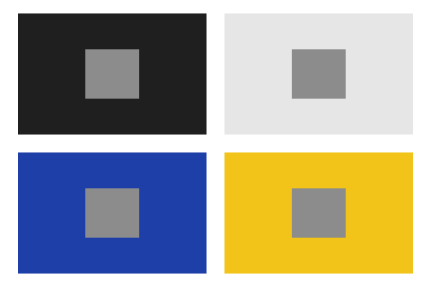
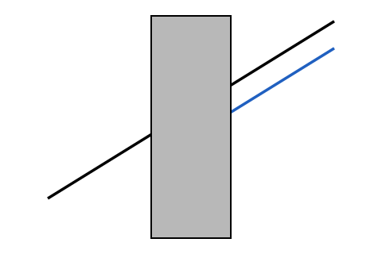

# Цветовые иллюзии

*Глаз видит не то, что напечатано на странице*

Цвет, яркость, размер и форма не считываются с изображения точка за точкой: зрительная система сравнивает каждый участок с окружением и угадывает, что там находится. Эти иллюзии показывают такое угадывание в действии. Не все они связаны с цветовым тоном: некоторым достаточно контраста чёрного и белого.

Рассматривайте рисунки на экране или на хорошей цветной распечатке с удобного расстояния. Сила каждой иллюзии у разных людей различна. Некоторые используют движение или мерцание: прекратите, если это неприятно.

> Все рисунки выполнены специально для этого документа. Тексты — краткие изложения статей Википедии по ссылкам (доступны по лицензии CC BY-SA).

## Содержание

- **Цвет**
  - [Одновременный контраст](#contrast)
  - [Эффект Бецольда](#bezold)
  - [Постоянство цвета](#constancy)
  - [Отрицательный послеобраз](#afterimage)
  - [Сиреневый преследователь](#lilac)
  - [Эффект Маккалоу](#mccollough)
  - [Хроместереопсис](#chromostereopsis)
- **Яркость и контраст**
  - [Тень на шахматной доске](#checker)
  - [Иллюзии Уайта и Мункера](#white)
  - [Полосы Маха](#mach)
  - [Иллюзия Корнсвита](#cornsweet)
  - [Решётки Германа и мерцающая](#grid)
  - [Иллюзия Эренштейна](#ehrenstein)
  - [Иллюзия иррадиации](#irradiation)
- **Размер и длина**
  - [Иллюзия Эббингауза (круги Титченера)](#ebbinghaus)
  - [Иллюзия Мюллера-Лайера](#muller_lyer)
  - [Иллюзия Понцо](#ponzo)
- **Изогнутые и наклонные линии**
  - [Иллюзия стены кафе](#cafe)
  - [Спираль Фрэзера](#fraser)
  - [Иллюзия Геринга](#hering)
  - [Иллюзия Вундта](#wundt)
  - [Иллюзия Орбисона](#orbison)
  - [Иллюзия Цёлльнера](#zollner)
  - [Иллюзия Поггендорфа](#poggendorff)
  - [Иллюзия наклона и последействие наклона](#tilt)
- **Движение в неподвижных картинках**
  - [Иллюзорное движение](#motion)
  - [Периферический дрейф](#drift)
- **Фигура, фон и невозможные объекты**
  - [Ваза Рубина](#rubin)
  - [Треугольник Пенроуза](#penrose)

## Цвет

### Одновременный контраст

**Что видно.** Четыре маленьких квадрата одного и того же серого цвета. На тёмном фоне он кажется светлее, чем на светлом; на синем отдаёт жёлтым, а на жёлтом — синим.

**Почему так происходит.** Цвет оценивается по различию. Фон как бы отталкивает от себя окружённый им участок по светлоте и тону.

**Попробуйте.** Прорежьте в листе два отверстия, чтобы были видны только два квадратика: разница исчезнет.

[Статья в Википедии](https://ru.wikipedia.org/wiki/%D0%AD%D1%84%D1%84%D0%B5%D0%BA%D1%82_%D0%BA%D0%BE%D0%BD%D1%82%D1%80%D0%B0%D1%81%D1%82%D0%B0)

### Эффект Бецольда

**Что видно.** Красный между чёрными полосами кажется глубже и темнее, чем красный между белыми, который выглядит бледнее и розовее. Это один и тот же красный.

**Почему так происходит.** Когда мелкие цветные участки чередуются, глаз отчасти смешивает их (ассимиляция): красный перенимает что-то у соседа. Вильгельм фон Бецольд заметил это, переделывая ковры сменой одного цвета.

**Попробуйте.** Отойдите от страницы: чем дальше, тем сильнее смешение.

[Статья в Википедии](https://ru.wikipedia.org/wiki/%D0%AD%D1%84%D1%84%D0%B5%D0%BA%D1%82_%D0%91%D0%B5%D1%86%D0%BE%D0%BB%D1%8C%D0%B4%D0%B0)

### Постоянство цвета

**Что видно.** Две копии мозаики освещены тёплым и холодным светом (кружки сверху). Вторая плитка второго ряда кажется слева голубоватой, а справа желтоватой, хотя это один нейтральный серый.

**Почему так происходит.** Чтобы предметы оставались узнаваемыми, мозг оценивает цвет освещения и вычитает его. Серый в сплошь оранжевой сцене читается как голубоватая поверхность.

**Попробуйте.** Закройте всё, кроме двух серых плиток.

[Статья в Википедии](https://ru.wikipedia.org/wiki/%D0%A6%D0%B2%D0%B5%D1%82%D0%BE%D0%BF%D0%BE%D1%81%D1%82%D0%BE%D1%8F%D0%BD%D1%81%D1%82%D0%B2%D0%BE)

### Отрицательный послеобраз

**Что видно.** Если долго смотреть на точку в цветных кольцах, одинокая точка справа кажется окружённой кольцами других цветов: красным, зелёным и жёлтым.

**Почему так происходит.** Клетки, отвечающие на один цвет, утомляются (адаптация). На белом остальные отвечают сильнее, и виден дополнительный цвет.

**Попробуйте.** Смотрите 30 секунд на левую точку, не двигая глазами, затем взгляните на правую и моргните.

[Статья в Википедии](https://ru.wikipedia.org/wiki/%D0%9F%D0%BE%D1%81%D0%BB%D0%B5%D0%BE%D0%B1%D1%80%D0%B0%D0%B7)

### Сиреневый преследователь

**Что видно.** Если смотреть на крестик, пропуск бежит по кольцу сиреневых кругов; потом он превращается в зелёный круг, а через некоторое время сиреневые круги могут совсем исчезнуть.

**Почему так происходит.** Бегущий пропуск — это кажущееся движение (фи-феномен). Там, где круг пропадает, возникает послеобраз противоположного, зелёного цвета. Размытые неподвижные круги на периферии выпадают из сознания (эффект Трокслера).

**Попробуйте.** Не отводите взгляд от крестика не менее 30 секунд. Эту анимацию создал Джереми Хинтон до 2005 года.

[Статья в Википедии (на английском)](https://en.wikipedia.org/wiki/Lilac_chaser)

### Эффект Маккалоу

**Что видно.** После поочерёдного рассматривания красных горизонтальных и зелёных вертикальных полос чёрно-белые участки внизу кажутся подкрашенными: зеленоватыми при горизонтальных полосах и розовыми при вертикальных.

**Почему так происходит.** Зрительная система адаптируется к цвету, связанному с ориентацией. Селеста Маккалоу описала это в 1965 году; эффект может держаться часами и даже месяцами.

**Попробуйте.** Несколько минут переводите взгляд между двумя цветными решётками, по несколько секунд на каждую, затем посмотрите на маленькие участки. Внимание: эффект может сохраняться долго.

[Статья в Википедии](https://ru.wikipedia.org/wiki/%D0%AD%D1%84%D1%84%D0%B5%D0%BA%D1%82_%D0%9C%D0%B0%D0%BA%D0%BA%D0%B0%D0%BB%D0%BE%D1%83)

### Хроместереопсис

**Что видно.** Красный и синий на чёрном не кажутся лежащими в одной плоскости: большинству красный видится впереди синего, некоторым — позади.

**Почему так происходит.** Хрусталик по-разному преломляет короткие и длинные волны (хроматическая аберрация), поэтому два цвета попадают в каждом глазу в чуть разные места, и мозг читает это смещение как глубину.

**Попробуйте.** Смотрите в полутёмной комнате двумя глазами; попробуйте в очках и без них.

[Статья в Википедии (на английском)](https://en.wikipedia.org/wiki/Chromostereopsis)

## Яркость и контраст

### Тень на шахматной доске

**Что видно.** Клетка A кажется гораздо темнее клетки B. На самом деле они одного и того же серого цвета, как показывает полоса на втором рисунке.

**Почему так происходит.** Мозг видит клетчатый пол с тенью и делает на неё поправку: B должна быть светлой клеткой, поэтому видится светлой. Эдвард Адельсон опубликовал иллюзию в 1995 году.

**Попробуйте.** Закройте остальную доску двумя листками, оставив только A и B.

[Статья в Википедии](https://ru.wikipedia.org/wiki/%D0%98%D0%BB%D0%BB%D1%8E%D0%B7%D0%B8%D1%8F_%D1%81_%D1%82%D0%B5%D0%BD%D1%8C%D1%8E_%D0%BD%D0%B0_%D1%88%D0%B0%D1%85%D0%BC%D0%B0%D1%82%D0%BD%D0%BE%D0%B9_%D0%B4%D0%BE%D1%81%D0%BA%D0%B5)

### Иллюзии Уайта и Мункера

**Что видно.** Серые бруски внутри чёрных полос кажутся светлее, чем внутри белых. В цветном варианте (Мункера) один и тот же красный с одной стороны выглядит оранжевым, а с другой — фиолетовым.

**Почему так происходит.** Вопреки тому, что предсказывал бы простой контраст, глаз, по-видимому, объединяет каждый брусок с полосой, в которую он вставлен.

**Попробуйте.** Сравните две группы через маленькое отверстие в бумаге.

[Статья в Википедии (на английском)](https://en.wikipedia.org/wiki/White%27s_illusion)

### Полосы Маха

**Что видно.** Каждая ровная серая полоса кажется темнее рядом с более светлой соседкой и светлее рядом с более тёмной, словно полосы рифлёные.

**Почему так происходит.** Соседние клетки сетчатки тормозят друг друга (латеральное торможение), что подчёркивает края. Эрнст Мах описал эффект в 1865 году.

**Попробуйте.** Закройте все полосы, кроме одной: она совершенно ровная.

[Статья в Википедии](https://ru.wikipedia.org/wiki/%D0%9F%D0%BE%D0%BB%D0%BE%D1%81%D1%8B_%D0%9C%D0%B0%D1%85%D0%B0)

### Иллюзия Корнсвита

**Что видно.** Левая половина кажется светлее правой. Вдали от середины обе одного серого цвета.

**Почему так происходит.** Отличается только граница: с одной стороны яркость растёт, с другой падает. Зрение принимает перепад на границе за различие целых областей.

**Попробуйте.** Положите карандаш на среднюю линию — половины сравняются.

[Статья в Википедии (на английском)](https://en.wikipedia.org/wiki/Cornsweet_illusion)

### Решётки Германа и мерцающая

**Что видно.** В белой решётке на перекрёстках появляются серые пятна — везде, кроме того, на который вы смотрите. С кружками на серой решётке чёрные точки будто вспыхивают и гаснут.

**Почему так происходит.** Решётку Германа (1870) долго объясняли одним латеральным торможением; поздние опыты (изгиб линий её уничтожает) показывают, что дело и в обработке прямых корой мозга. Мерцающий вариант описан в 1990-х.

**Попробуйте.** Поводите взглядом по решётке, затем зафиксируйте один перекрёсток.

[Статья в Википедии (на английском)](https://en.wikipedia.org/wiki/Grid_illusion)

### Иллюзия Эренштейна

**Что видно.** Там, где линии обрываются, не доходя до пересечения, будто появляются яркие диски белее бумаги.

**Почему так происходит.** Концы линий намекают на фигуру, лежащую сверху и закрывающую пересечения. Мозг дорисовывает её контур (иллюзорный контур) и наполняет яркостью.

**Попробуйте.** Замкните разрывы мысленно или карандашом: диски исчезнут.

[Статья в Википедии (на английском)](https://en.wikipedia.org/wiki/Ehrenstein_illusion)

### Иллюзия иррадиации

**Что видно.** Белый квадрат на чёрном кажется больше чёрного на белом, хотя они равны.

**Почему так происходит.** Свет рассеивается внутри глаза, и яркий участок расплывается на сетчатке. Об этом упоминал Галилей в 1632 году; название дал Гельмгольц.

**Попробуйте.** Измерьте оба квадрата.

[Статья в Википедии](https://ru.wikipedia.org/wiki/%D0%98%D1%80%D1%80%D0%B0%D0%B4%D0%B8%D0%B0%D1%86%D0%B8%D1%8F_%28%D0%BE%D0%BF%D1%82%D0%B8%D0%BA%D0%B0%29)

## Размер и длина

### Иллюзия Эббингауза (круги Титченера)

**Что видно.** Оранжевый круг среди больших кругов кажется меньше, чем среди маленьких.

**Почему так происходит.** Размер оценивается относительно окружения; важны также расстояние до соседних кругов и их плотность.

**Попробуйте.** Закройте синие круги пальцами.

[Статья в Википедии](https://ru.wikipedia.org/wiki/%D0%98%D0%BB%D0%BB%D1%8E%D0%B7%D0%B8%D1%8F_%D0%AD%D0%B1%D0%B1%D0%B8%D0%BD%D0%B3%D0%B0%D1%83%D0%B7%D0%B0)

### Иллюзия Мюллера-Лайера

**Что видно.** Отрезок с «хвостиками» наружу кажется длиннее отрезка с «хвостиками» внутрь. Они равны, как и красная линия внизу.

**Почему так происходит.** Стрелки смещают кажущееся положение концов отрезка; одно из объяснений связывает их с углами комнат и зданий в перспективе. Франц Мюллер-Лайер описал иллюзию в 1889 году.

**Попробуйте.** Сравните оба отрезка с пунктирными направляющими.

[Статья в Википедии](https://ru.wikipedia.org/wiki/%D0%98%D0%BB%D0%BB%D1%8E%D0%B7%D0%B8%D1%8F_%D0%9C%D1%8E%D0%BB%D0%BB%D0%B5%D1%80%D0%B0-%D0%9B%D0%B0%D0%B9%D0%B5%D1%80%D0%B0)

### Иллюзия Понцо

**Что видно.** Верхний жёлтый брусок кажется длиннее нижнего.

**Почему так происходит.** Сходящиеся линии намекают на удаление, как железнодорожные пути: брусок того же размера на странице, но более далёкий, должен быть крупнее.

**Попробуйте.** Измерьте оба бруска или переверните страницу.

[Статья в Википедии](https://ru.wikipedia.org/wiki/%D0%98%D0%BB%D0%BB%D1%8E%D0%B7%D0%B8%D1%8F_%D0%9F%D0%BE%D0%BD%D1%86%D0%BE)

## Изогнутые и наклонные линии

### Иллюзия стены кафе

**Что видно.** Серые швы кажутся наклонёнными то в одну, то в другую сторону, хотя они параллельны и горизонтальны.

**Почему так происходит.** Сдвинутые чёрные и белые плитки со швом промежуточного серого создают вдоль каждой линии мелкие наклонные элементы. Ричард Грегори назвал иллюзию в 1973 году по стене кафе в Бристоле.

**Попробуйте.** Посмотрите вдоль шва, держа страницу почти ребром.

[Статья в Википедии](https://ru.wikipedia.org/wiki/%D0%98%D0%BB%D0%BB%D1%8E%D0%B7%D0%B8%D1%8F_%D1%81%D1%82%D0%B5%D0%BD%D1%8B_%D0%BA%D0%B0%D1%84%D0%B5)

### Спираль Фрэзера

**Что видно.** Спираль будто закручивается к центру. Спирали нет: чёрно-белые жгуты образуют концентрические окружности.

**Почему так происходит.** Каждый короткий отрезок наклонён, закрученный фон усиливает наклон, и глаз соединяет их в спираль. Джеймс Фрэзер описал это в 1908 году.

**Попробуйте.** Поставьте палец на жгут и ведите по нему: вернётесь в начало.

[Статья в Википедии](https://ru.wikipedia.org/wiki/%D0%A1%D0%BF%D0%B8%D1%80%D0%B0%D0%BB%D1%8C_%D0%A4%D1%80%D1%8D%D0%B7%D0%B5%D1%80%D0%B0)

### Иллюзия Геринга

**Что видно.** Две красные линии в середине будто выгибаются наружу. Они прямые и параллельные.

**Почему так происходит.** Углы с расходящимися лучами переоцениваются, а узор ещё и намекает на движение вглубь. Эвальд Геринг открыл иллюзию в 1861 году.

**Попробуйте.** Приложите линейку к красной линии.

[Статья в Википедии](https://ru.wikipedia.org/wiki/%D0%98%D0%BB%D0%BB%D1%8E%D0%B7%D0%B8%D1%8F_%D0%93%D0%B5%D1%80%D0%B8%D0%BD%D0%B3%D0%B0)

### Иллюзия Вундта

**Что видно.** Две красные линии в середине будто прогибаются внутрь, навстречу друг другу. Они прямые и параллельные.

**Почему так происходит.** Это пара к фигуре Геринга: лучи здесь расходятся из точек по обе стороны, и углы искажают красные линии в обратную сторону. Вильгельм Вундт описал её в 1898 году.

**Попробуйте.** Сравните с иллюзией Геринга.

[Статья в Википедии](https://ru.wikipedia.org/wiki/%D0%98%D0%BB%D0%BB%D1%8E%D0%B7%D0%B8%D1%8F_%D0%92%D1%83%D0%BD%D0%B4%D1%82%D0%B0)

### Иллюзия Орбисона

**Что видно.** Красный квадрат кажется искажённым: стороны изогнуты, углы вытянуты.

**Почему так происходит.** Как и у Геринга, пересечения с кольцами фона сбивают воспринимаемое направление каждой стороны. Уильям Орбисон описал это в 1939 году.

**Попробуйте.** Проверьте стороны линейкой.

[Статья в Википедии](https://ru.wikipedia.org/wiki/%D0%98%D0%BB%D0%BB%D1%8E%D0%B7%D0%B8%D1%8F_%D0%9E%D1%80%D0%B1%D0%B8%D1%81%D0%BE%D0%BD%D0%B0)

### Иллюзия Цёлльнера

**Что видно.** Длинные диагонали будто сходятся и расходятся. Они параллельны.

**Почему так происходит.** Короткие штрихи пересекают их под углом, а зрение преувеличивает острые углы, чуть поворачивая каждую линию. Иоганн Цёлльнер сообщил о ней в 1860 году.

**Попробуйте.** Посмотрите вдоль длинных линий из угла страницы.

[Статья в Википедии](https://ru.wikipedia.org/wiki/%D0%98%D0%BB%D0%BB%D1%8E%D0%B7%D0%B8%D1%8F_%D0%A6%D1%91%D0%BB%D0%BB%D1%8C%D0%BD%D0%B5%D1%80%D0%B0)

### Иллюзия Поггендорфа

**Что видно.** Чёрная линия, входящая слева в серый блок, будто выходит синей. Она выходит верхней чёрной, как показывает второй рисунок.

**Почему так происходит.** Острые углы между линией и блоком видятся шире, чем есть, и кажущийся путь смещается. Это заметили на рисунках самого Цёлльнера.

**Попробуйте.** Продлите левую линию по линейке.

[Статья в Википедии](https://ru.wikipedia.org/wiki/%D0%98%D0%BB%D0%BB%D1%8E%D0%B7%D0%B8%D1%8F_%D0%9F%D0%BE%D0%B3%D0%B3%D0%B5%D0%BD%D0%B4%D0%BE%D1%80%D1%84%D0%B0)

### Иллюзия наклона и последействие наклона

**Что видно.** Полосы в двух внутренних кругах вертикальны, но кажутся отклонёнными от окружающих полос.

**Почему так происходит.** Клетки, настроенные на близкие ориентации, тормозят друг друга, отталкивая воспринимаемый угол. Долгое рассматривание наклонных полос так же влияет на увиденное после.

**Попробуйте.** Закройте внешние кольца и сравните внутренние круги.

[Статья в Википедии (на английском)](https://en.wikipedia.org/wiki/Visual_tilt_effects)

## Движение в неподвижных картинках

### Иллюзорное движение

**Что видно.** Колёса будто медленно вращаются, особенно те, на которые не смотришь прямо.

**Почему так происходит.** Блоки разного контраста обрабатываются с чуть разной задержкой, а каждое мелкое движение глаз запускает последовательность заново; детекторы движения принимают её за движение.

**Попробуйте.** Переводите взгляд с колеса на колесо или моргайте.

[Статья в Википедии (на английском)](https://en.wikipedia.org/wiki/Illusory_motion)

### Периферический дрейф

**Что видно.** Кольца из серых градиентов будто вращаются, если видеть их краем глаза.

**Почему так происходит.** Повторяющийся переход от тёмного к светлому (пилообразный) возбуждает детекторы движения на периферии; движение видится от тёмного к светлому.

**Попробуйте.** Посмотрите сбоку от рисунка и быстро поморгайте.

[Статья в Википедии (на английском)](https://en.wikipedia.org/wiki/Peripheral_drift_illusion)

## Фигура, фон и невозможные объекты

### Ваза Рубина

**Что видно.** Светлая ваза или два тёмных лица, глядящих друг на друга: то одно, то другое, но едва ли вместе.

**Почему так происходит.** Общий контур может принадлежать лишь одной стороне: то, что принято за фигуру, получает форму, остальное становится фоном. Эдгар Рубин изучал это около 1915 года.

**Попробуйте.** Попробуйте переключаться по желанию и сосчитайте, сколько раз образ сменится сам.

[Статья в Википедии](https://ru.wikipedia.org/wiki/%D0%92%D0%B0%D0%B7%D0%B0_%D0%A0%D1%83%D0%B1%D0%B8%D0%BD%D0%B0)

### Треугольник Пенроуза

**Что видно.** Сплошной треугольник из трёх квадратных брусьев, каждый соединён со следующим под прямым углом.

**Почему так происходит.** Каждый угол сам по себе непротиворечив, но все три вместе невозможны: такого предмета нет. Оскар Реутерсверд нарисовал его в 1934 году; Лайонел и Роджер Пенроузы сделали его известным, и он вдохновил «Водопад» М. К. Эшера.

**Попробуйте.** Закрывайте по одному углу: остальное станет возможным.

[Статья в Википедии](https://ru.wikipedia.org/wiki/%D0%A2%D1%80%D0%B5%D1%83%D0%B3%D0%BE%D0%BB%D1%8C%D0%BD%D0%B8%D0%BA_%D0%9F%D0%B5%D0%BD%D1%80%D0%BE%D1%83%D0%B7%D0%B0)
