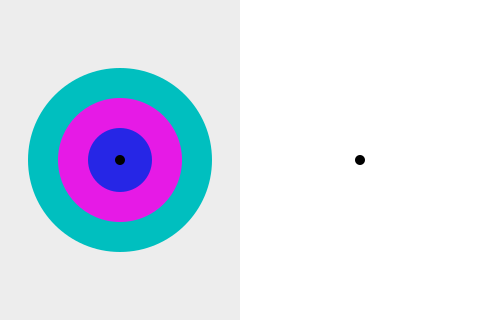
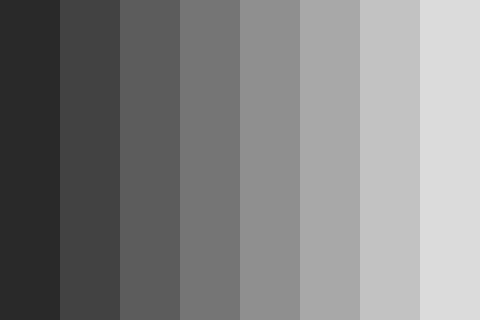
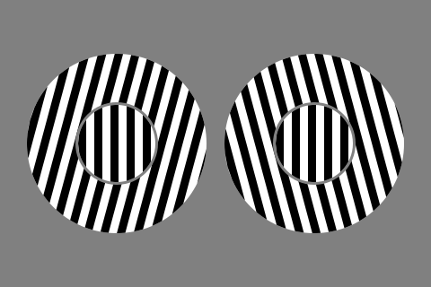
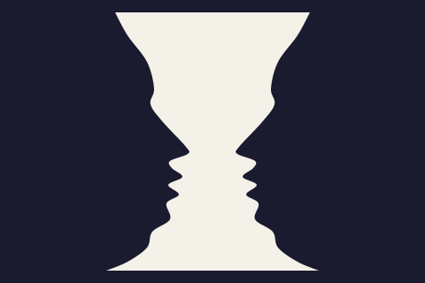

# Renk Yanılsamaları

*Gözün gördüğü, sayfadakinin aynısı değildir*

Renk, parlaklık, boyut ve biçim görüntüden nokta nokta okunmaz: görme sistemi her alanı çevresiyle karşılaştırır ve orada ne olduğunu tahmin eder. Bu yanılsamalar o tahmini iş başında gösterir. Hepsi renk tonuyla ilgili değildir; bazıları için siyahla beyazın karşıtlığı yeter.

Şekillere ekranda ya da iyi bir renkli baskıda, rahat bir uzaklıktan bakın. Her yanılsamanın gücü kişiden kişiye değişir. Birkaçı hareket veya titreşim kullanır: rahatsız ederse bırakın.

> Bütün şekiller bu belge için çizildi. Metinler, bağlantısı verilen Vikipedi maddelerine (CC BY-SA lisansıyla sunulur) dayanan kısa özetlerdir.

## İçindekiler

- **Renk**
  - [Eşzamanlı karşıtlık](#contrast)
  - [Bezold etkisi](#bezold)
  - [Renk değişmezliği](#constancy)
  - [Negatif ardıl görüntü](#afterimage)
  - [Leylak kovalayan](#lilac)
  - [McCollough etkisi](#mccollough)
  - [Kromostereopsi](#chromostereopsis)
- **Parlaklık ve karşıtlık**
  - [Dama tahtası gölge yanılsaması](#checker)
  - [White ve Munker yanılsaması](#white)
  - [Mach bantları](#mach)
  - [Cornsweet yanılsaması](#cornsweet)
  - [Izgara yanılsamaları: Hermann ve ışıldayan](#grid)
  - [Ehrenstein yanılsaması](#ehrenstein)
  - [Işıma yanılsaması](#irradiation)
- **Boyut ve uzunluk**
  - [Ebbinghaus yanılsaması (Titchener daireleri)](#ebbinghaus)
  - [Müller-Lyer yanılsaması](#muller_lyer)
  - [Ponzo yanılsaması](#ponzo)
- **Eğri ve eğik çizgiler**
  - [Kafe duvarı yanılsaması](#cafe)
  - [Fraser sarmalı](#fraser)
  - [Hering yanılsaması](#hering)
  - [Wundt yanılsaması](#wundt)
  - [Orbison yanılsaması](#orbison)
  - [Zöllner yanılsaması](#zollner)
  - [Poggendorff yanılsaması](#poggendorff)
  - [Eğim yanılsaması ve eğim ardıl etkisi](#tilt)
- **Durağan resimlerde hareket**
  - [Yanılsamalı hareket](#motion)
  - [Çevresel kayma yanılsaması](#drift)
- **Şekil, zemin ve imkânsız nesneler**
  - [Rubin vazosu](#rubin)
  - [Penrose üçgeni](#penrose)

## Renk

### Eşzamanlı karşıtlık

**Ne görülür.** Dört küçük kare aynı gridir. Koyu zeminde açık zemindekinden daha açık görünür; mavi üstünde sarıya, sarı üstünde maviye çalar.

**Neden olur.** Renk, farka göre değerlendirilir. Çevre, içindeki alanı açıklık ve ton bakımından kendisinden uzağa iter.

**Deneyin.** Bir kâğıtta yalnız iki küçük kare görünecek şekilde iki delik açın: fark kaybolur.

[Vikipedi maddesi (İngilizce)](https://en.wikipedia.org/wiki/Contrast_effect)

### Bezold etkisi

**Ne görülür.** Siyah çizgiler arasındaki kırmızı, daha soluk ve pembemsi görünen beyaz çizgiler arasındaki kırmızıdan daha derin ve koyu görünür. İkisi tek ve aynı kırmızıdır.

**Neden olur.** Küçük renk alanları dönüşümlü dizildiğinde göz onları kısmen karıştırır (asimilasyon): kırmızı komşusundan bir şeyler alır. Wilhelm von Bezold bunu, halıları tek bir rengi değiştirerek yeniden tasarlarken fark etti.

**Deneyin.** Sayfadan uzaklaşın: uzaklaştıkça karışım güçlenir.

[Vikipedi maddesi (İngilizce)](https://en.wikipedia.org/wiki/Bezold_effect)

### Renk değişmezliği

**Ne görülür.** Bir mozaiğin iki kopyası sıcak ve soğuk ışıkla aydınlatılmıştır (üstteki diskler). İkinci sıranın ikinci karosu solda mavimsi, sağda sarımsı görünür; oysa aynı nötr gridir.

**Neden olur.** Nesneler tanınabilir kalsın diye beyin ışığın rengini tahmin edip hesaptan düşer. Tümüyle turuncu bir sahnedeki gri, mavimsi bir yüzey olarak okunur.

**Deneyin.** İki gri karo dışında her şeyi kapatın.

[Vikipedi maddesi (İngilizce)](https://en.wikipedia.org/wiki/Color_constancy)

### Negatif ardıl görüntü

**Ne görülür.** Renkli halkalardaki noktaya baktıktan sonra sağdaki yalın nokta başka renkte halkalarla çevrili gibi görünür: kırmızı, yeşil ve sarı.

**Neden olur.** Bir renge yanıt veren hücreler yorulur (uyum). Beyaz yüzeyde öteki hücreler daha güçlü yanıt verir ve tamamlayıcı renk görülür.

**Deneyin.** Gözlerinizi oynatmadan soldaki noktaya 30 saniye bakın, sonra sağdaki noktaya bakıp göz kırpın.

[Vikipedi maddesi (İngilizce)](https://en.wikipedia.org/wiki/Afterimage)

### Leylak kovalayan

**Ne görülür.** Artıya bakarken bir boşluk leylak disk halkasında döner; sonra boşluk yeşil bir diske dönüşür ve bir süre sonra leylak diskler tümden kaybolabilir.

**Neden olur.** Gezen boşluk görünür harekettir (fi olgusu). Bir diskin kaybolduğu yerde karşıt rengin, yeşilin ardıl görüntüsü belirir. Çevrede kıpırdamadan duran bulanık diskler farkındalıktan silinir (Troxler etkisi).

**Deneyin.** Gözünüzü en az 30 saniye artıda tutun. Bu canlandırmayı Jeremy Hinton 2005'ten önce yaptı.

[Vikipedi maddesi (İngilizce)](https://en.wikipedia.org/wiki/Lilac_chaser)

### McCollough etkisi

**Ne görülür.** Sırayla kırmızı yatay ve yeşil düşey çizgilere baktıktan sonra alttaki siyah beyaz alanlar renkli görünür: çizgiler yataysa yeşilimsi, düşeyse pembe.

**Neden olur.** Görme sistemi yöne bağlı bir renge uyum sağlar. Celeste McCollough bunu 1965'te tanımladı; saatlerce, hatta aylarca sürebilir.

**Deneyin.** Birkaç dakika boyunca iki renkli ızgaraya dönüşümlü olarak birkaç saniye bakın, sonra küçük alanlara bakın. Dikkat: etki uzun süre kalabilir.

[Vikipedi maddesi (İngilizce)](https://en.wikipedia.org/wiki/McCollough_effect)

### Kromostereopsi

**Ne görülür.** Siyah üstünde kırmızı ile mavi aynı düzlemde değilmiş gibi görünür: çoğu kişiye kırmızı mavinin önünde, bazılarına arkasında gelir.

**Neden olur.** Göz merceği kısa ve uzun dalga boylarını farklı kırar (renk sapması); iki renk her gözde biraz farklı yere düşer ve beyin bu kaymayı derinlik olarak okur.

**Deneyin.** Loş bir odada iki gözle bakın; gözlüklü ve gözlüksüz deneyin.

[Vikipedi maddesi (İngilizce)](https://en.wikipedia.org/wiki/Chromostereopsis)

## Parlaklık ve karşıtlık

### Dama tahtası gölge yanılsaması

**Ne görülür.** A karesi B karesinden çok daha koyu görünür. İkinci şekildeki şeridin gösterdiği gibi ikisi tam aynı gridir.

**Neden olur.** Beyin üstüne gölge düşmüş damalı bir zemin okur ve gölgeyi hesaba katar: B açık bir kare olmalıdır, bu yüzden açık görülür. Edward Adelson yanılsamayı 1995'te yayımladı.

**Deneyin.** Tahtanın geri kalanını iki kâğıtla kapatıp yalnız A ile B'yi bırakın.

[Vikipedi maddesi (İngilizce)](https://en.wikipedia.org/wiki/Checker_shadow_illusion)

### White ve Munker yanılsaması

**Ne görülür.** Siyah şeritlere yerleştirilen gri çubuklar beyaz şeritlere yerleştirilenlerden daha açık görünür. Renkli sürümde (Munker) aynı kırmızı bir yanda turuncu, öbür yanda morumsu görünür.

**Neden olur.** Basit karşıtlığın öngöreceğinin tersine, göz her çubuğu içine yerleştirildiği şeritle gruplar gibidir.

**Deneyin.** İki grubu kâğıda açılmış küçük bir delikten karşılaştırın.

[Vikipedi maddesi](https://tr.wikipedia.org/wiki/Munker_ill%C3%BCzyonu)

### Mach bantları

**Ne görülür.** Her düz gri şerit, açık komşusunun yanında daha koyu, koyu komşusunun yanında daha açık görünür; şeritler oluklu gibidir.

**Neden olur.** Ağtabakadaki komşu hücreler birbirini baskılar (yanal ketleme), bu da kenarları abartır. Ernst Mach etkiyi 1865'te tanımladı.

**Deneyin.** Biri dışında tüm şeritleri kapatın: o şerit tümüyle düzdür.

[Vikipedi maddesi (İngilizce)](https://en.wikipedia.org/wiki/Mach_bands)

### Cornsweet yanılsaması

**Ne görülür.** Sol yarı sağ yarıdan daha açık görünür. Ortadan uzakta ikisi aynı gridir.

**Neden olur.** Yalnız kenar farklıdır; bir yanda yükselir, öbür yanda alçalır. Görme sistemi kenardaki basamağı tüm alanların farkı sayar.

**Deneyin.** Orta çizgiye bir kalem koyun, iki yarının eşitlendiğini görün.

[Vikipedi maddesi (İngilizce)](https://en.wikipedia.org/wiki/Cornsweet_illusion)

### Izgara yanılsamaları: Hermann ve ışıldayan

**Ne görülür.** Beyaz ızgaranın kesişimlerinde, baktığınız yer dışında gri lekeler belirir. Gri ızgaraya diskler konunca siyah noktalar yanıp söner gibi olur.

**Neden olur.** Hermann ızgarası (1870) uzun süre yalnız yanal ketlemeyle açıklandı; sonraki deneyler (çizgileri bükmek onu yok eder) korteksin düz çizgileri işleyişine de bağlı olduğunu gösterir. Işıldayan sürüm 1990'larda bildirildi.

**Deneyin.** Gözünüzü ızgarada gezdirin, sonra tek bir kesişime sabitleyin.

[Vikipedi maddesi (İngilizce)](https://en.wikipedia.org/wiki/Grid_illusion)

### Ehrenstein yanılsaması

**Ne görülür.** Çizgilerin kesişmeden durduğu yerlerde kâğıttan daha beyaz parlak diskler belirir gibi olur.

**Neden olur.** Çizgi uçları, üstte duran ve kesişimleri örten bir biçimi düşündürür. Beyin onun sınırını çizer (yanılsamalı kontur) ve içini parlaklıkla doldurur.

**Deneyin.** Boşlukları zihninizde veya kalemle kapatın: diskler yok olur.

[Vikipedi maddesi (İngilizce)](https://en.wikipedia.org/wiki/Ehrenstein_illusion)

### Işıma yanılsaması

**Ne görülür.** Siyah üstündeki beyaz kare, aynı boyda oldukları halde beyaz üstündeki siyah kareden büyük görünür.

**Neden olur.** Işık gözün içinde saçılır ve parlak alan ağtabakada yayılır. Galileo 1632'de bundan söz etti; adını Helmholtz verdi.

**Deneyin.** İki kareyi ölçün.

[Vikipedi maddesi (İngilizce)](https://en.wikipedia.org/wiki/Irradiation_illusion)

## Boyut ve uzunluk

### Ebbinghaus yanılsaması (Titchener daireleri)

**Ne görülür.** Büyük dairelerle çevrili turuncu daire, küçük dairelerle çevrili olandan küçük görünür.

**Neden olur.** Boyut bağlama göre değerlendirilir; çevredeki dairelerin uzaklığı ve aralığı da önemlidir.

**Deneyin.** Mavi daireleri parmaklarınızla kapatın.

[Vikipedi maddesi](https://tr.wikipedia.org/wiki/Ebbinghaus_ill%C3%BCzyonu)

### Müller-Lyer yanılsaması

**Ne görülür.** Uçları dışa açılan çizgi, uçları içe dönük olandan uzun görünür. Alttaki kırmızı çizgi gibi ikisi de eşittir.

**Neden olur.** Kanatlar çizgi uçlarının görünen yerini kaydırır; bir açıklama bunları derinlikte görülen oda ve bina köşelerine bağlar. Franz Müller-Lyer 1889'da tanımladı.

**Deneyin.** İki çizgiyi kesikli kılavuzlarla karşılaştırın.

[Vikipedi maddesi (İngilizce)](https://en.wikipedia.org/wiki/M%C3%BCller-Lyer_illusion)

### Ponzo yanılsaması

**Ne görülür.** Üstteki sarı çubuk alttakinden uzun görünür.

**Neden olur.** Birbirine yaklaşan çizgiler, demiryolu gibi uzaklık düşündürür: sayfada aynı boyda ama daha uzaktaki bir çubuk daha büyük olmalıydı.

**Deneyin.** İki çubuğu ölçün ya da sayfayı baş aşağı çevirin.

[Vikipedi maddesi](https://tr.wikipedia.org/wiki/Ponzo_yan%C4%B1lsamas%C4%B1)

## Eğri ve eğik çizgiler

### Kafe duvarı yanılsaması

**Ne görülür.** Gri harç çizgileri paralel ve yatay oldukları halde dönüşümlü olarak eğimli görünür.

**Neden olur.** Kaydırılmış siyah beyaz karolar ve ara tondaki gri harç, her çizgi boyunca küçük eğik öğeler oluşturur. Richard Gregory 1973'te Bristol'deki bir kafe duvarından esinlenerek adlandırdı.

**Deneyin.** Sayfayı neredeyse yandan tutup bir harç çizgisi boyunca bakın.

[Vikipedi maddesi](https://tr.wikipedia.org/wiki/Kafe_duvar%C4%B1_ill%C3%BCzyonu)

### Fraser sarmalı

**Ne görülür.** Bir sarmal merkeze doğru dolanıyor gibidir. Sarmal yoktur: siyah beyaz kordonlar eşmerkezli çemberlerdir.

**Neden olur.** Her kısa parça eğiktir, bükümlü zemin eğimi artırır ve göz onları sarmal olarak birleştirir. James Fraser 1908'de tanımladı.

**Deneyin.** Parmağınızı bir kordona koyup izleyin: başladığınız yere dönersiniz.

[Vikipedi maddesi](https://tr.wikipedia.org/wiki/Fraser_spiral_ill%C3%BCzyonu)

### Hering yanılsaması

**Ne görülür.** İki kırmızı çizgi ortada dışa doğru bombeleşiyor gibi görünür. Düz ve paraleldirler.

**Neden olur.** Işınsal çizgilerle yaptıkları açılar olduğundan büyük algılanır ve desen derinliğe doğru hareket de düşündürür. Ewald Hering 1861'de buldu.

**Deneyin.** Bir kırmızı çizgiye cetvel tutun.

[Vikipedi maddesi (İngilizce)](https://en.wikipedia.org/wiki/Hering_illusion)

### Wundt yanılsaması

**Ne görülür.** İki kırmızı çizgi ortada içe, birbirine doğru bükülüyor gibi görünür. Düz ve paraleldirler.

**Neden olur.** Hering şeklinin karşılığıdır: ışınlar bu kez iki yandaki noktalardan çıkar, açılar kırmızı çizgileri ters yöne saptırır. Wilhelm Wundt 1898'de tanımladı.

**Deneyin.** Hering yanılsamasıyla karşılaştırın.

[Vikipedi maddesi (İngilizce)](https://en.wikipedia.org/wiki/Wundt_illusion)

### Orbison yanılsaması

**Ne görülür.** Kırmızı kare, kenarları bükülmüş ve köşeleri çekilmiş gibi çarpık görünür.

**Neden olur.** Hering şeklinde olduğu gibi, zemindeki halkalarla kesişimler her kenarın algılanan yönünü saptırır. William Orbison 1939'da tanımladı.

**Deneyin.** Kenarları cetvelle denetleyin.

[Vikipedi maddesi (İngilizce)](https://en.wikipedia.org/wiki/Orbison_illusion)

### Zöllner yanılsaması

**Ne görülür.** Uzun çapraz çizgiler birbirine yaklaşıp uzaklaşıyor gibidir. Paraleldirler.

**Neden olur.** Kısa çizgicikler onları açılı keser; görme sistemi dar açıları abartır ve her çizgiyi biraz döndürür. Johann Zöllner 1860'ta bildirdi.

**Deneyin.** Sayfanın bir köşesinden uzun çizgiler boyunca bakın.

[Vikipedi maddesi (İngilizce)](https://en.wikipedia.org/wiki/Z%C3%B6llner_illusion)

### Poggendorff yanılsaması

**Ne görülür.** Gri bloğa soldan giren siyah çizgi mavi çizgi olarak çıkıyor gibidir. İkinci şeklin gösterdiği gibi üstteki siyah olarak çıkar.

**Neden olur.** Çizgi ile blok arasındaki dar açılar olduğundan geniş görülür ve görünen yol kayar. Zöllner'in kendi çizimlerinde fark edildi.

**Deneyin.** Soldaki çizgiyi cetvelle uzatın.

[Vikipedi maddesi (İngilizce)](https://en.wikipedia.org/wiki/Poggendorff_illusion)

### Eğim yanılsaması ve eğim ardıl etkisi

**Ne görülür.** İki iç diskteki çizgiler düşeydir ama çevredeki çizgilerin ters yönüne yatıkmış gibi görünür.

**Neden olur.** Yakın yönlere ayarlı hücreler birbirini baskılar ve algılanan açıyı iter. Eğik çizgilere uzun süre bakmak da sonra gördüklerinizi benzer biçimde etkiler.

**Deneyin.** Dış halkaları kapatıp iç diskleri karşılaştırın.

[Vikipedi maddesi (İngilizce)](https://en.wikipedia.org/wiki/Visual_tilt_effects)

## Durağan resimlerde hareket

### Yanılsamalı hareket

**Ne görülür.** Halkalar, özellikle doğrudan bakmadıklarınız, yavaşça dönüyor gibidir.

**Neden olur.** Farklı karşıtlıktaki bloklar biraz farklı gecikmelerle işlenir ve her küçük göz hareketi diziyi yeniden başlatır; hareket algılayıcıları bunu hareket sayar.

**Deneyin.** Bakışınızı bir tekerlekten ötekine kaydırın ya da göz kırpın.

[Vikipedi maddesi (İngilizce)](https://en.wikipedia.org/wiki/Illusory_motion)

### Çevresel kayma yanılsaması

**Ne görülür.** Gri geçişlerden yapılmış halkalar göz ucuyla görüldüğünde dönüyor gibidir.

**Neden olur.** Koyudan açığa yinelenen geçiş (testere dişi) görme alanının kıyısındaki hareket algılayıcılarını uyarır; hareket koyudan açığa görülür.

**Deneyin.** Şeklin yanına bakıp hızlıca göz kırpın.

[Vikipedi maddesi (İngilizce)](https://en.wikipedia.org/wiki/Peripheral_drift_illusion)

## Şekil, zemin ve imkânsız nesneler

### Rubin vazosu

**Ne görülür.** Açık renkli bir vazo ya da birbirine bakan iki koyu yüz: biri ya da öteki, ikisi birden zor.

**Neden olur.** Ortak sınır aynı anda yalnız bir yana ait olabilir: şekil sayılan taraf biçimi alır, gerisi zemin olur. Edgar Rubin 1915 dolaylarında inceledi.

**Deneyin.** İsteğinizle geçiş yapmayı deneyin ve kendiliğinden kaç kez değiştiğini sayın.

[Vikipedi maddesi (İngilizce)](https://en.wikipedia.org/wiki/Rubin_vase)

### Penrose üçgeni

**Ne görülür.** Kare kesitli üç kirişten oluşan, her biri sonrakine dik açıyla bağlanan dolu bir üçgen.

**Neden olur.** Her köşe tek başına tutarlıdır ama üçü birlikte doğru olamaz: böyle bir nesne yoktur. Oscar Reutersvärd 1934'te çizdi; Lionel ve Roger Penrose ünlendirdi ve M. C. Escher'in Şelale'sine esin verdi.

**Deneyin.** Her seferinde bir köşeyi kapatın: geri kalanı mümkün olur.

[Vikipedi maddesi (İngilizce)](https://en.wikipedia.org/wiki/Penrose_triangle)
